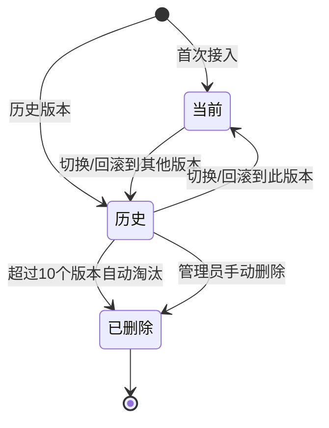

# M01-03 模型版本管理 — 业务流程图

## 所属模块

- **模块编号**：M01-03
- **模块名称**：模型版本管理
- **对应功能**：F-004 模型版本管理
- **涉及角色**：平台管理员
- **前置条件**：模型已接入并可正常调用（M01-01）

---

## 业务流程图

```mermaid
flowchart TD
    %% ===== 主流程：版本记录 =====
    subgraph 版本记录流程
        direction TB
        A1([开始]) --> A2[管理员进入模型详情页]
        A2 --> A3[切换到"版本管理"标签页]
        A3 --> A4[查看版本列表\n显示所有历史版本及当前版本]
        A4 --> A5[系统自动记录版本信息]
        A5 --> A6{版本号生成规则}
        A6 -->|首次接入| A7[版本号: v1.0.0\n标记为"当前"]
        A6 -->|配置变更| A8[版本号: v1.x.x 递增\n自动保留上一个版本为"历史"]
        A7 --> A9[保存版本记录到数据库\n版本号 / 发布时间 / 变更说明]
        A8 --> A9
        A9 --> A10{历史版本数量 >= 10?}
        A10 -->|是| A11[自动删除最早版本\n保留最近10个版本]
        A10 -->|否| A12[继续保留所有版本]
        A11 --> A13([结束])
        A12 --> A13
    end

    %% ===== 子流程：版本切换 =====
    subgraph 版本切换流程
        direction TB
        B1([开始]) --> B2[管理员在版本管理列表中找到目标版本]
        B2 --> B3[确认目标版本配置信息\n版本号 / 变更说明 / 配置参数]
        B3 --> B4[点击"切换到此版本"按钮]
        B4 --> B5[弹出确认对话框\n提示"切换版本会影响正在进行的请求"]
        B5 --> B6{确认切换?}
        B6 -->|是| B7[将当前版本标记为"历史"]
        B7 --> B8[将目标版本标记为"当前"]
        B8 --> B9[更新网关路由到新版本]
        B9 --> B10[记录版本切换操作到审计日志]
        B10 --> B11[系统提示"版本切换成功"]
        B11 --> B12([结束])
        B6 -->|否| B13([取消切换])
    end

    %% ===== 子流程：版本回滚 =====
    subgraph 版本回滚流程
        direction TB
        C1([开始]) --> C2[管理员发现当前版本存在问题]
        C2 --> C3[在版本管理列表中找到目标回滚版本]
        C3 --> C4[点击"回滚到此版本"按钮]
        C4 --> C5[弹出详细确认对话框\n显示回滚版本信息 / 当前版本信息\n对比差异 / 提示"回滚不可逆"]
        C5 --> C6{确认回滚?}
        C6 -->|是| C7[将当前版本标记为"历史"]
        C7 --> C8[将目标回滚版本标记为"当前"]
        C8 --> C9[更新网关路由到回滚版本]
        C9 --> C10[记录版本回滚操作到审计日志\n回滚版本 / 回滚时间 / 操作人]
        C10 --> C11[系统提示"版本回滚成功"]
        C11 --> C12{是否清理问题版本?}
        C12 -->|是| C13[删除或标记问题版本\n避免后续误用]
        C12 -->|否| C14[保留问题版本作为历史记录]
        C13 --> C15([结束])
        C14 --> C15
        C6 -->|否| C16([取消回滚])
    end

    %% ===== 子流程：版本信息查看 =====
    subgraph 版本信息查看
        direction TB
        D1([开始]) --> D2[管理员在版本管理列表中选择版本]
        D2 --> D3[展开版本详情\n版本号 / 发布时间 / 状态\n变更说明 / 配置参数快照]
        D3 --> D4{可执行操作}
        D4 -->|当前版本| D5[查看详情 / 编辑配置]
        D4 -->|历史版本| D6[查看详情 / 切换到此版本 / 回滚到此版本]
        D5 --> D7([结束])
        D6 --> D7
    end
```

---

## 流程说明

### 1. 版本记录流程

当模型首次接入或配置发生变更时，系统自动记录版本信息。

| 步骤 | 操作 | 角色 | 说明 |
|------|------|------|------|
| 1 | 系统自动生成版本号 | 系统自动 | 首次接入为 v1.0.0，后续递增 |
| 2 | 保存版本快照 | 系统自动 | 保存当前配置参数完整快照 |
| 3 | 版本标记 | 系统自动 | 新版本标记为"当前"，旧版本标记为"历史" |
| 4 | 版本数量控制 | 系统自动 | 超过 10 个历史版本时自动淘汰最早的 |

### 2. 版本切换流程

| 步骤 | 操作 | 角色 | 说明 |
|------|------|------|------|
| 1 | 选择目标版本 | 平台管理员 | 从历史版本列表中选择 |
| 2 | 确认切换 | 平台管理员 | 系统提示影响范围，二次确认 |
| 3 | 切换生效 | 系统自动 | 更新版本标记，网关切换路由 |
| 4 | 审计记录 | 系统自动 | 记录操作时间、操作人、版本信息 |

### 3. 版本回滚流程

| 步骤 | 操作 | 角色 | 说明 |
|------|------|------|------|
| 1 | 发现问题 | 平台管理员 | 当前版本存在异常或性能下降 |
| 2 | 选择回滚版本 | 平台管理员 | 从历史版本中选择稳定的版本 |
| 3 | 确认回滚 | 平台管理员 | 系统展示版本对比，提示回滚不可逆 |
| 4 | 回滚生效 | 系统自动 | 更新版本标记，网关切换路由 |
| 5 | 问题版本处理 | 平台管理员 | 可选删除或标记问题版本 |

---

## 版本号规则

| 场景 | 版本号 | 示例 |
|------|--------|------|
| 首次接入 | v1.0.0 | v1.0.0 |
| 配置更新 | 次版本号 +1 | v1.1.0 → v1.2.0 |
| 回滚操作 | 不产生新版本号 | 复用目标版本号 |
| 微调模型部署 | 主版本号 +1 | v1.x.x → v2.0.0 |

---

## 版本数据结构

| 字段 | 类型 | 说明 | 示例 |
|------|------|------|------|
| 版本号 | string | 语义化版本号 | v1.2.0 |
| 发布时间 | datetime | 版本创建时间 | 2025-01-15 14:30:00 |
| 状态 | enum | 当前 / 历史 | 当前 |
| 变更说明 | string | 本次变更的内容描述 | 升级 API 版本至 v2 |
| 配置快照 | JSON | 完整的配置参数快照 | {api_url, api_key, ...} |
| 操作人 | string | 创建/变更该版本的操作人 | admin@example.com |

---

## 界面元素

| 界面元素 | 类型 | 说明 |
|---------|------|------|
| 版本管理标签页 | 标签页 | 模型详情页中的子页面 |
| 版本列表 | 列表/表格 | 展示版本号、发布时间、状态、变更说明、操作按钮 |
| 当前版本标识 | 徽标 | 绿色"当前"标签标记正在使用的版本 |
| 切换按钮 | 按钮 | 切换到此版本（仅历史版本可见） |
| 回滚按钮 | 按钮 | 回滚到此版本（仅历史版本可见） |
| 版本详情 | 展开面板 | 点击展开查看配置快照和完整变更说明 |
| 确认对话框 | 对话框 | 二次确认操作，展示版本信息对比 |

---

## 异常处理

| 异常场景 | 处理方式 | 用户提示 |
|----------|----------|----------|
| 切换版本时系统正在处理请求 | 等待当前请求处理完毕后再切换 | "系统正在处理请求，请稍后再试" |
| 回滚的目标版本配置已过期 | 提示配置已过期，给出建议 | "该版本的 API 配置可能已过期，建议确认后操作" |
| 版本数据损坏 | 记录错误日志，禁止操作 | "版本数据异常，请联系技术支持" |
| 同时多人操作版本切换 | 乐观锁机制，后操作者失败 | "版本已被其他管理员变更，请刷新后重试" |

---

## 版本状态流转图



---

## 与微调模块的关联

当微调任务（M05-01）完成并部署时，微调后的模型会作为新版本注册到当前模块：

| 步骤 | 来源 | 目标 | 说明 |
|------|------|------|------|
| 1 | 微调任务完成 | 模型版本管理 | 微调结果提交为新版本 |
| 2 | 版本 v1.x.x | 版本 v2.0.0 | 主版本号 +1，标记为"微调部署" |
| 3 | 管理员确认 | 版本切换 | 管理员可选择是否切换微调版本为当前版本 |