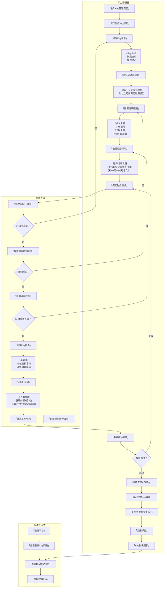

# M02-01 — Key 生成分发 - 业务流程图

> **子模块编号：** M02-01  
> **子模块名称：** Key 生成分发  
> **对应功能：** F-005 API Key 生成与分发  
> **优先级：** Must  
> **角色：** 平台管理员、应用开发者

---

## 1. 核心流程：API Key 生成与分发

---

## 2. 界面元素说明

### 2.1 Key 列表

| 界面元素 | 说明 |
|----------|------|
| Key 名称 | 管理员自定义的 Key 标识 |
| 脱敏 Key | 格式：`sk-****....****{后4位}`，全平台统一脱敏展示 |
| 所属应用 | Key 关联的应用名称 |
| 状态 | 启用 / 禁用 / 过期 / 已回收 |
| 可调用模型 | 显示模型名称列表，hover 可展开全部 |
| 速率限制 | 显示 QPS / RPM / RPD / Token 上限 |
| 过期时间 | 显示过期日期，到期前 7 天显示「即将过期」标签 |
| 操作 | 编辑 / 禁用 / 延长有效期 / 查看详情 |

### 2.2 Key 生成表单

| 表单字段 | 类型 | 必填 | 说明 |
|---------|------|------|------|
| Key 名称 | 文本框 | 是 | 1-50 字符，唯一性校验 |
| 所属应用 | 下拉选择 | 是 | 从已注册的应用列表中选择 |
| 描述说明 | 文本框 | 否 | 最多 200 字符 |
| 可调用模型 | 多选 | 是 | 默认全选所有已启用的模型 |
| QPS 上限 | 数字输入 | 否 | 正整数，不填则继承全局默认值 |
| RPM 上限 | 数字输入 | 否 | 正整数，不填则继承全局默认值 |
| RPD 上限 | 数字输入 | 否 | 正整数，不填则继承全局默认值 |
| Token 日上限 | 数字输入 | 否 | 正整数，不填则不限制 |
| 过期时间 | 日期选择 | 是 | 支持预设选项 + 自定义日期 |

### 2.3 完整 Key 展示弹窗

| 元素 | 说明 |
|------|------|
| Key 全值 | 大号等宽字体展示：`sk-xxxxxxxxxxxxxxxxxxxxxxxxxxxxxxxxxxxxxxxx` |
| 复制按钮 | 一键复制到剪贴板 |
| 警告提示 | "请立即保存此 Key，关闭弹窗后不再显示完整内容" |
| 重新生成 | 提供「重新生成」超链接（生成新 Key 并作废旧 Key） |
| 确认关闭 | 需勾选"我已保存"复选框方可关闭 |

---

## 3. 业务规则

| 规则编号 | 规则描述 |
|---------|---------|
| BR-F005-01 | Key 前缀固定为 `sk-`，后接 40 位随机字符，总长度 43 字符 |
| BR-F005-02 | 完整 Key 仅在生成成功后弹出展示一次，页面刷新或关闭弹窗后不再可获取 |
| BR-F005-03 | 列表页及详情页统一展示为脱敏格式：`sk-****....****{后4位}` |
| BR-F005-04 | 数据库仅存储 Key 的哈希值和脱敏标识（前缀 + 后 4 位），不存储完整 Key |
| BR-F005-05 | Key 名称在同一应用内唯一 |
| BR-F005-06 | 生成 Key 时自动记录操作审计日志，包含操作人、时间、Key 名称 |

---

## 4. 异常处理

| 异常场景 | 处理方式 | 用户提示 |
|----------|----------|----------|
| 表单必填项缺失 | 前端校验后拒绝提交 | 标红必填字段并显示提示信息 |
| Key 名称重复 | 后端校验返回冲突 | "该 Key 名称已存在，请重新命名" |
| 所选模型已停用 | 保存时自动移除并提示 | "模型「xxx」已停用，已自动移除" |
| 过期时间早于当前时间 | 前端校验拦截 | "过期时间不能早于当前时间" |
| 系统生成 Key 失败 | 事务回滚，记录错误日志 | "Key 生成失败，请稍后重试" |
| 用户未保存就关闭弹窗 | 二次确认弹窗 | "关闭后不可恢复完整 Key，确认关闭？" |

---

## 5. 关联数据实体

| 实体 | 说明 | 关键字段 |
|------|------|---------|
| ApiKey | Key 主记录 | id, key_name, display_key(脱敏), app_name, status, created_by, expired_at |
| KeyPermission | Key 模型权限 | id, key_id, model_id, granted |
| KeyAuditLog | 操作审计日志 | id, key_id, action, operator, detail, created_at |