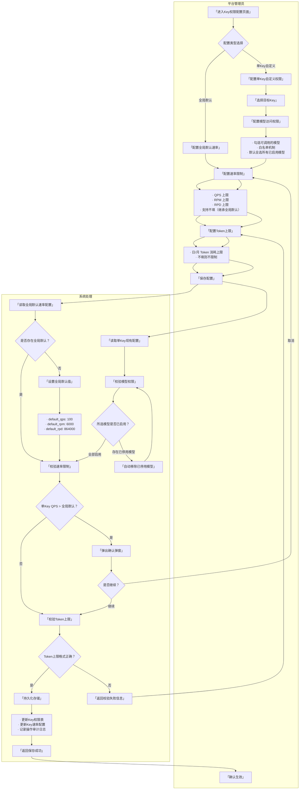

# M02-02 — Key 权限控制 - 业务流程图

> **子模块编号：** M02-02  
> **子模块名称：** Key 权限控制  
> **对应功能：** F-006 Key 权限与速率控制  
> **优先级：** Must  
> **角色：** 平台管理员

---

## 1. 核心流程：Key 权限与速率控制



---

## 2. 两级速率策略说明

### 2.1 策略体系

```
┌─────────────────────────────────────────────────────────────────┐
│                    两级速率策略体系                                │
├─────────────────────────────────────────────────────────────────┤
│                                                                   │
│  ┌─────────────────────────────────┐                              │
│  │  第一级：全局默认速率              │  ← 系统预设，管理员可修改      │
│  │  ───────────────────────          │                              │
│  │  · QPS 上限: 100                  │                              │
│  │  · RPM 上限: 6,000                │                              │
│  │  · RPD 上限: 864,000              │                              │
│  │  · Token 上限: 不限制              │                              │
│  └─────────────────────────────────┘                              │
│           ↓ 继承（未自定义时生效）                                  │
│  ┌─────────────────────────────────┐                              │
│  │  第二级：单 Key 自定义速率          │  ← 针对特定 Key 覆盖全局默认    │
│  │  ───────────────────────          │                              │
│  │  · QPS 上限: 自定义（可超过全局）    │                              │
│  │  · RPM 上限: 自定义（可超过全局）    │                              │
│  │  · RPD 上限: 自定义（可超过全局）    │                              │
│  │  · Token 上限: 自定义              │                              │
│  └─────────────────────────────────┘                              │
│                                                                   │
│  生效规则：单 Key 有自定义值 → 使用自定义值                          │
│           单 Key 未设置 → 继承全局默认值                            │
└─────────────────────────────────────────────────────────────────┘
```

### 2.2 全局默认配置界面

| 配置项 | 默认值 | 说明 |
|--------|--------|------|
| 默认 QPS | 100 | 每秒请求数上限 |
| 默认 RPM | 6,000 | 每分钟请求数上限 |
| 默认 RPD | 864,000 | 每天请求数上限 |
| 默认 Token 日上限 | 不限 | 每天 Token 消耗上限 |

### 2.3 单 Key 自定义配置界面

| 配置项 | 类型 | 说明 |
|--------|------|------|
| 可调用模型 | 多选（Checkbox 列表） | 白名单模式，勾选即授权 |
| QPS 上限 | 数字输入（可选） | 留空继承全局默认 |
| RPM 上限 | 数字输入（可选） | 留空继承全局默认 |
| RPD 上限 | 数字输入（可选） | 留空继承全局默认 |
| Token 日上限 | 数字输入（可选） | 留空则不限制 |

---

## 3. 业务规则

| 规则编号 | 规则描述 |
|---------|---------|
| BR-F006-01 | 全局默认速率由系统预设，平台管理员可随时修改，修改后对所有未自定义的 Key 生效 |
| BR-F006-02 | 单 Key 自定义速率优先于全局默认速率，只要设置了一个维度的值，该维度就使用自定义值 |
| BR-F006-03 | 自定义速率值可以超过全局默认值，但保存时需二次确认 |
| BR-F006-04 | 模型访问权限采用白名单机制：未勾选的模型默认不可调用 |
| BR-F006-05 | 当模型被管理员的模型管理模块停用时，自动从所有 Key 的授权列表中移除 |
| BR-F006-06 | 全局默认速率配置变更时，不影响已自定义的 Key |
| BR-F006-07 | 权限和速率配置变更立即生效，无需重启网关 |

---

## 4. 异常处理

| 异常场景 | 处理方式 | 用户提示 |
|----------|----------|----------|
| 单 Key QPS 超过全局默认值 | 弹出二次确认弹窗 | "自定义 QPS 超过全局默认值（100），是否确认？" |
| 速率配置值非正整数 | 前端校验后拒绝提交 | "请输入正整数" |
| 模型已停用但仍被选中 | 保存时自动移除并提示 | "模型「xxx」已停用，已自动移除" |
| 并发保存冲突 | 乐观锁机制，提示重试 | "配置已更新，请刷新后重试" |
| 全局默认值设置为空 | 不允许全部留空 | "至少设置一项速率限制的默认值" |

---

## 5. 关联数据实体

| 实体 | 说明 | 关键字段 |
|------|------|---------|
| RateLimitConfig | 速率限制配置 | id, key_id(可为null), qps, rpm, rpd, token_limit, is_global_default, updated_at |
| KeyPermission | Key 模型权限 | id, key_id, model_id, granted |
| KeyAuditLog | 操作审计日志 | id, key_id, action, operator, detail, created_at |