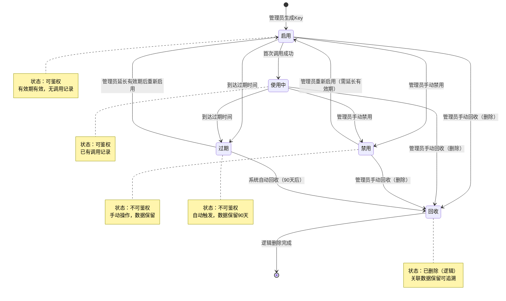
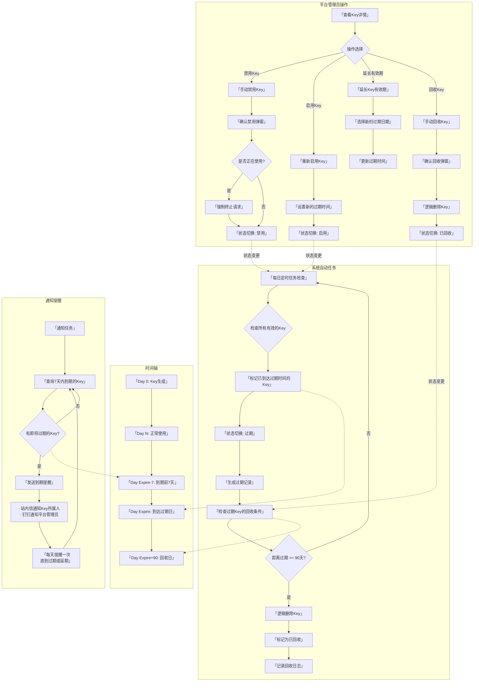

# M02-03 — Key 生命周期管理 - 业务流程图

> **子模块编号：** M02-03  
> **子模块名称：** Key 生命周期管理  
> **对应功能：** F-007 Key 生命周期管理  
> **优先级：** Should  
> **角色：** 系统自动 + 平台管理员

---

## 1. 状态机定义



---

## 2. 完整生命周期业务流程



---

## 3. 状态定义

| 状态 | 编码 | 图标 | 说明 | 是否可鉴权 | 可转换到 |
|------|------|------|------|-----------|---------|
| 启用 | `active` | 🟢 | Key 已生成，有效期有效，可正常调用。区分有无调用记录（启用→使用中） | ✅ | 禁用、过期、回收 |
| 使用中 | `in_use` | 🟢 | Key 已启用且有至少一次成功调用记录，可正常调用 | ✅ | 禁用、过期、回收 |
| 禁用 | `disabled` | 🔴 | 管理员手动禁用，不可调用，数据保留 | ❌ | 启用、回收 |
| 过期 | `expired` | ⚪ | 到达过期时间，系统自动禁用，不可调用，数据保留 90 天 | ❌ | 启用（延长有效期）、回收 |
| 已回收 | `revoked` | ⚫ | 逻辑删除状态，关联数据保留但 Key 本身不可恢复 | ❌ | — |

---

## 4. 核心业务流程

### 4.1 到期前提醒流程

```
日期检查（每日定时任务）
    │
    ├── 遍历所有启用/使用中状态的 Key
    │
    ├── 计算过期剩余天数 = expired_at - NOW()
    │
    ├── 剩余天数 == 7 天 → 触发第一次提醒
    │   ├── 站内信：发送给 Key 所属人
    │   └── 钉钉通知：发送给平台管理员
    │
    ├── 7天 > 剩余天数 > 1 天 → 每天重复提醒（同内容）
    │
    ├── 剩余天数 == 0 天 → 当天不提醒，直接触发过期自动禁用
    │
    └── 若管理员延长了有效期 → 取消当前提醒，重新按新日期计算
```

### 4.2 过期自动禁用流程

```
每日定时任务（00:05 AM）
    │
    ├── SELECT * FROM api_key WHERE expired_at <= NOW() AND status IN ('active','in_use')
    │
    ├── 逐条处理：
    │   ├── 更新 status = 'expired'
    │   ├── 记录操作日志（触发人: system）
    │   └── 通知 Key 所属人（站内信）和管理员（钉钉）
    │
    └── 批量处理，支持事务回滚
```

### 4.3 回收流程

```
每日定时任务（01:00 AM）
    │
    ├── SELECT * FROM api_key WHERE status = 'expired' AND expired_at <= NOW() - INTERVAL 90 DAY
    │
    ├── 逐条处理：
    │   ├── 逻辑删除：标记 deleted_at, status = 'revoked'
    │   ├── 关联的权限和速率配置同步逻辑删除
    │   ├── 绑定该 Key 的请求日志不做物理删除（保留审计追溯）
    │   └── 记录操作日志（触发人: system）
    │
    └── 管理员也可手动回收任意状态（启用/使用中/禁用/过期）的 Key
```

---

## 5. 业务规则

| 规则编号 | 规则描述 |
|---------|---------|
| BR-F007-01 | Key 的初始状态为「启用」，首次调用成功后自动转「使用中」 |
| BR-F007-02 | 到达过期时间后，系统自动将状态切换为「过期」，不再接受鉴权请求 |
| BR-F007-03 | 到期前 7 天开始每天发送一次提醒通知，直到 Key 过期或被延期 |
| BR-F007-04 | 已过期或已禁用的 Key 可手动重新启用，但需同时设置新的过期时间 |
| BR-F007-05 | 过期 Key 的数据保留 90 天，90 天后由系统自动回收（逻辑删除） |
| BR-F007-06 | 回收操作为逻辑删除，关联的请求日志、Token 统计等数据不物理删除 |
| BR-F007-07 | 禁用正在使用的 Key 时需二次确认，确认后正在进行的请求将被强制终止 |
| BR-F007-08 | 所有 Key 状态变更操作均记录审计日志，包含操作人、时间、操作类型、变更前后状态 |

---

## 6. 异常处理

| 异常场景 | 处理方式 | 用户提示 |
|----------|----------|----------|
| 管理员禁用正在使用的 Key | 弹出二次确认弹窗，提示影响范围 | "该 Key 当前 QPS 为 xxx，正在处理请求，禁用后将立即中断所有请求，是否确认？" |
| 重新启用已过期的 Key 但未设过期时间 | 表单校验拦截 | "请先设置新的过期时间" |
| 通知发送失败（钉钉 webhook 异常） | 记录错误日志，次日重试 | 异步通知，不影响主流程 |
| 定时任务执行期间系统宕机 | 下次执行时补扫，状态恢复幂等 | 无需用户干预 |
| 手动回收后需要恢复数据 | 提供数据恢复申请流程（提工单） | "已回收的 Key 不可恢复，如需恢复请提交工单" |

---

## 7. 关联数据实体

| 实体 | 说明 | 关键字段 |
|------|------|---------|
| ApiKey | Key 主记录 | id, key_name, status, expired_at, deleted_at(逻辑删除), created_at |
| KeyAuditLog | 操作审计日志 | id, key_id, action, operator, detail, created_at |
| NotificationRecord | 通知记录 | id, key_id, notify_type, channel, content, status, sent_at |