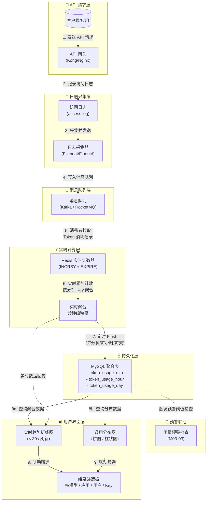
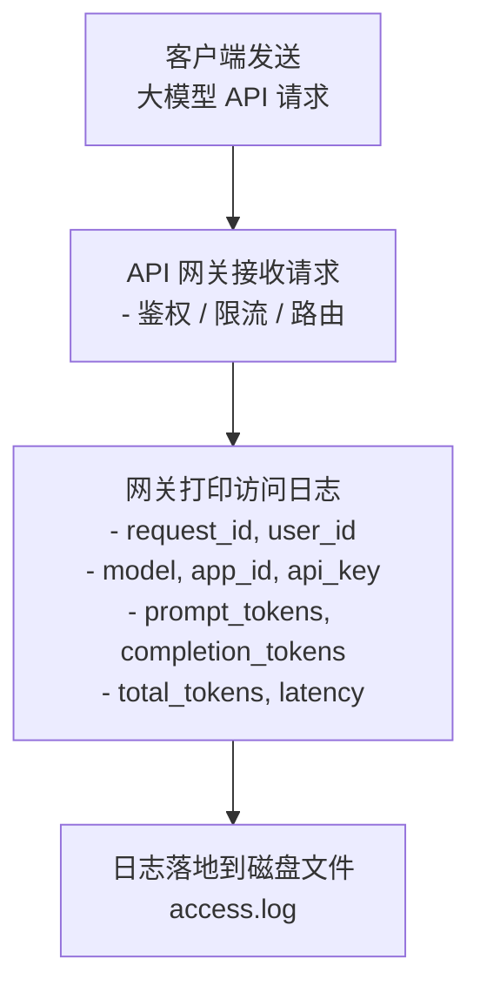
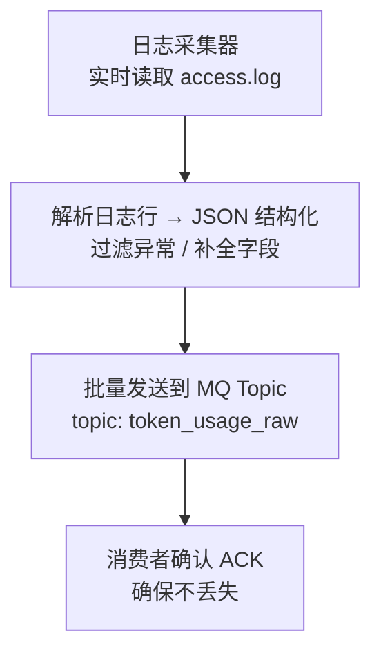
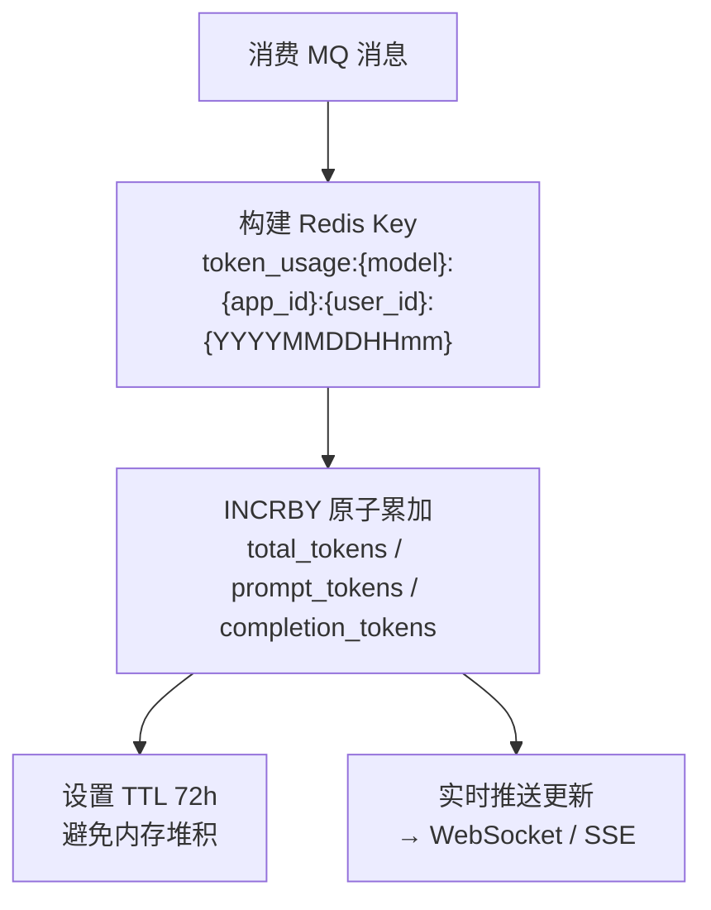
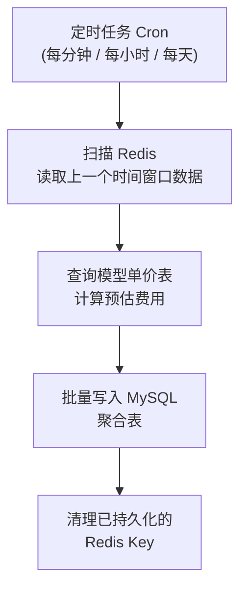
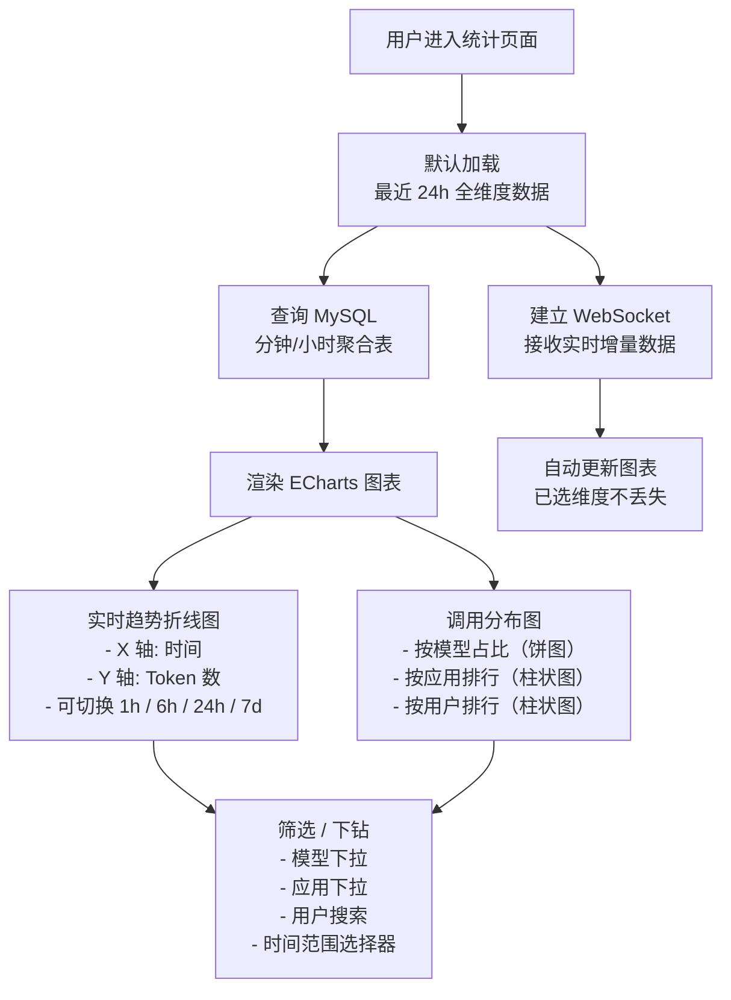
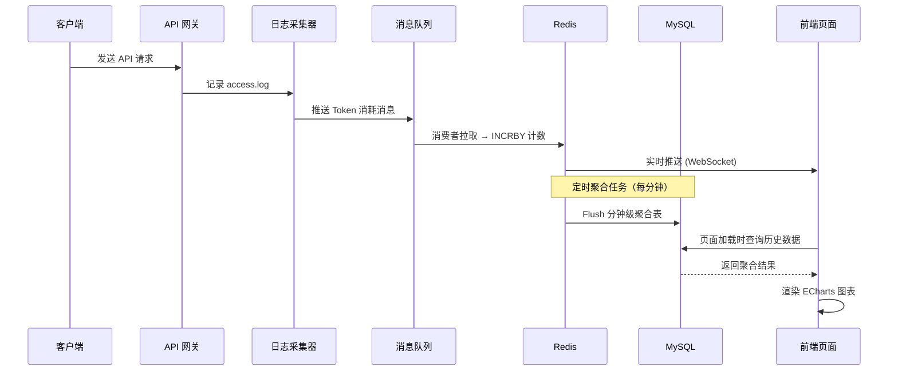

# M03-01-用量统计 — 业务流程图

> **功能点：** F-008 Token 用量实时统计  
> **数据刷新要求：** < 30 秒  
> **关联角色：** 平台管理员、应用开发者、业务管理者

---

## 1. 业务流程总图



---

## 2. 详细流程说明

### 阶段一：API 请求与日志记录



**日志核心字段：**

| 字段 | 示例 | 说明 |
|------|------|------|
| `request_id` | `req_20240101_abc123` | 请求唯一标识 |
| `user_id` | `u_10001` | 调用用户 |
| `app_id` | `app_chatbot` | 所属应用 |
| `api_key` | `sk-****` | 调用使用的 API Key（脱敏） |
| `model` | `gpt-4o` | 模型名称 |
| `prompt_tokens` | 150 | 输入 Token 数 |
| `completion_tokens` | 300 | 输出 Token 数 |
| `total_tokens` | 450 | 总 Token 数 |
| `timestamp` | `2024-01-01T10:00:00Z` | 请求时间戳 |

---

### 阶段二：消息队列异步消费



**MQ 消息体示例（JSON）：**

```json
{
  "request_id": "req_20240101_abc123",
  "user_id": "u_10001",
  "app_id": "app_chatbot",
  "api_key_hash": "sk-xxxx",
  "model": "gpt-4o",
  "prompt_tokens": 150,
  "completion_tokens": 300,
  "total_tokens": 450,
  "timestamp": "2024-01-01T10:00:00Z"
}
```

---

### 阶段三：Redis 实时计数



**Redis Key 设计：**

| Key 模式 | 示例 | 粒度 | TTL |
|----------|------|------|-----|
| `token_usage:min:{model}:{app}:{user}:{YYYYMMDDHHmm}` | `token_usage:min:gpt-4o:app_chatbot:u_10001:202401011000` | 分钟 | 72h |
| `token_usage:min:{model}:{YYYYMMDDHHmm}` | `token_usage:min:gpt-4o:202401011000` | 按模型汇总 | 72h |
| `token_usage:min:{app}:{YYYYMMDDHHmm}` | `token_usage:min:app_chatbot:202401011000` | 按应用汇总 | 72h |

---

### 阶段四：持久化到 MySQL 聚合表



**MySQL 聚合表结构（概要）：**

**`token_usage_min`** — 分钟级聚合

| 字段 | 类型 | 说明 |
|------|------|------|
| `id` | bigint | 主键 |
| `time_bucket` | datetime | 时间窗口（分钟） |
| `model` | varchar(64) | 模型名称 |
| `app_id` | varchar(64) | 应用标识 |
| `user_id` | varchar(64) | 用户标识 |
| `api_key_hash` | varchar(128) | API Key 哈希 |
| `prompt_tokens` | bigint | 累计输入 Token |
| `completion_tokens` | bigint | 累计输出 Token |
| `total_tokens` | bigint | 累计总 Token |
| `call_count` | int | 调用次数 |
| `estimated_cost` | decimal(12,4) | 预估费用 |
| `created_at` | datetime | 创建时间 |

---

### 阶段五：页面展示



---

## 3. 角色交互说明

| 角色 | 数据范围 | 操作权限 | 特殊说明 |
|------|---------|---------|---------|
| **平台管理员** | 全平台数据 | 查看、筛选、下钻 | 可查看任意应用/用户/Key 的明细 |
| **应用开发者** | 本人所属应用 | 查看、筛选 | 系统自动过滤非本人应用数据 |
| **业务管理者** | 全平台数据 | 查看、筛选、下钻 | 不可查看具体 API Key 明细（脱敏） |

---

## 4. 时序图（关键路径）



---

## 5. 与相邻模块的关系

| 相邻模块 | 交互点 | 说明 |
|---------|--------|------|
| **M03-02 费用报表** | 共享 `token_usage_min` 表 | 费用报表直接读取已持久化的聚合表 |
| **M03-03 用量预警** | 通过 Redis / MySQL 读取用量数据 | 预警检查定时扫描当前窗口用量 |
| **API 网关** | 提供 access.log | 本模块的原始数据来源 |
| **认证中心** | 校验用户身份、获取角色 | 用于数据权限过滤 |