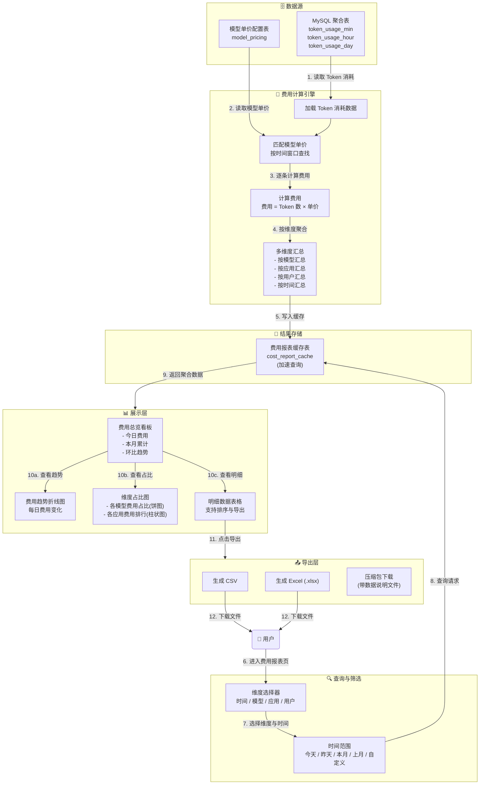
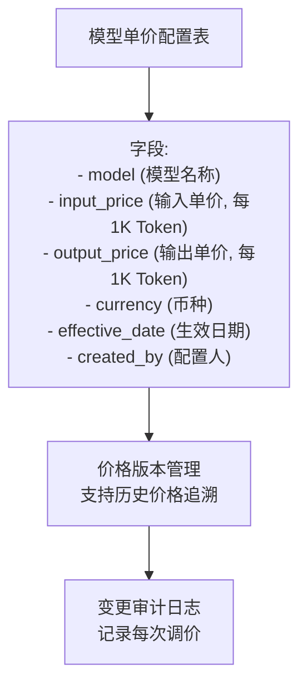
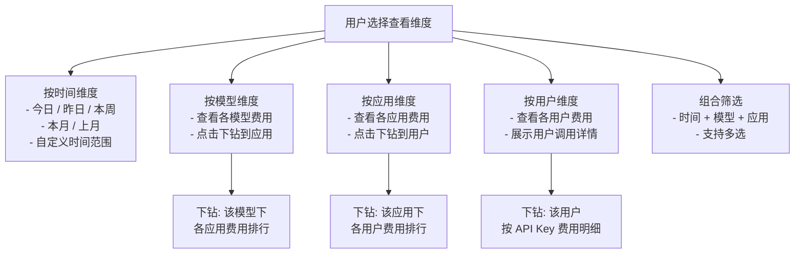
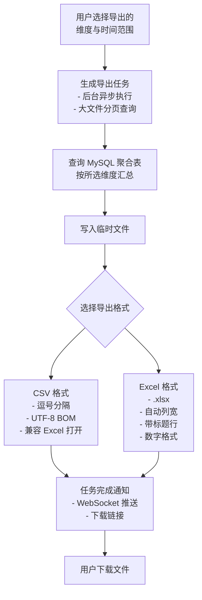
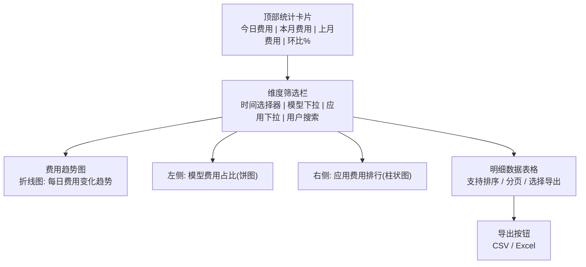

# M03-02-费用报表 — 业务流程图

> **功能点：** F-009 多维度费用报表  
> **关联角色：** 平台管理员、业务管理者

---

## 1. 业务流程总图



---

## 2. 详细流程说明

### 阶段一：费用计算

#### 费用公式

```
费用 = ∑(各模型消耗 Token 数 × 对应模型单价)

其中：
- Token 数：取自 token_usage_min 的 total_tokens 累加值
- 模型单价：取自 model_pricing 配置表，区分输入/输出单价
- 精细计算：费用 = (prompt_tokens × input_price) + (completion_tokens × output_price)
```

#### 模型单价配置表 `model_pricing`



**常见模型单价示例：**

| 模型 | 输入单价 (¥/1K tokens) | 输出单价 (¥/1K tokens) |
|------|----------------------|----------------------|
| gpt-4o | 0.05 | 0.15 |
| gpt-4o-mini | 0.01 | 0.03 |
| gpt-3.5-turbo | 0.003 | 0.006 |
| claude-3-opus | 0.09 | 0.27 |
| deepseek-chat | 0.002 | 0.004 |

---

### 阶段二：多维度查看



---

### 阶段三：报表导出



**导出文件内容示例：**

| 时间 | 模型 | 应用 | Prompt Tokens | Completion Tokens | 总 Tokens | 费用(¥) |
|------|------|------|--------------|-----------------|-----------|---------|
| 2024-01-01 | gpt-4o | app_chatbot | 150,000 | 300,000 | 450,000 | 52.50 |
| 2024-01-01 | gpt-4o-mini | app_chatbot | 800,000 | 1,200,000 | 2,000,000 | 44.00 |

---

## 3. 页面布局示意



---

## 4. 角色权限说明

| 角色 | 查看范围 | 导出权限 | 说明 |
|------|---------|---------|------|
| **平台管理员** | 全平台数据 | ✅ 可导出 | 可查看所有维度明细 |
| **业务管理者** | 全平台费用数据 | ✅ 可导出 | 用于预算核算与成本分析 |
| **应用开发者** | ❌ 无权限 | ❌ 无权限 | 费用报表不向开发者开放 |

---

## 5. 与相邻模块的关系

| 相邻模块 | 交互点 | 说明 |
|---------|--------|------|
| **M03-01 用量统计** | 共享 `token_usage_*` 聚合表 | 费用报表直接读取已聚合的 Token 数据 |
| **M03-03 用量预警** | 费用计算结果可被预警引用 | 费用类预警可在此模块扩展 |
| **系统配置模块** | 读取 `model_pricing` 表 | 单价由系统配置模块统一管理 |