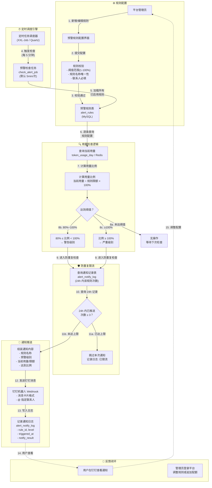
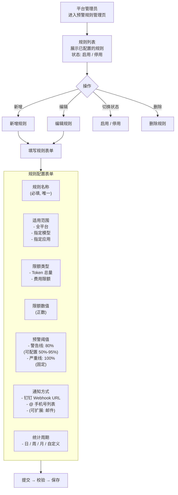
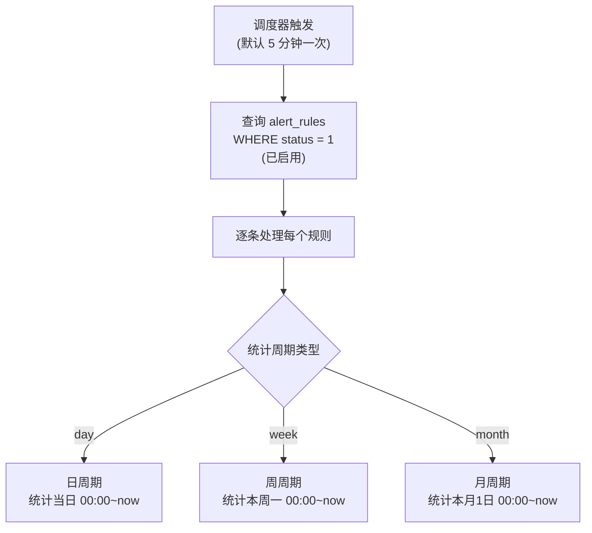
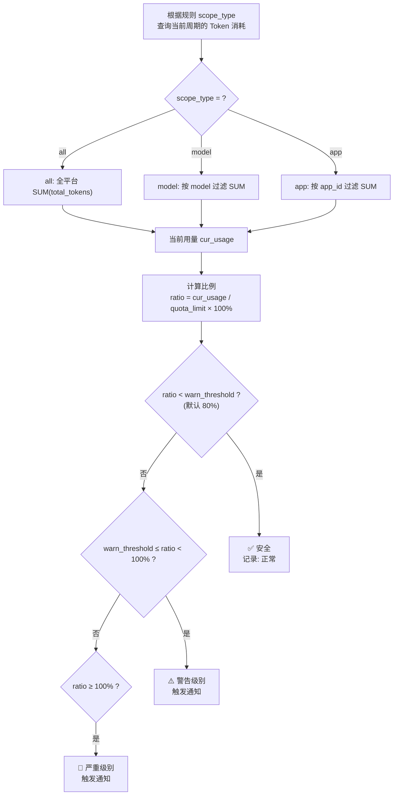
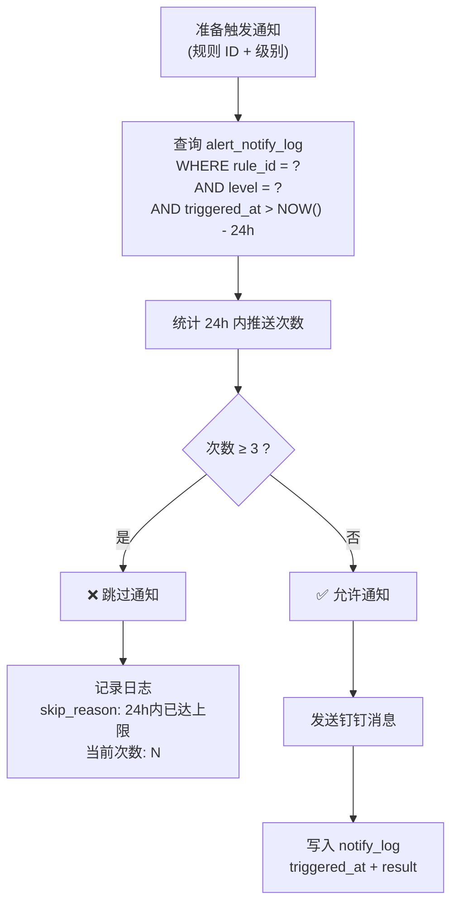
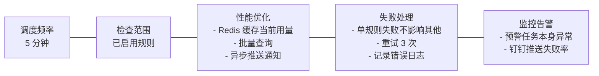

# M03-03-用量预警 — 业务流程图

> **功能点：** F-010 用量预警规则  
> **关联角色：** 平台管理员  
> **防重复机制：** 同一规则 24h 内最多推送 3 次

---

## 1. 业务流程总图



---

## 2. 详细流程说明

### 阶段一：预警规则配置



**`alert_rules` 表结构（概要）：**

| 字段 | 类型 | 说明 |
|------|------|------|
| `id` | bigint | 主键 |
| `rule_name` | varchar(128) | 规则名称（唯一） |
| `scope_type` | varchar(32) | 适用范围: all / model / app |
| `scope_value` | varchar(256) | 范围值（模型名/应用ID，全平台时为空） |
| `quota_type` | varchar(32) | 限额类型: token / cost |
| `quota_limit` | decimal(18,4) | 限额数值 |
| `warn_threshold` | decimal(5,2) | 警告阈值百分比，默认 80.00 |
| `critical_threshold` | decimal(5,2) | 严重阈值百分比，固定 100.00 |
| `notify_dingtalk_webhook` | varchar(512) | 钉钉机器人 Webhook |
| `notify_phones` | varchar(256) | @ 手机号列表，逗号分隔 |
| `stat_period` | varchar(16) | 统计周期: day / week / month |
| `status` | tinyint | 状态: 1=启用, 0=停用 |
| `created_by` | varchar(64) | 创建人 |
| `created_at` | datetime | 创建时间 |
| `updated_at` | datetime | 更新时间 |

---

### 阶段二：定时检查调度



---

### 阶段三：用量检查与阈值判断



---

### 阶段四：防重复通知机制



**`alert_notify_log` 表结构（概要）：**

| 字段 | 类型 | 说明 |
|------|------|------|
| `id` | bigint | 主键 |
| `rule_id` | bigint | 关联规则 ID |
| `alert_level` | varchar(16) | 预警级别: warn / critical |
| `current_usage` | decimal(18,4) | 触发时的当前用量 |
| `usage_ratio` | decimal(5,2) | 触发时的用量比例 |
| `notify_channel` | varchar(32) | 通知渠道: dingtalk |
| `notify_result` | varchar(256) | 推送结果: success / fail |
| `fail_reason` | varchar(256) | 失败原因 |
| `triggered_at` | datetime | 触发时间 |

---

### 阶段五：钉钉通知示例

**消息卡片格式（Markdown）：**

```
## ⚠️ Token 用量预警

**规则名称：** 月度 Token 限额预警
**预警级别：** 🔴 严重

| 项目 | 数值 |
|------|------|
| 统计周期 | 本月 (2024-01-01 ~ 2024-01-15) |
| 当前用量 | 9,850,000 Token |
| 限额 | 10,000,000 Token |
| 使用比例 | **98.50%** |
| 剩余额度 | 150,000 Token |

**建议操作：**
- 登录平台查看详情：[大模型监测平台](http://console.example.com)
- 联系管理员追加配额

---

*由大模型监测平台自动发送 | 24h内最多推送3次*
```

---

## 3. 调度与性能



---

## 4. 角色权限说明

| 角色 | 规则管理 | 查看规则 | 查看通知记录 | 说明 |
|------|---------|---------|------------|------|
| **平台管理员** | ✅ 增删改查 | ✅ 查看全部 | ✅ 查看全部 | 唯一可操作预警的角色 |
| **应用开发者** | ❌ 无权限 | ❌ 无权限 | ❌ 无权限 | 预警功能不向开发者开放 |
| **业务管理者** | ❌ 无权限 | ❌ 无权限 | ❌ 无权限 | 预警功能本次未开放，可后续扩展 |

---

## 5. 与相邻模块的关系

| 相邻模块 | 交互点 | 说明 |
|---------|--------|------|
| **M03-01 用量统计** | 读取 `token_usage_day` / Redis 实时用量 | 用量检查的数据来源 |
| **M03-02 费用报表** | 费用限额场景下读取费用数据 | 检查费用是否超限 |
| **消息通知模块** | 调用钉钉 Webhook 发送消息 | 统一通知渠道管理 |
| **系统监控模块** | 上报预警检查任务自身状态 | 确保预警功能本身健康运行 |