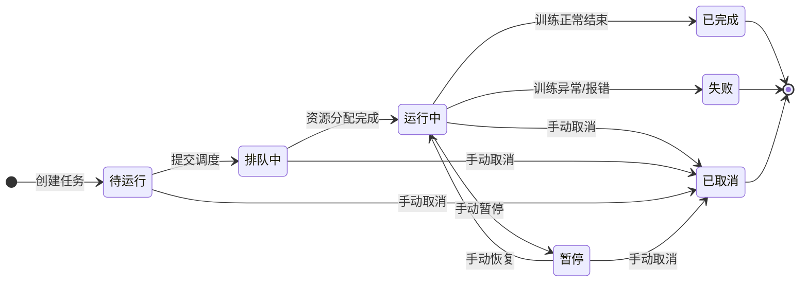

# M05-01 微调任务 —— 业务流程

## 功能编号

F-014 微调任务管理

## 功能概述

微调任务管理模块负责模型微调任务的全生命周期管理。用户通过可视化界面创建微调任务，配置基座模型、数据集和超参数，提交后任务进入调度队列，系统自动分配训练资源执行训练。训练过程中支持实时监控进度、手动暂停/恢复，训练完成后可触发部署流程。

---

## 一、任务状态机

使用 Mermaid `stateDiagram-v2` 描述微调任务的状态流转。



### 状态说明

| 状态 | 说明 | 可操作 |
|------|------|--------|
| 待运行 (Pending) | 任务已创建，尚未提交调度队列 | 提交调度、取消、编辑配置 |
| 排队中 (Queued) | 任务已提交，等待资源分配 | 取消 |
| 运行中 (Running) | 训练任务正在执行 | 暂停、取消 |
| 暂停 (Paused) | 任务被手动暂停，资源已释放 | 恢复、取消 |
| 已完成 (Completed) | 训练正常结束，模型权重已保存 | 查看结果、部署模型 |
| 失败 (Failed) | 训练过程发生异常 | 查看日志、重试 |
| 已取消 (Cancelled) | 用户主动取消任务 | 重新创建 |

---

## 二、业务流程

使用 Mermaid `flowchart TD` 描述微调任务的完整业务流程。

```mermaid
flowchart TD
    A([开始]) --> B[登录系统]
    B --> C[进入微调任务管理]
    C --> D[点击"创建微调任务"]
    D --> E[填写任务名称与描述]
    E --> F[选择基座模型]
    F --> G[选择训练数据集]
    G --> H[配置超参数]
    
    H --> I{是否使用高级配置?}
    I -->|否| J[使用默认参数]
    I -->|是| K[自定义配置]
    
    K --> K1[设置学习率 / Epoch / Batch Size]
    K1 --> K2[选择微调方法: LoRA / QLoRA / P-Tuning]
    K2 --> K3[配置 LoRA rank / alpha / target modules]
    K3 --> L
    
    J --> L[确认任务配置]
    L --> M[提交任务]
    
    M --> N[任务状态: 待运行]
    N --> O[系统校验任务配置]
    O --> P{配置校验通过?}
    P -->|否| Q[返回配置修改]
    Q --> H
    P -->|是| R[任务进入调度队列]
    R --> S[任务状态: 排队中]
    
    S --> T[调度器检查GPU资源]
    T --> U{GPU资源可用?}
    U -->|否| V[等待队列中>
    持续等待]
    V --> T
    U -->|是| W[分配GPU资源]
    W --> X[任务状态: 运行中]
    
    X --> Y[加载基座模型]
    Y --> Z[加载训练数据集]
    Z --> AA[开始训练循环]
    
    AA --> AB[实时监控训练进度]
    AB --> AC{是否手动暂停?}
    AC -->|是| AD[手动暂停任务]
    AD --> AE[任务状态: 暂停]
    AE --> AF{是否恢复?}
    AF -->|是| AG[恢复训练]
    AG --> AA
    AF -->|否 取消| AH[取消任务]
    AH --> AI[任务状态: 已取消]
    AI --> AJ([结束])
    
    AC -->|否| AK{训练是否完成?}
    AK -->|否| AA
    AK -->|是| AL[保存模型权重]
    AL --> AM[任务状态: 已完成]
    
    AA --> AN{训练发生异常?}
    AN -->|是| AO[记录错误日志]
    AO --> AP[任务状态: 失败]
    AP --> AQ([结束])
    
    AM --> AR[查看训练结果]
    AR --> AS{是否部署模型?}
    AS -->|是| AT[选择部署配置]
    AT --> AU[部署到推理服务]
    AU --> AV([结束])
    AS -->|否| AV
```

---

## 三、关键流程说明

### 3.1 创建任务流程

1. 用户填写任务名称和描述信息
2. 从已接入模型列表中选择基座模型（如 DeepSeek-V3、Qwen2.5、LLaMA-3 等）
3. 选择已预处理并版本化的训练数据集和验证数据集
4. 配置超参数：学习率、训练轮数（Epoch）、批次大小（Batch Size）
5. 选择微调方法（LoRA / QLoRA / P-Tuning v2）
6. 高级配置：LoRA rank、LoRA alpha、Target modules 等
7. 确认并提交任务

### 3.2 调度执行流程

1. 任务提交后进入调度队列，系统自动校验配置合法性
2. 调度器根据 GPU 资源可用情况和任务优先级分配资源
3. 资源分配成功后自动开始训练
4. 训练过程中实时采集 Loss、Learning Rate、GPU 利用率等指标

### 3.3 暂停与恢复

- **暂停操作**：用户手动暂停任务，系统保存当前训练 Checkpoint 并释放 GPU 资源
- **恢复操作**：从最近的 Checkpoint 加载训练状态，重新分配资源继续训练
- 暂停期间任务不消耗 GPU 资源

### 3.4 完成后部署

1. 训练完成后自动保存模型权重和 Tokenizer 配置
2. 用户可在结果页面查看训练指标和 Loss 曲线
3. 选择"部署模型"进入部署配置页，一键部署到推理服务