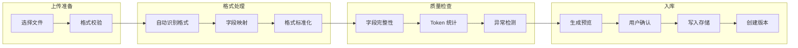
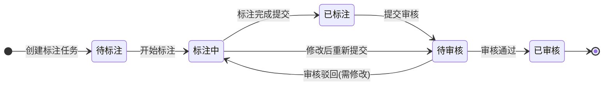
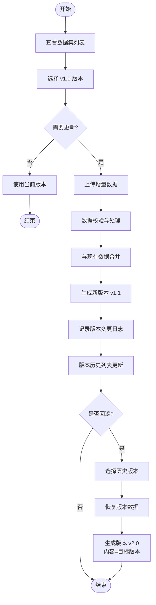

# M05-02 数据集管理 —— 业务流程

## 功能编号

F-015 数据集管理

## 功能概述

数据集管理模块为模型微调提供数据支撑。支持上传多种格式的微调数据集，提供数据预览、格式转换、统计分析和标注管理功能。通过版本管理机制确保数据集的可追溯性和可复现性。

---

## 一、核心业务流程

使用 Mermaid `flowchart TD` 描述数据集管理的完整业务流程。

```mermaid
flowchart TD
    A([开始]) --> B[进入数据集管理]
    B --> C[点击"上传数据集"]
    C --> D[选择数据集文件]
    D --> E{文件格式校验}
    
    E -->|格式正确| F[解析数据格式]
    E -->|格式错误| G[提示格式错误]
    G --> D
    
    F --> H{选择数据格式类型}
    H --> H1[Alpaca 格式]
    H --> H2[ShareGPT 格式]
    H --> H3[CSV 格式]
    H --> H4[JSONL 格式]
    H --> H5[自定义格式]
    
    H1 --> I[格式转换与标准化]
    H2 --> I
    H3 --> I
    H4 --> I
    H5 --> I
    
    I --> J[数据校验]
    J --> J1{必填字段完整性}
    J1 -->|不完整| J2[标记缺失字段]
    J2 --> J3[提示用户补充]
    J3 --> D
    J1 -->|完整| J4[Token 长度分布统计]
    J4 --> J5{数据质量检查}
    J5 -->|通过| K[数据预览]
    J5 -->|不通过| J6[标记异常数据]
    J6 --> K
    
    K --> L[用户确认数据集信息]
    L --> M[填写数据集名称与描述]
    M --> N[选择标注状态]
    N --> N1{标注状态}
    N1 -->|无需标注| O[保存为版本 v1.0]
    N1 -->|需要标注| P[进入标注管理]
    
    O --> Q[数据集上传完成]
    Q --> R([结束])
    
    P --> P1[创建标注任务]
    P1 --> P2[分配给标注人员]
    P2 --> P3[标注状态: 待标注]
    
    P3 --> P4[标注人员开始标注]
    P4 --> P5[标注状态: 标注中]
    P5 --> P6{标注完成?}
    P6 -->|否| P4
    P6 -->|是| P7[提交标注结果]
    P7 --> P8[标注状态: 已标注]
    
    P8 --> P9[提交审核]
    P9 --> P10[标注状态: 待审核]
    P10 --> P11[审核人员审核]
    P11 --> P12{审核通过?}
    P12 -->|是| P13[标注状态: 已审核]
    P12 -->|否| P14[驳回 标注状态: 标注中]
    P14 --> P4
    
    P13 --> O
```

---

## 二、数据上传流程详解



### 支持的数据格式

| 格式 | 说明 | 典型结构 |
|------|------|---------|
| Alpaca | instruction / input / output 三字段 | `{"instruction": "...", "input": "...", "output": "..."}` |
| ShareGPT | 多轮对话格式 | `{"conversations": [{"from": "human", "value": "..."}, ...]}` |
| CSV | 表格格式 | instruction, input, output 列 |
| JSONL | 每行一个 JSON 对象 | 逐行读取 |
| 自定义 | 用户自定义字段映射 | 用户手动配置字段对应关系 |

---

## 三、标注状态流转

使用 Mermaid `stateDiagram-v2` 描述数据集标注的状态机。



### 标注状态说明

| 状态 | 说明 | 负责人 |
|------|------|--------|
| 待标注 (Pending) | 标注任务已创建，待分配标注人员 | 标注管理员 |
| 标注中 (Labeling) | 标注人员正在对数据进行标注 | 标注人员 |
| 已标注 (Labeled) | 标注完成，待审核人员审核 | 审核人员 |
| 待审核 (Reviewing) | 审核人员正在审核标注质量 | 审核人员 |
| 已审核 (Approved) | 标注审核通过，数据集可发布 | 审核人员 |

---

## 四、版本管理流程



### 版本管理规则

- **版本号格式**：`v{major}.{minor}`（如 v1.0、v1.1、v2.0）
- **Major 升级**：数据内容发生重大变更（如新增/删除大量数据、标注方式变更）
- **Minor 升级**：增量更新（如补充少量数据、修正标注错误）
- **版本回滚**：回滚操作会基于目标版本创建一个新版本，不会覆盖现有版本
- **版本对比**：支持任意两个版本之间的差异对比，包括数据量、标签分布等