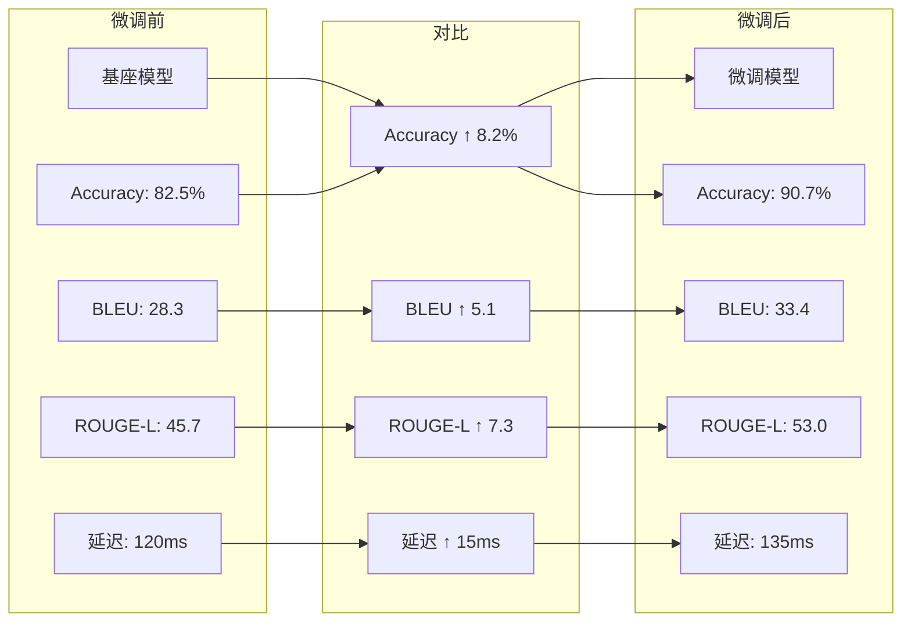
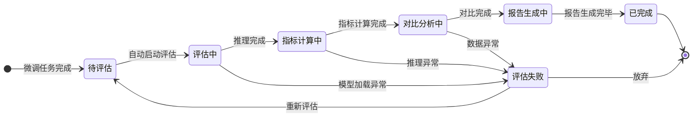

# M05-03 结果评估 —— 业务流程

## 功能编号

F-016 微调结果评估

## 功能概述

微调结果评估模块在微调任务完成后自动触发，对微调后的模型进行多维度自动化评估。通过对比微调前后的各项指标，直观展示微调效果，并生成可导出的评估报告，辅助用户判断模型是否达到部署标准。

---

## 一、核心业务流程

使用 Mermaid `flowchart TD` 描述微调结果评估的完整业务流程。

```mermaid
flowchart TD
    A([开始]) --> B[微调任务完成]
    B --> C[自动触发评估流程]
    
    C --> D[加载微调后模型]
    D --> E[加载测试数据集]
    E --> F[执行推理评估]
    
    F --> G[计算评估指标]
    
    G --> G1[Accuracy 计算]
    G --> G2[BLEU 计算]
    G --> G3[ROUGE-L 计算]
    G --> G4[推理延迟测量]
    
    G1 --> H[指标汇总]
    G2 --> H
    G3 --> H
    G4 --> H
    
    H --> I[加载微调前基座模型]
    I --> J[基座模型在测试集上推理]
    J --> K[计算基座模型各项指标]
    
    K --> L[对比微调前/后指标]
    
    L --> M[生成对比图表]
    M --> M1[柱状图: 各项指标对比]
    M --> M2[折线图: Loss 收敛曲线]
    M --> M3[雷达图: 多维度能力对比]
    M --> M4[表格: 详细指标数值]
    
    M1 --> N[评估结果展示]
    M2 --> N
    M3 --> N
    M4 --> N
    
    N --> O{是否达到部署标准?}
    O -->|是| P[推荐部署]
    P --> Q[展示"部署模型"入口]
    O -->|否| R[展示优化建议]
    R --> S{是否重新微调?}
    S -->|是| T[返回微调任务配置]
    S -->|否| U[保存评估结果]
    
    Q --> V{是否导出报告?}
    U --> V
    V -->|是| W[选择导出格式]
    W --> W1[PDF]
    W --> W2[HTML]
    W --> W3[Markdown]
    W1 --> X[生成报告文件]
    W2 --> X
    W3 --> X
    X --> Y[下载报告]
    V -->|否| Z([结束])
    Y --> Z
```

---

## 二、评估指标详解

### 指标维度

| 指标 | 说明 | 计算方式 | 适用场景 |
|------|------|---------|---------|
| **Accuracy** | 准确率 | 预测正确的样本数 / 总样本数 | 分类任务、判别任务 |
| **BLEU** | 双语评估替补 | 计算 n-gram 精确匹配率 + 短句惩罚因子 | 文本生成、翻译任务 |
| **ROUGE-L** | 最长公共子序列召回率 | 基于 LCS 的召回率计算 | 摘要生成、问答任务 |
| **推理延迟** | 推理响应时间 | 平均每轮推理耗时 (ms) | 所有场景（性能维度） |

### 对比展示形式



---

## 三、评估报告结构

### 3.1 报告内容

```
╔══════════════════════════════════════════════════════════╗
║              微调评估报告                                ║
║  Report ID: EVAL-2026-0001                              ║
║  生成时间: 2026-09-07 10:30:00                          ║
╠══════════════════════════════════════════════════════════╣
║  1. 基本信息                                             ║
║     - 任务名称: customer-service-v1                      ║
║     - 基座模型: DeepSeek-V3-7B                           ║
║     - 微调方法: LoRA (rank=16)                           ║
║     - 训练数据: cs_train_v1.0 (12,000条)                  ║
║     - 测试数据: cs_test_v1.0 (1,500条)                   ║
║                                                          ║
║  2. 评估指标对比                                          ║
║     ┌──────────────┬────────┬────────┬────────┐          ║
║     │ 指标          │ 微调前  │ 微调后  │ 变化    │          ║
║     ├──────────────┼────────┼────────┼────────┤          ║
║     │ Accuracy     │ 82.5%  │ 90.7%  │ ↑8.2%  │          ║
║     │ BLEU         │ 28.3   │ 33.4   │ ↑5.1   │          ║
║     │ ROUGE-L      │ 45.7   │ 53.0   │ ↑7.3   │          ║
║     │ 推理延迟(ms) │ 120    │ 135    │ ↑15    │          ║
║     └──────────────┴────────┴────────┴────────┘          ║
║                                                          ║
║  3. 训练收敛曲线                                          ║
║     [Loss / Step 折线图]                                  ║
║                                                          ║
║  4. 多维度能力对比                                         ║
║     [雷达图: 6维度能力对比]                                 ║
║                                                          ║
║  5. 结论与建议                                            ║
║     - 综合评分: 87/100                                    ║
║     - 推荐部署: ✅ 建议                                ║
║     - 优化建议: 推理延迟略有增加，建议量化优化               ║
╚══════════════════════════════════════════════════════════╝
```

### 3.2 导出格式对比

| 格式 | 特点 | 适用场景 |
|------|------|---------|
| PDF | 排版固定，适合打印/存档 | 正式报告提交 |
| HTML | 交互式图表，可在浏览器中查看 | 团队分享、在线查看 |
| Markdown | 轻量级，可嵌入文档/Wiki | 内部文档记录 |

---

## 四、评估流程状态机

