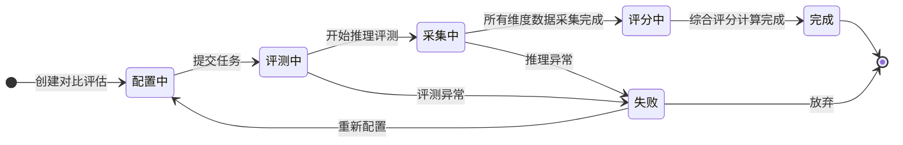
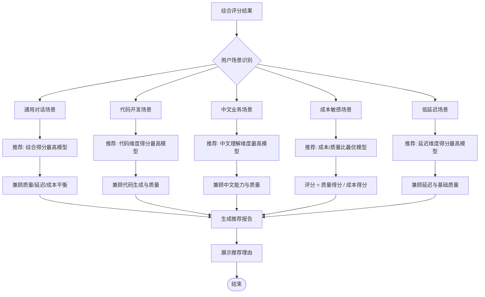

# M06 模型对比评估 —— 业务流程

## 功能编号

F-017 模型对比评估

## 功能概述

模型对比评估模块通过标准化的评测流程，对多个大语言模型进行多维度、多指标的综合评估。用户可根据业务场景自定义评测维度和权重，系统自动执行评测并生成综合评分和推荐建议，为模型选型提供数据支撑。

---

## 一、核心业务流程

使用 Mermaid `flowchart TD` 描述模型对比评估的完整业务流程。

```mermaid
flowchart TD
    A([开始]) --> B[进入模型对比评估]
    B --> C[点击"创建对比评估"]
    
    C --> D[选择待对比模型]
    D --> D1[从已接入模型列表中勾选]
    D --> D2[支持混选: 开源/商业/微调模型]
    
    D2 --> E[选择对比维度]
    E --> E1[质量]
    E --> E2[延迟]
    E --> E3[成本]
    E --> E4[上下文长度]
    E --> E5[多模态能力]
    E --> E6[中文理解]
    E --> E7[代码生成]
    
    E1 --> F[配置维度权重]
    E2 --> F
    E3 --> F
    E4 --> F
    E5 --> F
    E6 --> F
    E7 --> F
    
    F --> G{使用默认权重?}
    G -->|是| H[加载系统默认权重]
    G -->|否| I[自定义权重配置]
    I --> I1[拖拽滑块调整各维度权重]
    I1 --> I2[实时预览权重分布]
    I2 --> J
    
    H --> J[选择评测数据集]
    J --> J1[系统推荐评测集]
    J --> J2[自定义上传评测集]
    
    J1 --> K[确认评测配置]
    J2 --> K
    
    K --> L[提交评测任务]
    L --> M[系统分发评测任务]
    
    M --> N[对模型1执行批量评测]
    M --> O[对模型2执行批量评测]
    M --> P[对模型N执行批量评测]
    
    N --> Q[收集各维度评测结果]
    O --> Q
    P --> Q
    
    Q --> R[计算各维度得分]
    R --> R1[原始分归一化]
    R1 --> R2[加权综合评分]
    
    R2 --> S[生成综合评分排名]
    
    S --> T[可视化展示]
    T --> T1[雷达图: 多维度能力对比]
    T --> T2[柱状图: 综合得分排名]
    T --> T3[柱状图: 各维度分项对比]
    T --> T4[表格: 详细得分明细]
    
    T1 --> U[生成推荐建议]
    T2 --> U
    T3 --> U
    T4 --> U
    
    U --> V{根据评分和场景}
    V --> V1[综合得分最高模型]
    V --> V2[性价比最优模型]
    V --> V3[特定维度最优模型]
    
    V1 --> W[展示推荐结果]
    V2 --> W
    V3 --> W
    
    W --> X{是否导出报告?}
    X -->|是| Y[选择导出格式]
    Y --> Y1[PDF]
    Y --> Y2[HTML]
    Y1 --> Z[生成并下载报告]
    Y2 --> Z
    X -->|否| Z1([结束])
    Z --> Z1
```

---

## 二、评测维度与评分模型

### 2.1 评分计算流程

```mermaid
flowchart LR
    subgraph 原始评分
        A1[质量: 0-100分]
        A2[延迟: 0-100分<br>分数越高延迟越低]
        A3[成本: 0-100分<br>分数越高成本越低]
        A4[上下文: 0-100分]
        A5[多模态: 0-100分]
        A6[中文理解: 0-100分]
        A7[代码生成: 0-100分]
    end
    
    subgraph 加权计算
        B1[质量 × 30%]
        B2[延迟 × 15%]
        B3[成本 × 15%]
        B4[上下文 × 10%]
        B5[多模态 × 10%]
        B6[中文理解 × 10%]
        B7[代码生成 × 10%]
    end
    
    subgraph 综合评分
        C[综合得分 = Σ(维度得分 × 权重)]
    end
    
    A1 --> B1
    A2 --> B2
    A3 --> B3
    A4 --> B4
    A5 --> B5
    A6 --> B6
    A7 --> B7
    
    B1 --> C
    B2 --> C
    B3 --> C
    B4 --> C
    B5 --> C
    B6 --> C
    B7 --> C
```

### 2.2 评分示例

| 模型 | 质量(30%) | 延迟(15%) | 成本(15%) | 上下文(10%) | 多模态(10%) | 中文(10%) | 代码(10%) | **综合得分** |
|------|-----------|-----------|-----------|------------|------------|----------|----------|:----------:|
| DeepSeek-V3 | 92 | 88 | 70 | 95 | 60 | 95 | 85 | **85.1** |
| GPT-4o | 95 | 82 | 40 | 90 | 90 | 88 | 92 | **83.8** |
| Qwen2.5-72B | 88 | 85 | 75 | 85 | 55 | 93 | 78 | **81.6** |
| LLaMA-3-70B | 90 | 80 | 80 | 70 | 50 | 70 | 82 | **77.7** |

---

## 三、评测执行流程

### 3.1 评测任务调度



### 3.2 多模型并行评测

```
时间线 →
─────────────────────────────────────────────────────────
模型A:  ████████████████████████████░░░░░░
        质量评测    延迟测试    成本分析    后续维度...
模型B:  ████████████████████████████░░░░░░
        质量评测    延迟测试    成本分析    后续维度...
模型C:  ████████████████████████████░░░░░░
        质量评测    延迟测试    成本分析    后续维度...
─────────────────────────────────────────────────────────
        所有模型并行执行相同评测基准                  完成
```

### 3.3 评测数据集

| 维度 | 推荐评测集 | 说明 |
|------|-----------|------|
| 质量 | MMLU-Pro, ARC-Challenge, HellaSwag | 通用知识推理 |
| 延迟 | 自定义延迟测试集 (1,000 queries) | 首Token延迟 + 生成速率 |
| 成本 | - | API定价对比 + 实际Token消耗估算 |
| 上下文长度 | Needle-in-a-Haystack, RULER | 长文本检索准确率 |
| 多模态能力 | MMMU, MathVista, ChartQA | 图像理解与推理 |
| 中文理解 | C-Eval, CMMLU, CHID | 中文语言理解 |
| 代码生成 | HumanEval, MBPP, Codeforces | 代码功能正确性 |

---

## 四、推荐建议生成逻辑

