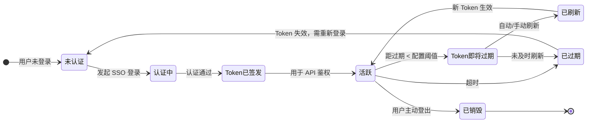

# M07-01 SSO 统一认证 —— 业务流程

## 功能编号

F-018 SSO 统一认证

## 功能概述

SSO 统一认证模块为大模型监测管理平台提供统一的身份认证服务。用户只需在统一登录页面完成一次认证，即可访问平台所有授权资源。本模块支持多种主流认证协议，可与企业的统一身份认证系统（如 LDAP、AD、CAS、OAuth2 等）无缝集成。

---

## 一、核心认证流程

使用 Mermaid `flowchart TD` 描述 SSO 统一认证的完整业务流程。

```mermaid
flowchart TD
    A([用户访问系统]) --> B[请求受保护资源]
    B --> C{本地会话是否有效?}
    
    C -->|是, 有效| D[返回请求资源]
    D --> E([结束])
    
    C -->|否, 无效| F[重定向到 SSO 登录页]
    F --> G{认证协议类型}
    
    G -->|OAuth2| H1[OAuth2 认证流程]
    G -->|SAML| H2[SAML 认证流程]
    G -->|LDAP| H3[LDAP 认证流程]
    G -->|CAS| H4[CAS 认证流程]
    
    H1 --> H1_1[拼接OAuth2授权URL<br>包含 client_id / redirect_uri / scope]
    H1_1 --> H1_2[跳转到 OAuth2 授权服务]
    H1_2 --> H1_3[用户在授权页输入凭证]
    H1_3 --> H1_4{凭证验证}
    H1_4 -->|通过| H1_5[授权服务返回 authorization_code]
    H1_4 -->|失败| H1_6[返回错误提示]
    H1_6 --> H1_3
    
    H2 --> H2_1[生成 SAML Request]
    H2_1 --> H2_2[跳转到 IdP 认证服务]
    H2_2 --> H2_3[用户在 IdP 登录页认证]
    H2_3 --> H2_4{认证成功?}
    H2_4 -->|是| H2_5[IdP 返回 SAML Response (Assertion)]
    H2_4 -->|否| H2_6[返回错误提示]
    H2_6 --> H2_3
    
    H3 --> H3_1[用户在 SSO 页输入 LDAP 凭证]
    H3_1 --> H3_2[系统连接 LDAP 服务器]
    H3_2 --> H3_3{绑定验证}
    H3_3 -->|通过| H3_4[LDAP 返回用户属性]
    H3_3 -->|失败| H3_5[返回登录失败提示]
    H3_5 --> H3_1
    
    H4 --> H4_1[拼接 CAS 登录 URL]
    H4_1 --> H4_2[跳转到 CAS 认证服务]
    H4_2 --> H4_3[用户在 CAS 登录页认证]
    H4_3 --> H4_4{认证成功?}
    H4_4 -->|是| H4_5[CAS 回调系统并携带 ticket]
    H4_4 -->|否| H4_6[返回错误提示]
    H4_6 --> H4_3
    
    H1_5 --> I[SSO 回调接口接收票据]
    H2_5 --> I
    H3_4 --> I
    H4_5 --> I
    
    I --> J[验证票据有效性]
    J --> J1{票据验证通过?}
    J1 -->|是| K[获取用户信息]
    J1 -->|否| J2[返回认证失败]
    J2 --> F
    
    K --> K1[从认证服务获取用户身份信息]
    K1 --> K2[用户名 / 邮箱 / 角色 / 部门]
    
    K2 --> L[查询本地用户映射]
    L --> M{本地用户是否存在?}
    M -->|是| N[更新用户最后登录时间]
    M -->|否| O[创建本地用户记录]
    O --> P[首次登录引导]
    
    N --> Q[创建本地会话]
    P --> Q
    
    Q --> Q1[生成 Session ID]
    Q1 --> Q2[签发 JWT Token]
    Q2 --> Q3{Token 包含内容}
    Q3 --> Q3_1[用户身份信息]
    Q3 --> Q3_2[角色 / 权限]
    Q3 --> Q3_3[过期时间]
    Q3 --> Q3_4[签名]
    
    Q3_1 --> R[JWT Token 返回客户端]
    Q3_2 --> R
    Q3_3 --> R
    Q3_4 --> R
    
    R --> S[客户端存储 Token]
    S --> S1[前端存储于 localStorage / httpOnly Cookie]
    S1 --> T[重定向回原始页面]
    T --> U[携带 Token 请求资源]
    U --> V[后端验证 Token 有效性]
    V --> V1{Token 有效?}
    V1 -->|是| D
    V1 -->|否| V2[Token 过期/无效]
    V2 --> F
```

---

## 二、协议对比

### 2.1 认证协议对比

| 特性 | OAuth2 | SAML | LDAP | CAS |
|------|--------|------|------|-----|
| 协议类型 | 授权框架 | 身份联合 | 目录访问 | 认证服务 |
| 消息格式 | HTTP + JSON | XML / HTTP Redirect | LDAP 协议 | HTTP + XML |
| 适用场景 | 互联网应用、API 授权 | 企业应用、跨域单点登录 | 企业内部统一认证 | 高校/科研机构 |
| 配置复杂度 | 中 | 高 | 低 | 中 |
| 支持 MFA | ✅ 支持 | ✅ 支持 | 🔸 需扩展 | ✅ 支持 |
| 用户属性获取 | 通过 UserInfo 端点 | 通过 Assertion 属性 | 通过搜索查询 | 通过属性回调 |

### 2.2 各协议流程对比

```mermaid
flowchart TD
    subgraph OAuth2
        OA1[用户访问] --> OA2[重定向授权服务]
        OA2 --> OA3[用户授权]
        OA3 --> OA4[回调 code]
        OA4 --> OA5[换取 Token]
        OA5 --> OA6[获取用户信息]
    end
    
    subgraph SAML
        SA1[用户访问] --> SA2[生成 SAML Request]
        SA2 --> SA3[重定向 IdP]
        SA3 --> SA4[用户认证]
        SA4 --> SA5[回调 SAML Response]
        SA5 --> SA6[解析 Assertion]
    end
    
    subgraph LDAP
        LD1[用户输入凭证] --> LD2[连接 LDAP Server]
        LD2 --> LD3[bind 验证]
        LD3 --> LD4[搜索用户属性]
    end
    
    subgraph CAS
        CA1[用户访问] --> CA2[重定向 CAS Server]
        CA2 --> CA3[用户认证]
        CA3 --> CA4[回调 ticket]
        CA4 --> CA5[验证 ticket]
        CA5 --> CA6[获取用户信息]
    end
```



---

## 三、Token 生命周期管理



### Token 配置说明

| 参数 | 默认值 | 说明 |
|------|--------|------|
| Access Token 有效期 | 2 小时 | 用于 API 鉴权 |
| Refresh Token 有效期 | 7 天 | 用于刷新 Access Token |
| Token 刷新阈值 | 30 分钟 | 距过期前触发自动刷新 |
| Token 存储方式 | httpOnly Cookie | 防止 XSS 窃取 |