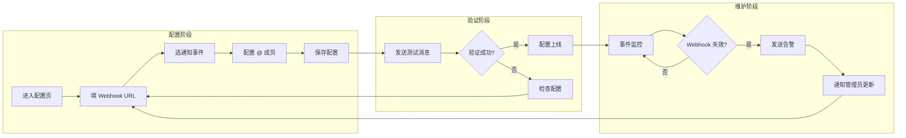
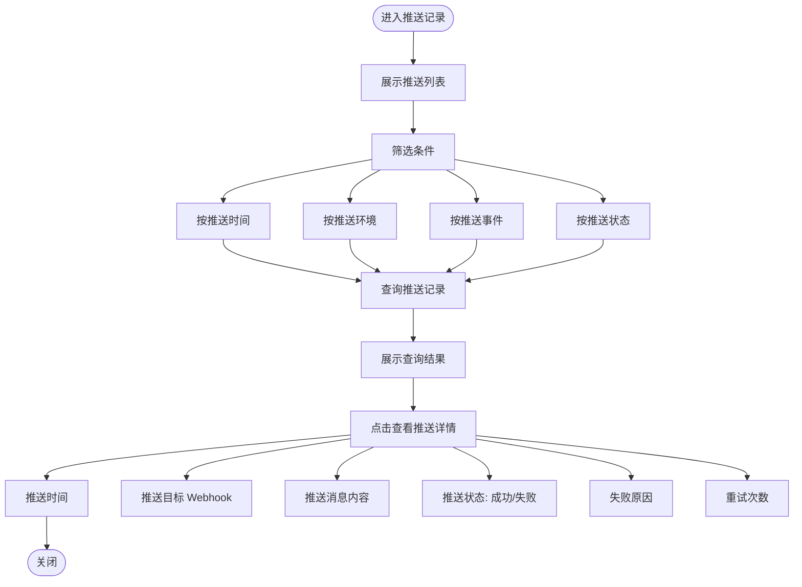

# M07-02 通知推送 —— 业务流程

## 功能编号

F-019 钉钉通知推送

## 功能概述

钉钉通知推送模块基于钉钉群机器人 Webhook 能力，将系统内的重要事件实时推送到指定的钉钉群。支持多环境配置、@指定成员、消息模板自定义等功能，确保团队成员能够第一时间获知关键事件的动态。

---

## 一、核心业务流程

使用 Mermaid `flowchart TD` 描述钉钉通知推送的完整业务流程。

```mermaid
flowchart TD
    A([开始]) --> B[进入通知推送配置]
    
    B --> C[添加钉钉机器人配置]
    C --> C1[填写配置名称]
    C1 --> C2[选择目标环境]
    C2 --> C2_1[开发环境]
    C2 --> C2_2[测试环境]
    C2 --> C2_3[生产环境]
    
    C2_1 --> C3[填写 Webhook URL]
    C2_2 --> C3
    C2_3 --> C3
    
    C3 --> C4[配置加签密钥(Secret)]
    C4 --> C5[配置消息通知开关]
    
    C5 --> D[选择通知事件]
    D --> D1[微调任务事件]
    D1 --> D1_1[微调任务完成]
    D1 --> D1_2[微调任务失败]
    D1 --> D1_3[微调任务暂停]
    
    D --> D2[模型事件]
    D2 --> D2_1[模型部署完成]
    D2 --> D2_2[模型部署失败]
    D2 --> D2_3[模型下线]
    
    D --> D3[系统事件]
    D3 --> D3_1[系统异常告警]
    D3 --> D3_2[GPU 资源告警]
    D3 --> D3_3[评测任务完成]
    
    D --> D4[安全事件]
    D4 --> D4_1[用户异常登录]
    D4 --> D4_2[敏感操作告警]
    
    D1_1 --> E[配置@指定成员]
    D1_2 --> E
    D1_3 --> E
    D2_1 --> E
    D2_2 --> E
    D2_3 --> E
    D3_1 --> E
    D3_2 --> E
    D3_3 --> E
    D4_1 --> E
    D4_2 --> E
    
    E --> E1[选择@所有人]
    E --> E2[指定手机号列表]
    E --> E3[不@任何人]
    
    E1 --> F[配置消息模板]
    E2 --> F
    E3 --> F
    
    F --> F1[使用默认消息模板]
    F --> F2[自定义消息模板]
    
    F1 --> G[保存配置]
    F2 --> G
    
    G --> H{是否测试推送?}
    H -->|是| I[发送测试消息]
    I --> J{测试消息是否成功?}
    J -->|成功| K[配置完成]
    J -->|失败| L[检查 Webhook URL 和 Secret]
    L --> M[修正配置]
    M --> H
    H -->|否| K
    
    K --> N[配置生效]
    
    N --> O([等待事件触发])
    
    O --> P[系统事件发生]
    P --> Q{事件是否已配置通知?}
    Q -->|否| R[忽略]
    R --> O
    Q -->|是| S[触发通知推送]
    
    S --> T[构建消息内容]
    T --> T1[选择消息类型]
    T1 --> T1_1[Markdown 消息]
    T1 --> T1_2[Text 消息]
    T1 --> T1_3[ActionCard 消息]
    
    T1_1 --> U[填充消息模板]
    T1_2 --> U
    T1_3 --> U
    
    U --> U1[事件标题]
    U --> U2[事件详情]
    U --> U3[触发时间]
    U --> U4[来源环境]
    U --> U5[操作链接/跳转 URL]
    
    U1 --> V[添加 @ 标记]
    U2 --> V
    U3 --> V
    U4 --> V
    U5 --> V
    
    V --> W[签名计算]
    W --> W1[timestamp + "\n" + Secret]
    W1 --> W2[HmacSHA256 计算签名]
    W2 --> W3[Base64 编码]
    
    W3 --> X[调用钉钉 Webhook API]
    X --> Y{推送结果}
    Y -->|成功 200 OK| Z[记录推送成功]
    Y -->|失败| Z1[记录推送失败]
    Z1 --> Z2{重试次数 < 3?}
    Z2 -->|是| Z3[等待 3 秒后重试]
    Z3 --> X
    Z2 -->|否| Z4[标记推送失败]
    
    Z --> AA[更新推送记录]
    Z4 --> AA
    
    AA --> AB([结束])
```

---

## 二、消息模板示例

### 2.1 微调任务完成通知 (Markdown)

```markdown
# ✅ 微调任务完成通知

**任务名称**: {{task_name}}
**基座模型**: {{base_model}}
**微调方法**: {{finetune_method}}
**训练耗时**: {{duration}}
**最终 Loss**: {{final_loss}}
**GPU 利用率**: {{gpu_utilization}}%

📊 [查看训练详情]({{detail_url}})
📋 [查看评估报告]({{eval_url}})
```

### 2.2 系统异常告警 (ActionCard)

```json
{
  "actionCard": {
    "title": "🔥 系统异常告警",
    "text": "### 🔥 系统异常告警\n\n**告警级别**: {{severity}}\n**告警类型**: {{alert_type}}\n**发生时间**: {{occur_time}}\n**告警详情**: {{detail}}\n**当前状态**: {{current_status}}\n\n---\n> 请及时处理！",
    "btnOrientation": "1",
    "btns": [
      { "title": "查看详情", "actionURL": "{{detail_url}}" },
      { "title": "确认处理", "actionURL": "{{confirm_url}}" }
    ]
  }
}
```

### 2.3 GPU 资源告警 (Text + @指定人)

```text
⚠️ GPU 资源告警
环境: {{environment}}
GPU 使用率: {{gpu_usage}}%
可用显存: {{available_memory}} GB / {{total_memory}} GB
剩余可分配任务数: {{available_slots}}
时间: {{trigger_time}}
```

---

## 三、配置管理流程



---

## 四、推送记录查询

