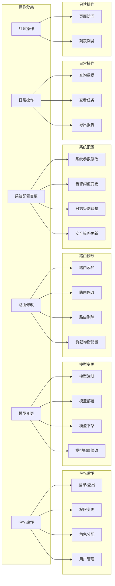
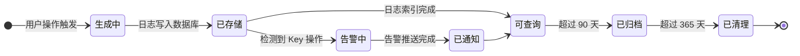
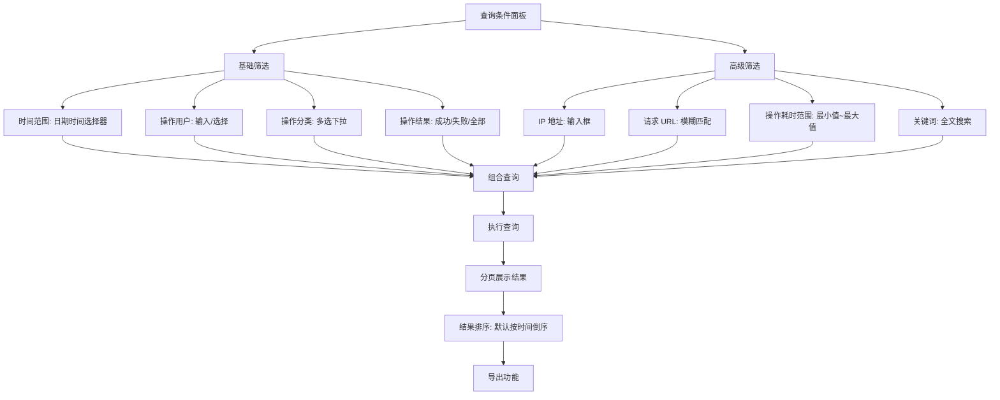

# M07-03 操作审计 —— 业务流程

## 功能编号

F-020 操作日志审计

## 功能概述

操作审计模块对平台内所有关键用户操作进行全量记录，确保每一次操作都有迹可循、有据可查。通过标准化的日志格式、多维度的查询筛选和灵活的导出功能，满足合规审计、安全追溯和运维排查的需求。

本模块重点覆盖四类关键操作：Key 操作（登录/权限变更）、模型变更（注册/部署/下架）、路由修改（API 路由配置）、系统配置变更（参数/阈值修改）。

---

## 一、核心业务流程

使用 Mermaid `flowchart TD` 描述操作审计的完整业务流程。

```mermaid
flowchart TD
    A([用户执行操作]) --> B[操作请求进入应用层]
    
    B --> C[后端拦截器/中间件拦截请求]
    C --> C1[提取操作上下文]
    
    C1 --> D[收集操作信息]
    
    D --> D1[操作用户]
    D1 --> D1_1[用户 ID]
    D1 --> D1_2[用户名]
    
    D --> D2[操作时间]
    D2 --> D2_1[请求时间戳]
    
    D --> D3[来源信息]
    D3 --> D3_1[客户端 IP 地址]
    D3 --> D3_2[User-Agent]
    D3 --> D3_3[请求来源模块]
    
    D --> D4[操作内容]
    D4 --> D4_1[HTTP 方法: GET/POST/PUT/DELETE]
    D4 --> D4_2[请求 URL]
    D4 --> D4_3[请求参数]
    D4 --> D4_4[请求 Body]
    
    D1_1 --> E[判断操作等级]
    D1_2 --> E
    D2_1 --> E
    D3_1 --> E
    D3_2 --> E
    D3_3 --> E
    D4_1 --> E
    D4_2 --> E
    D4_3 --> E
    D4_4 --> E
    
    E --> E1{操作分类判断}
    
    E1 --> E1_1[Key 操作]
    E1 --> E1_2[模型变更]
    E1 --> E1_3[路由修改]
    E1 --> E1_4[系统配置变更]
    E1 --> E1_5[日常操作]
    E1 --> E1_6[只读操作]
    
    E1_1 --> F[构建日志记录]
    E1_2 --> F
    E1_3 --> F
    E1_4 --> F
    E1_5 --> F
    E1_6 --> F
    
    F --> G[记录操作结果]
    G --> G1{操作执行结果}
    G1 -->|成功| G2[记录: 成功]
    G1 -->|失败| G3[记录: 失败 + 错误信息]
    
    G2 --> H[组装标准日志格式]
    G3 --> H
    
    H --> I[日志内容标准化]
    I --> I1[日志 ID: 全局唯一 UUID]
    I --> I2[操作分类: Key/模型/路由/配置/日常/只读]
    I --> I3[操作人信息]
    I --> I4[时间戳]
    I --> I5[操作详情 JSON]
    I --> I6[操作结果: 成功/失败]
    I --> I7[请求追踪 ID (Trace ID)]
    
    I1 --> J[持久化存储]
    I2 --> J
    I3 --> J
    I4 --> J
    I5 --> J
    I6 --> J
    I7 --> J
    
    J --> J1[写入审计日志表]
    J1 --> J2[异步写入: 不影响主流程性能]
    J2 --> J3{是否 Key 操作?}
    J3 -->|是| J4[额外写入告警队列]
    J3 -->|否| J5[仅持久化]
    
    J4 --> K[审计日志入库完成]
    J5 --> K
    
    K --> L([日志查询与审计])
    
    L --> M[进入审计日志查询页]
    M --> N[设置筛选条件]
    
    N --> N1[时间范围]
    N --> N2[操作用户]
    N --> N3[操作分类]
    N --> N4[操作结果]
    N --> N5[IP 地址]
    N --> N6[关键词搜索]
    
    N1 --> O[查询日志]
    N2 --> O
    N3 --> O
    N4 --> O
    N5 --> O
    N6 --> O
    
    O --> P[展示查询结果]
    P --> P1[分页展示日志列表]
    
    P1 --> Q[点击单条日志查看详情]
    Q --> Q1[完整操作上下文]
    Q --> Q2[请求/响应详情]
    Q --> Q3[关联追踪 ID]
    
    Q1 --> R{是否导出?}
    Q2 --> R
    Q3 --> R
    
    R -->|是| S[选择导出格式]
    S --> S1[Excel 导出]
    S --> S2[CSV 导出]
    
    S1 --> T[选择导出范围]
    S2 --> T
    T --> T1[导出全部筛选结果]
    T --> T2[仅导出选中条目]
    
    T1 --> U[生成导出文件]
    T2 --> U
    U --> V[下载导出文件]
    R -->|否| W([结束])
    V --> W
```

---

## 二、日志格式规范

### 2.1 标准日志字段

| 字段 | 类型 | 说明 | 示例 |
|------|------|------|------|
| `log_id` | String | 全局唯一日志 ID | `aud-20260907-000001` |
| `trace_id` | String | 请求追踪 ID | `trace-a1b2c3d4` |
| `user_id` | String | 操作用户 ID | `u-10086` |
| `username` | String | 操作用户名 | `zhangsan` |
| `operation_time` | DateTime | 操作时间 (UTC+8) | `2026-09-07 10:30:00` |
| `operation_category` | Enum | 操作分类 | `KEY_OPERATION`, `MODEL_CHANGE`, `ROUTE_CHANGE`, `SYSTEM_CONFIG`, `DAILY`, `READONLY` |
| `operation_type` | String | 操作类型 | `LOGIN`, `MODEL_DEPLOY`, `ROUTE_ADD`, `CONFIG_UPDATE` |
| `http_method` | String | HTTP 方法 | `POST`, `PUT`, `DELETE`, `GET` |
| `request_url` | String | 请求 URL | `/api/v1/models/deploy` |
| `request_params` | JSON | 请求参数 | `{"model_id": "deepseek-v3"}` |
| `request_body` | JSON | 请求 Body | `{"name": "test-model"}` |
| `response_status` | Int | 响应状态码 | `200`, `400`, `500` |
| `response_body` | JSON | 响应内容 (脱敏) | `{"code": 0, "data": {...}}` |
| `client_ip` | String | 客户端 IP | `192.168.1.100` |
| `user_agent` | String | 客户端 User-Agent | `Mozilla/5.0 ...` |
| `source_module` | String | 来源模块 | `model-finetune` |
| `result` | Enum | 操作结果 | `SUCCESS`, `FAILURE` |
| `error_message` | String | 错误信息 (失败时) | `GPU 资源不足` |
| `duration_ms` | Int | 操作耗时 (ms) | `2350` |

### 2.2 操作分类对照表



---

## 三、日志生命周期管理



### 日志保留策略

| 阶段 | 时间 | 存储方式 | 说明 |
|------|------|---------|------|
| 热数据 | 0~7 天 | 数据库主表 | 频繁查询，保持高查询性能 |
| 温数据 | 8~90 天 | 数据库归档表 | 偶尔查询，保留完整详情 |
| 冷数据 | 91~365 天 | 文件存储/对象存储 | 合规保留，仅保留核心字段 |
| 清理 | 超过 365 天 | - | 根据合规要求可延长保留期 |

---

## 四、日志查询与导出

### 4.1 查询条件组合



### 4.2 导出数据格式

**Excel 导出结构**：

| 日志 ID | 操作时间 | 用户 | IP | 操作分类 | 操作类型 | 请求 URL | 结果 | 耗时(ms) |
|---------|---------|------|----|---------|---------|---------|------|---------|
| aud-0001 | 2026-09-07 10:30:00 | zhangsan | 192.168.1.100 | KEY | LOGIN | /api/auth/login | 成功 | 120 |
| aud-0002 | 2026-09-07 10:31:00 | lisi | 192.168.1.101 | MODEL | MODEL_DEPLOY | /api/models/deploy | 成功 | 3500 |
| ... | ... | ... | ... | ... | ... | ... | ... | ... |