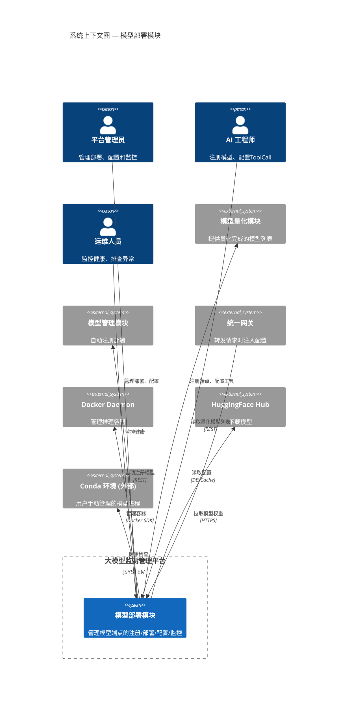
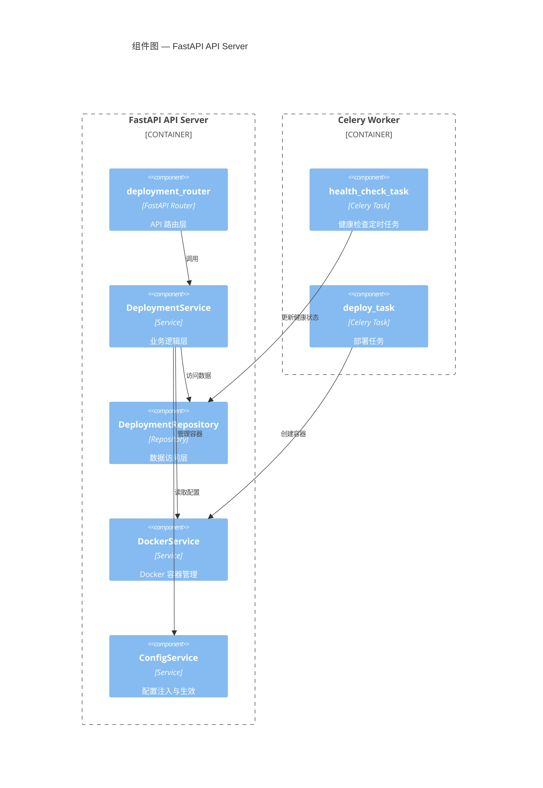

# 架构设计文档 — 模型部署模块

| 项目 | 内容 |
|------|------|
| 项目名称 | 大模型监测管理平台 |
| 模块名称 | 模型部署模块 |
| 文档版本 | v1.0 |
| C4层级 | Context / Container / Component |

---

## Level 1 — 系统上下文 (System Context)



---

## Level 2 — 容器图 (Container)

```mermaid
C4Container
    title 容器图 — 模型部署模块

    Person(admin, "平台管理员", "管理部署")

    System_Boundary(be, "后端") {
        Container(api, "FastAPI API Server", "Python", "REST API 接口")
        Container(celery, "Celery Worker", "Python", "异步部署任务 + 健康检查")
        Container(db, "PostgreSQL", "SQL", "部署配置、健康日志")
        Container(cache, "Redis / RabbitMQ", "", "消息队列 + 缓存")
    }

    System_Boundary(fe, "前端") {
        Container(vue, "Vue 3 管理界面", "Ant Design Vue", "部署管理页面")
    }

    System_Boundary(runtime, "推理运行时") {
        Container(vllm, "vLLM Container", "Docker", "平台管理的推理容器")
        Container(conda_service, "Conda 模型进程", "外部", "用户手动管理的推理")
        Container(docker_service, "Docker 模型容器", "外部", "用户手动管理的容器")
    }

    System_Ext(mm, "模型管理模块", "已有")
    System_Ext(gw, "统一网关", "已有")

    Rel(admin, vue, "操作部署")
    Rel(vue, api, "HTTP", "REST API")
    Rel(api, db, "读写", "SQLAlchemy")
    Rel(api, celery, "提交任务", "RabbitMQ")
    Rel(celery, docker, "Docker SDK", "容器管理")
    Rel(celery, vllm, "健康检查", "HTTP")
    Rel(celery, conda_service, "健康检查", "HTTP")
    Rel(celery, docker_service, "健康检查", "HTTP")
    Rel(api, mm, "自动注册", "REST")
    Rel(gw, db, "读取配置", "共享DB")
```

---

## Level 3 — 组件图 (Component) — API Server



---

## 关键架构决策 (ADR)

### ADR-001: 推理引擎先只支持 vLLM
| 项目 | 内容 |
|------|------|
| **状态** | 已决定 |
| **背景** | 需要选择一个推理引擎作为平台管理的默认引擎 |
| **方案** | vLLM 优先，TGI/SGLang 列为二期 |
| **理由** | vLLM 对 GPTQ/AWQ 支持最成熟，社区活跃，PagedAttention 性能好 |
| **后果** | 一期只支持 vLLM，TGI/SGLang 用户可自行注册已有端点规避 |

### ADR-002: 健康检查使用 Celery Beat 定时任务
| 项目 | 内容 |
|------|------|
| **状态** | 已决定 |
| **背景** | 需要对所有已注册端点进行周期性健康检测 |
| **方案** | 使用 Celery Beat 每 30 秒调度健康检查任务 |
| **理由** | 与现有架构一致（已有 Celery Beat），分布式可扩展 |
| **后果** | 健康检查有 ~秒级调度延迟，对 30 秒间隔可接受 |

### ADR-003: conda/Docker 类型部署平台不管理生命周期
| 项目 | 内容 |
|------|------|
| **状态** | 已决定 |
| **背景** | 用户已有大量 conda 环境和手动管理的 Docker 服务 |
| **方案** | 仅提供注册+监控+配置，启停由用户自行管理 |
| **后果** | UI 上启停按钮灰化展示，避免用户误认为平台可操作 |

### ADR-004: 新建部署使用独立 Docker 容器而非进程
| 项目 | 内容 |
|------|------|
| **状态** | 已决定 |
| **背景** | 需要自动化管理推理服务的生命周期 |
| **方案** | 每个部署一个独立的 vLLM Docker 容器，使用 docker-py 管理 |
| **理由** | 隔离性好，单容器故障不影响其他；资源分配明确 |
| **后果** | 每个 7B 模型占用 ~14GB 显存，8×L20 可部署约 20 个 |