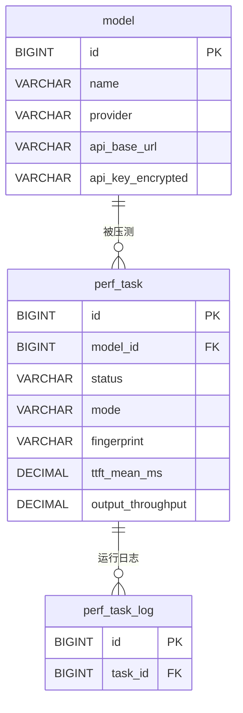

# 数据库设计文档 — 模型压测模块

## 1. 压测任务表 `perf_task`

核心表。存任务参数、执行状态、结果摘要、全量结果。

| 字段 | 类型 | 约束 | 说明 |
|------|------|------|------|
| `id` | BIGINT | PK AUTO_INCREMENT | 主键 |
| `name` | VARCHAR(128) | NOT NULL | 任务名称 |
| `model_id` | BIGINT | NOT NULL FK→model.id | 目标模型 |
| `status` | VARCHAR(16) | NOT NULL DEFAULT 'pending' | pending/running/completed/failed/cancelled |
| `mode` | VARCHAR(16) | NOT NULL | closed_loop/open_loop/sla/multi_turn |
| **压力参数** | | | |
| `parallel` | INT | NULL | 并发数（闭环/多轮） |
| `number` | INT | NULL | 总请求数 |
| `rate` | DECIMAL(8,2) | NULL | 目标 RPS（开环） |
| `max_concurrency` | INT | NULL | 并发上限（开环） |
| `duration_limit` | INT | NULL DEFAULT 600 | 时长上限（秒） |
| **SLA 参数** | | | |
| `sla_metric` | VARCHAR(16) | NULL | ttft/tpot/latency |
| `sla_threshold_ms` | INT | NULL | SLA 阈值 |
| `sla_lower_bound` | INT | NULL | 搜索下界（并发） |
| `sla_upper_bound` | INT | NULL | 搜索上界（并发） |
| **多轮参数** | | | |
| `turns` | INT | NULL | 对话轮数 |
| **输入构造** | | | |
| `dataset_type` | VARCHAR(32) | NOT NULL DEFAULT 'random' | random/openqa/speed_benchmark/share_gpt/line_by_line/longalpaca/custom |
| `input_length` | INT | NULL | 输入 token 数（random 用） |
| `output_length` | INT | NULL | 输出 token 数 |
| `dataset_file` | VARCHAR(512) | NULL | 自定义数据集路径 |
| **高级参数** | | | |
| `stream` | BOOLEAN | DEFAULT TRUE | 是否流式（决定能否测 TTFT） |
| `temperature` | DECIMAL(3,2) | DEFAULT 0.00 | 采样温度 |
| `request_timeout` | INT | DEFAULT 60 | 单请求超时（秒） |
| `tokenizer_path` | VARCHAR(256) | NULL | 留空按模型推断 |
| **打法** | | | |
| `target_url` | VARCHAR(512) | NOT NULL | 实际压测地址 |
| `via_gateway` | BOOLEAN | DEFAULT FALSE | 是否经平台网关（决定是否注入 X-Perf-Test） |
| `params_json` | JSONB | NULL | **完整参数快照**（重跑/对比用） |
| `fingerprint` | VARCHAR(64) | NULL | **参数指纹**（判定可比性） |
| **进度** | | | |
| `progress_sent` | INT | DEFAULT 0 | 已发送请求数 |
| `progress_total` | INT | DEFAULT 0 | 总请求数 |
| `current_rps` | DECIMAL(8,2) | NULL | 当前实际 RPS |
| **结果摘要** | | | |
| `ttft_mean_ms` | DECIMAL(10,2) | NULL | TTFT 均值 |
| `ttft_p99_ms` | DECIMAL(10,2) | NULL | TTFT P99 |
| `tpot_mean_ms` | DECIMAL(10,2) | NULL | TPOT 均值 |
| `output_throughput` | DECIMAL(12,2) | NULL | 输出吞吐 tok/s |
| `request_throughput` | DECIMAL(10,2) | NULL | 请求吞吐 req/s |
| `success_rate` | DECIMAL(5,2) | NULL | 成功率 % |
| `success_count` | INT | NULL | 成功请求数 |
| `result_json` | JSONB | NULL | **全量结果**（所有分位 + 错误分类） |
| **时间与错误** | | | |
| `error_message` | TEXT | NULL | 失败原因（截断 4000 字） |
| `started_at` | TIMESTAMP | NULL | 开始执行时间 |
| `finished_at` | TIMESTAMP | NULL | 结束时间 |
| `duration_seconds` | INT | NULL | 总耗时 |
| `created_by` | VARCHAR(64) | NOT NULL | 创建人 |
| `created_at` | TIMESTAMP | NOT NULL DEFAULT NOW() | |
| `updated_at` | TIMESTAMP | NOT NULL DEFAULT NOW() | |
| `deleted_at` | TIMESTAMP | NULL | 逻辑删除 |

### 索引
| 索引名 | 字段 | 类型 | 用途 |
|--------|------|------|------|
| `idx_perf_task_status_time` | (status, created_at DESC) | BTREE | 按状态筛选 + 时间排序（列表主查询） |
| `idx_perf_task_model` | (model_id, created_at DESC) | BTREE | 按模型筛选、查某模型历史 |
| `idx_perf_task_fingerprint` | (fingerprint) | BTREE | 同参数对比过滤 |
| `idx_perf_task_created_by` | (created_by) | BTREE | 按创建人筛选 |

---

## 2. 压测日志表 `perf_task_log`

| 字段 | 类型 | 约束 | 说明 |
|------|------|------|------|
| `id` | BIGSERIAL | PK | 主键 |
| `task_id` | BIGINT | NOT NULL FK→perf_task.id ON DELETE CASCADE | 关联任务 |
| `level` | VARCHAR(8) | NOT NULL DEFAULT 'info' | info/warn/error/ok |
| `message` | TEXT | NOT NULL | 日志内容 |
| `created_at` | TIMESTAMP | NOT NULL DEFAULT NOW() | 日志时间 |

### 索引
| 索引名 | 字段 | 用途 |
|--------|------|------|
| `idx_perf_log_task_time` | (task_id, created_at DESC) | 按任务查日志 |

**清理策略**：任务删除时级联删除；单任务日志上限 2000 行（超出丢弃最旧）。

---

## 3. 参数指纹算法

```python
def compute_fingerprint(task) -> str:
    """参数指纹：用于判定两个压测任务是否"严格可比"。

    只纳入影响负载本身的参数；不影响负载的（如任务名、备注）不纳入。
    """
    parts = [
        str(task.model_id),
        task.mode,
        str(task.parallel or ''),
        str(task.rate or ''),
        str(task.number or ''),
        task.dataset_type,
        str(task.input_length or ''),
        str(task.output_length or ''),
        '1' if task.stream else '0',
    ]
    raw = '|'.join(parts)
    return hashlib.sha256(raw.encode()).hexdigest()[:32]
```

**规则**：
- 指纹相同 → 「严格可比」，对比页正常展示
- 指纹不同 → 仍允许对比，但表头标红提示差异项，并列出具体哪几个参数不同

---

## 4. 枚举值定义

### status（任务状态）
| 值 | 标签 | 说明 |
|----|------|------|
| `pending` | 排队中 | 已入库，未被 worker 取走 |
| `running` | 运行中 | worker 执行中 |
| `completed` | 已完成 | 正常结束，指标已入库 |
| `failed` | 失败 | 执行异常 / 硬超时 |
| `cancelled` | 已中止 | 用户主动中止 |

### mode（压测模式）
| 值 | 对应 EvalScope |
|----|---------------|
| `closed_loop` | `parallel` + `number` |
| `open_loop` | `open_loop=true` + `rate` |
| `sla` | `sla_auto_tune=true` |
| `multi_turn` | `multi_turn=true` |

### level（日志级别）
`info` / `warn` / `error` / `ok`

---

## 5. 数据保留策略

| 数据 | 保留 | 说明 |
|------|------|------|
| `perf_task` | 永久 | 性能基线，量小（22MB/年） |
| `perf_task_log` | 随任务 | 级联删除；单任务上限 2000 行 |
| EvalScope `outputs/` 临时目录 | 任务结束后可清理 | 若需保留 HTML 报告则挂卷 |

---

## 6. 与既有表的关系



**注意**：`perf_task.model_id` 是**硬外键**（模型删除会受约束）。考虑到压测历史有留存价值，建议 `ON DELETE RESTRICT`，即删除模型前需先清理其压测记录，或改为 `ON DELETE SET NULL` 并把模型名冗余存一份。**推荐后者**（见待确认问题）。
