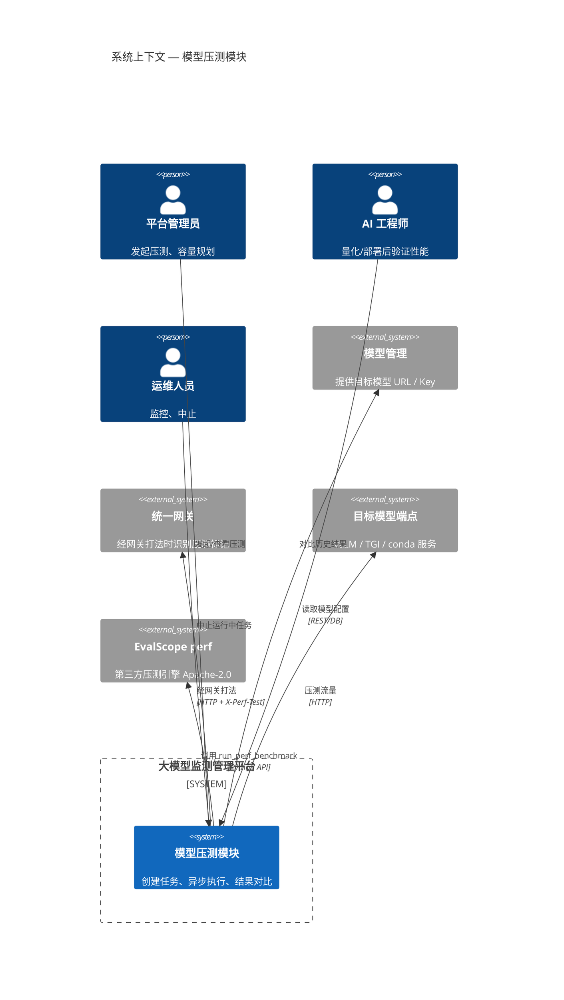
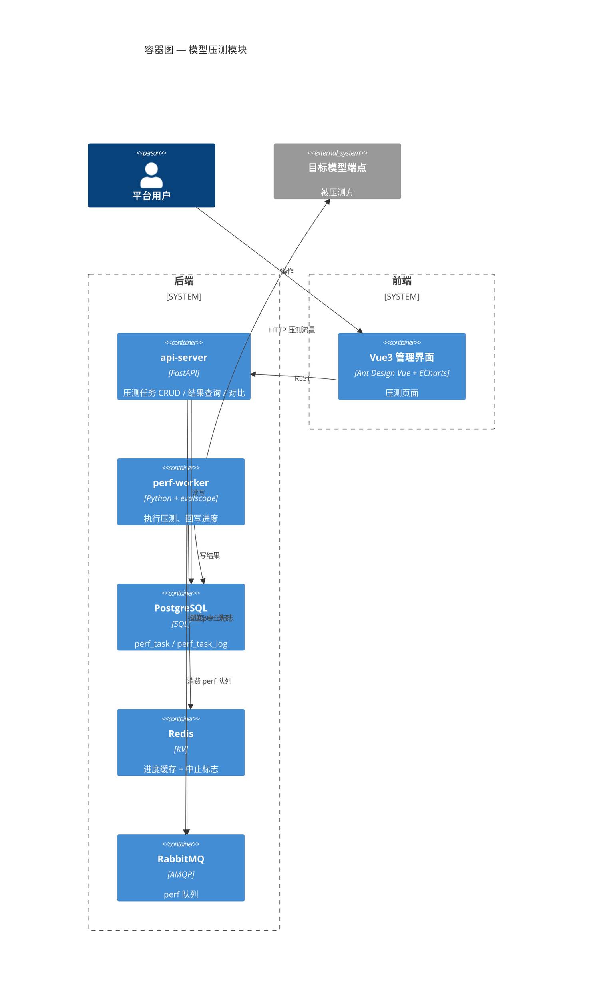
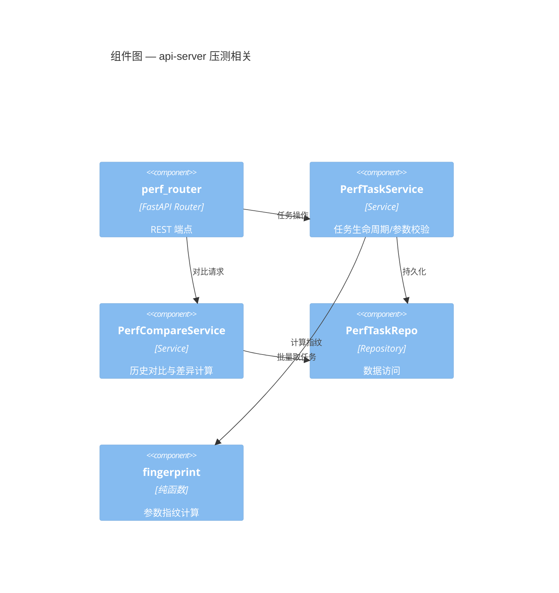

# 架构设计文档 — 模型压测模块

| 项目 | 内容 |
|------|------|
| 项目名称 | 大模型监测管理平台 |
| 模块 | 模型压测模块 |
| 版本 | v1.0 |
| C4 层级 | Context / Container / Component |

---

## Level 1 — 系统上下文



---

## Level 2 — 容器图



**关键点**：`api-server` 与 `perf-worker` 完全解耦 —— 前者只投递任务，后者只执行。`perf-worker` 崩溃不影响 API 与其他业务。

---

## Level 3 — 组件图（perf-worker 内部）

```mermaid
C4Component
    title 组件图 — perf-worker

    Component(entry, "perf_runner.py", "Celery Task", "任务入口 run_perf_task")
    Component(adapter, "EvalScopeAdapter", "Adapter", "平台参数 → Arguments 翻译")
    Component(progress, "ProgressReporter", "Component", "进度回写 Redis/DB")
    Component(abort, "AbortWatcher", "Component", "轮询中止标志")
    Component(parser, "ResultParser", "Component", "EvalScope 结果 → 平台指标模型")
    Component(es, "evalscope.perf", "第三方库", "run_perf_benchmark()")

    Rel(entry, adapter, "构造参数")
    Rel(entry, progress, "启动回写")
    Rel(entry, abort, "启动监听")
    Rel(adapter, es, "传入 Arguments")
    es --> parser: 返回 results
    parser --> entry: 指标
    entry --> progress: 结束状态
```

### API 侧组件



---

## 关键架构决策 (ADR)

### ADR-001: 采用 EvalScope perf 而非自研压测引擎
| 项 | 内容 |
|----|------|
| **状态** | 已决定 |
| **背景** | 需要 LLM 专用压测（TTFT/TPOT/token 吞吐），通用压测工具不覆盖 |
| **方案** | 直接依赖 EvalScope perf |
| **理由** | Apache-2.0 合规；四种压测模式开箱即用；有程序化入口 `run_perf_benchmark()` |
| **后果** | 需锁定版本；上游变更需跟随；依赖体积较大（必须独立镜像） |

### ADR-002: perf-worker 独立容器，与平台同机、与被压测模型分机
| 项 | 内容 |
|----|------|
| **状态** | 已决定（Q-001 确认） |
| **背景** | 压测会产生 500 并发跨机出站流量 |
| **方案** | 新增 `perf-worker` 容器部署在**平台机器**（与 api-server 同机），`-Q perf --concurrency=2`；被压测的大模型在**GPU 服务器**上，两者分属不同机器 |
| **理由** | ① 隔离 evalscope 大依赖 ② 崩溃不影响主链路 ③ **压测流量是跨机单向出站，不存在"自己压自己"** |
| **后果** | 平台机器网卡仍需承载压测出站流量（500 并发约 0.5-2 MB/s），网卡过小需关注；部署运维比独立机器简单 |
| **明确不做** | 跨机器分布式压测（Q-002）。一期单机，并发上限 500 |

### ADR-003: 默认直连模型而非经网关
| 项 | 内容 |
|----|------|
| **状态** | 已决定 |
| **背景** | 压测目标可能是模型性能，也可能是端到端性能 |
| **方案** | 默认直连 `model.api_base_url`；可选经网关 |
| **理由** | ① 测的是模型/引擎本身能力 ② **天然不污染 Token 统计，无需依赖网关改造** |
| **后果** | 想测网关开销需用户显式切换打法 |

### ADR-004: 压测流量完全不记录日志（而非打标记）
| 项 | 内容 |
|----|------|
| **状态** | 已决定 |
| **背景** | 需要排除压测流量的统计污染，有两种实现 |
| **方案** | 网关识别 `X-Perf-Test: 1` 后**完全不写 `api_request_log`** |
| **理由** | ① 不需要改表结构 ② 彻底满足"不污染" ③ 审计需求由 `perf_task` 表满足 |
| **后果** | 无法从日志侧追溯压测请求（但任务表有完整记录）；`X-Perf-Test` 不可关闭以防误关 |

### ADR-005: 结果摘要与全量结果分列存储
| 项 | 内容 |
|----|------|
| **状态** | 已决定 |
| **背景** | 列表页需要 TTFT/吞吐，详情页需要全部百分位 |
| **方案** | `perf_task` 存**摘要列**（ttft_mean/ttft_p99/throughput/success_rate）+ `result_json` 存全量 |
| **理由** | 列表查询不用解析 JSONB，索引友好；详情按需读 JSONB |
| **后果** | 轻微冗余，但换来列表性能 |

### ADR-006: model_id 用 ON DELETE SET NULL + 冗余模型名
| 项 | 内容 |
|----|------|
| **状态** | 已决定 |
| **背景** | 压测历史是性能基线，不应因删除模型而丢失 |
| **方案** | `model_id` 外键 `ON DELETE SET NULL`，同时冗余 `model_name_snapshot` |
| **理由** | 历史可读、不受模型删除影响 |
| **后果** | 创建任务时需写入名字快照 |

### ADR-007: 硬限制仅自建部署模型可压测（Q-005）
| 项 | 内容 |
|----|------|
| **状态** | 已决定（Q-005 确认） |
| **背景** | 压测第三方付费 API 会产生真实费用，且可能触发对方风控 |
| **方案** | API 层强制校验 `model.provider.startswith("local-")`，否则 400 拒绝；前端下拉直接过滤 |
| **理由** | 防止误操作烧钱；平台部署出来的模型 provider 本就是 `local-{engine}`，天然兼容 |
| **后果** | 手工注册的 conda/Docker 端点若要压测，provider 需设为 `local-*`；**不提供任何绕过开关** |

### ADR-008: EvalScope HTML 报告保留并提供下载（Q-003）
| 项 | 内容 |
|----|------|
| **状态** | 已决定（Q-003 确认） |
| **背景** | EvalScope 原生 HTML 报告图表丰富，用户有下载归档需求 |
| **方案** | `outputs/` 挂 Docker 卷持久化；新增 `GET /perf/tasks/{id}/report` 下载端点 |
| **理由** | 复用上游能力，省去自绘全部图表 |
| **后果** | 需管理 `outputs/` 磁盘占用；任务删除时一并清理目录 |

### ADR-009: 压测指标不回写模型管理（Q-004）
| 项 | 内容 |
|----|------|
| **状态** | 已决定（Q-004 确认） |
| **方案** | 压测结果只存 `perf_task` + `result_json`，不写 `model.model_config` |
| **理由** | 避免污染模型配置、避免模型表频繁更新；基线查询走压测模块 |
| **后果** | 若未来要看"某模型最新基线"，需在压测模块内按 model_id 查最新 completed 任务 |
