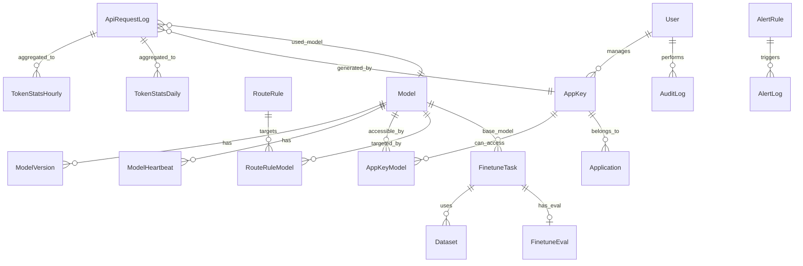

# 数据库设计文档 — 大模型监测管理平台

| 文档版本 | 日期 | 说明 | 作者 |
|----------|------|------|------|
| v1.0 | 2025-01-01 | 初始版本 | AI |

---

## 1. 概述

### 1.1 设计目标
设计大模型监测管理平台的数据库模型，支持模型管理、Key 管理、Token 统计、统一网关、模型微调、系统管理等核心业务模块。

### 1.2 数据库选型

| 项目 | 选型 |
|------|------|
| 数据库类型 | PostgreSQL 16 |
| 异步驱动 | asyncpg |
| 字符集 | UTF8 |
| 时区 | UTC+8（北京时间） |

### 1.3 设计规范

| 规范项 | 要求 |
|--------|------|
| 表名 | 小写下划线，模块前缀（如 `model_`、`key_`、`token_`） |
| 字段名 | 小写下划线 |
| 主键 | `id` BIGSERIAL / BIGINT |
| 审计字段 | `created_by`, `created_at`, `updated_by`, `updated_at` |
| 逻辑删除 | `deleted_at` TIMESTAMP（NULL 表示未删除） |
| 时间字段 | 统一使用 `TIMESTAMPTZ`（带时区） |
| 金额字段 | `DECIMAL(18,6)` 或 `BIGINT`（以最小单位存储） |

---

## 2. 实体关系图



---

## 3. 表结构设计

### 3.1 模型管理模块

#### 3.1.1 模型表（model）

| 字段名 | 数据类型 | 可空 | 默认值 | 说明 |
|--------|----------|------|--------|------|
| id | BIGSERIAL | NO | — | 主键 |
| name | VARCHAR(100) | NO | — | 模型名称（如 DeepSeek-V3） |
| provider | VARCHAR(50) | NO | — | 提供商（deepseek/openai/aliyun/baidu） |
| version | VARCHAR(50) | NO | '1.0.0' | 当前版本 |
| api_base_url | VARCHAR(500) | NO | — | API 基础地址 |
| api_key_encrypted | VARCHAR(500) | NO | — | 加密存储的 API Key |
| qps_limit | INT | NO | 100 | QPS 上限 |
| timeout_ms | INT | NO | 60000 | 超时时间（毫秒） |
| weight | INT | NO | 1 | 路由权重 |
| status | VARCHAR(20) | NO | 'pending' | 状态：online/offline/high_latency/pending |
| health_check_url | VARCHAR(500) | YES | NULL | 健康检查 URL |
| model_config | JSONB | YES | NULL | 模型特定配置（如温度、最大Token等） |
| description | TEXT | YES | NULL | 模型描述 |
| created_by | VARCHAR(64) | NO | — | 创建人 |
| created_at | TIMESTAMPTZ | NO | NOW() | 创建时间 |
| updated_by | VARCHAR(64) | NO | — | 更新人 |
| updated_at | TIMESTAMPTZ | NO | NOW() | 更新时间 |
| deleted_at | TIMESTAMPTZ | YES | NULL | 删除时间（NULL=未删除） |

**索引**：
| 索引名 | 字段 | 类型 | 说明 |
|--------|------|------|------|
| pk_model | id | PRIMARY KEY | 主键 |
| idx_model_provider | provider | BTREE | 按提供商查询 |
| idx_model_status | status | BTREE | 按状态查询 |
| idx_model_deleted_at | deleted_at | BTREE | 逻辑删除查询 |

---

#### 3.1.2 模型版本表（model_version）

| 字段名 | 数据类型 | 可空 | 默认值 | 说明 |
|--------|----------|------|--------|------|
| id | BIGSERIAL | NO | — | 主键 |
| model_id | BIGINT | NO | — | 关联模型 ID |
| version | VARCHAR(50) | NO | — | 版本号 |
| is_current | BOOLEAN | NO | false | 是否当前版本 |
| change_log | TEXT | YES | NULL | 变更说明 |
| created_by | VARCHAR(64) | NO | — | 创建人 |
| created_at | TIMESTAMPTZ | NO | NOW() | 创建时间 |
| deleted_at | TIMESTAMPTZ | YES | NULL | 删除时间 |

**索引**：
| 索引名 | 字段 | 类型 | 说明 |
|--------|------|------|------|
| pk_model_version | id | PRIMARY KEY | 主键 |
| idx_mv_model_id | model_id | BTREE | 按模型查询 |
| uk_mv_model_version | model_id, version | UNIQUE | 模型版本唯一 |

---

#### 3.1.3 模型心跳表（model_heartbeat）

| 字段名 | 数据类型 | 可空 | 默认值 | 说明 |
|--------|----------|------|--------|------|
| id | BIGSERIAL | NO | — | 主键 |
| model_id | BIGINT | NO | — | 模型 ID |
| status | VARCHAR(20) | NO | — | 状态：online/offline/high_latency |
| response_time_ms | INT | YES | NULL | 响应时间（毫秒） |
| error_message | TEXT | YES | NULL | 错误信息 |
| checked_at | TIMESTAMPTZ | NO | NOW() | 检查时间 |

**索引**：
| 索引名 | 字段 | 类型 | 说明 |
|--------|------|------|------|
| pk_model_heartbeat | id | PRIMARY KEY | 主键 |
| idx_mh_model_id | model_id | BTREE | 按模型查询 |
| idx_mh_checked_at | checked_at | BTREE | 按时间查询 |

---

### 3.2 Key 管理模块

#### 3.2.1 应用表（application）

| 字段名 | 数据类型 | 可空 | 默认值 | 说明 |
|--------|----------|------|--------|------|
| id | BIGSERIAL | NO | — | 主键 |
| name | VARCHAR(100) | NO | — | 应用名称 |
| description | TEXT | YES | NULL | 应用描述 |
| created_by | VARCHAR(64) | NO | — | 创建人 |
| created_at | TIMESTAMPTZ | NO | NOW() | 创建时间 |
| updated_by | VARCHAR(64) | NO | — | 更新人 |
| updated_at | TIMESTAMPTZ | NO | NOW() | 更新时间 |
| deleted_at | TIMESTAMPTZ | YES | NULL | 删除时间 |

---

#### 3.2.2 API Key 表（app_key）

| 字段名 | 数据类型 | 可空 | 默认值 | 说明 |
|--------|----------|------|--------|------|
| id | BIGSERIAL | NO | — | 主键 |
| name | VARCHAR(100) | NO | — | Key 名称 |
| key_hash | VARCHAR(255) | NO | — | Key 哈希值（SHA-256） |
| key_prefix | VARCHAR(10) | NO | — | Key 前缀（用于显示，如 sk-8a3f） |
| application_id | BIGINT | YES | NULL | 关联应用 ID |
| created_by | VARCHAR(64) | NO | — | 创建人（SSO 用户 ID） |
| qps_limit | INT | YES | NULL | QPS 限制（NULL=使用全局默认） |
| rpm_limit | INT | YES | NULL | 每分钟限制 |
| rpd_limit | INT | YES | NULL | 每日限制 |
| token_quota | BIGINT | YES | NULL | Token 总量上限 |
| token_used | BIGINT | NO | 0 | 已用 Token |
| expires_at | TIMESTAMPTZ | YES | NULL | 过期时间 |
| status | VARCHAR(20) | NO | 'active' | 状态：active/disabled/expired/revoked |
| last_used_at | TIMESTAMPTZ | YES | NULL | 最后使用时间 |
| created_at | TIMESTAMPTZ | NO | NOW() | 创建时间 |
| updated_at | TIMESTAMPTZ | NO | NOW() | 更新时间 |
| deleted_at | TIMESTAMPTZ | YES | NULL | 删除时间 |

**索引**：
| 索引名 | 字段 | 类型 | 说明 |
|--------|------|------|------|
| pk_app_key | id | PRIMARY KEY | 主键 |
| uk_app_key_hash | key_hash | UNIQUE | Key 哈希唯一 |
| idx_app_key_status | status | BTREE | 按状态查询 |
| idx_app_key_application_id | application_id | BTREE | 按应用查询 |
| idx_app_key_expires_at | expires_at | BTREE | 过期查询 |

---

#### 3.2.3 Key-模型关联表（app_key_model）

| 字段名 | 数据类型 | 可空 | 默认值 | 说明 |
|--------|----------|------|--------|------|
| id | BIGSERIAL | NO | — | 主键 |
| app_key_id | BIGINT | NO | — | Key ID |
| model_id | BIGINT | NO | — | 模型 ID |
| created_at | TIMESTAMPTZ | NO | NOW() | 创建时间 |

**索引**：
| 索引名 | 字段 | 类型 | 说明 |
|--------|------|------|------|
| pk_app_key_model | id | PRIMARY KEY | 主键 |
| uk_akm_key_model | app_key_id, model_id | UNIQUE | Key-模型唯一 |
| idx_akm_model_id | model_id | BTREE | 按模型查询 |

---

### 3.3 网关模块

#### 3.3.1 路由规则表（route_rule）

| 字段名 | 数据类型 | 可空 | 默认值 | 说明 |
|--------|----------|------|--------|------|
| id | BIGSERIAL | NO | — | 主键 |
| name | VARCHAR(100) | NO | — | 规则名称 |
| path_pattern | VARCHAR(200) | NO | — | 路径匹配模式 |
| match_type | VARCHAR(20) | NO | 'exact' | 匹配方式：exact/prefix/regex |
| strategy | VARCHAR(20) | NO | 'weighted' | 策略：weighted/active_standby/single |
| status | VARCHAR(20) | NO | 'disabled' | 状态：enabled/disabled |
| priority | INT | NO | 0 | 优先级（值越小越优先） |
| created_by | VARCHAR(64) | NO | — | 创建人 |
| created_at | TIMESTAMPTZ | NO | NOW() | 创建时间 |
| updated_by | VARCHAR(64) | NO | — | 更新人 |
| updated_at | TIMESTAMPTZ | NO | NOW() | 更新时间 |
| deleted_at | TIMESTAMPTZ | YES | NULL | 删除时间 |

---

#### 3.3.2 路由-模型关联表（route_rule_model）

| 字段名 | 数据类型 | 可空 | 默认值 | 说明 |
|--------|----------|------|--------|------|
| id | BIGSERIAL | NO | — | 主键 |
| route_rule_id | BIGINT | NO | — | 路由规则 ID |
| model_id | BIGINT | NO | — | 模型 ID |
| priority | INT | NO | 0 | 优先级（主备模式，越小越优先） |
| weight | INT | NO | 1 | 权重（加权轮询用） |
| created_at | TIMESTAMPTZ | NO | NOW() | 创建时间 |

---

#### 3.3.3 API 请求日志表（api_request_log）

| 字段名 | 数据类型 | 可空 | 默认值 | 说明 |
|--------|----------|------|--------|------|
| id | BIGSERIAL | NO | — | 主键 |
| request_id | VARCHAR(64) | NO | — | 请求唯一 ID（UUID） |
| app_key_id | BIGINT | YES | NULL | 使用的 Key ID |
| model_id | BIGINT | YES | NULL | 目标模型 ID |
| route_rule_id | BIGINT | YES | NULL | 匹配的路由规则 ID |
| request_path | VARCHAR(200) | NO | — | 请求路径 |
| request_method | VARCHAR(10) | NO | 'POST' | 请求方法 |
| prompt_tokens | INT | NO | 0 | 输入 Token 数 |
| completion_tokens | INT | NO | 0 | 输出 Token 数 |
| total_tokens | INT | NO | 0 | 总 Token 数 |
| response_time_ms | INT | NO | 0 | 响应时间（毫秒） |
| status_code | INT | NO | 200 | HTTP 状态码 |
| client_ip | VARCHAR(50) | YES | NULL | 客户端 IP |
| created_at | TIMESTAMPTZ | NO | NOW() | 请求时间（分区键） |

> **注意**：此表按 `created_at` 月分区，是系统中数据量最大的表。

**分区设计**：
```sql
-- 按月分区
CREATE TABLE api_request_log (
    id BIGSERIAL,
    request_id VARCHAR(64) NOT NULL,
    -- ... 其他字段
    created_at TIMESTAMPTZ NOT NULL DEFAULT NOW()
) PARTITION BY RANGE (created_at);

-- 每月创建新分区
CREATE TABLE api_request_log_2025_01 PARTITION OF api_request_log
    FOR VALUES FROM ('2025-01-01') TO ('2025-02-01');
```

---

### 3.4 Token 统计模块

#### 3.4.1 Token 统计小时表（token_stats_hourly）

| 字段名 | 数据类型 | 可空 | 默认值 | 说明 |
|--------|----------|------|--------|------|
| id | BIGSERIAL | NO | — | 主键 |
| stats_date | DATE | NO | — | 统计日期 |
| stats_hour | SMALLINT | NO | — | 统计小时（0-23） |
| dimension_type | VARCHAR(20) | NO | — | 维度类型：model/application/user/key |
| dimension_id | BIGINT | NO | — | 维度 ID |
| request_count | INT | NO | 0 | 请求次数 |
| prompt_tokens | BIGINT | NO | 0 | 输入 Token 总量 |
| completion_tokens | BIGINT | NO | 0 | 输出 Token 总量 |
| total_tokens | BIGINT | NO | 0 | 总 Token 量 |
| total_cost | DECIMAL(18,6) | NO | 0 | 费用估算 |
| avg_response_ms | INT | NO | 0 | 平均响应时间 |
| created_at | TIMESTAMPTZ | NO | NOW() | 创建时间 |

**索引**：
| 索引名 | 字段 | 类型 | 说明 |
|--------|------|------|------|
| pk_ts_hourly | id | PRIMARY KEY | 主键 |
| idx_tsh_dim | dimension_type, dimension_id, stats_date | BTREE | 维度查询 |
| idx_tsh_date | stats_date | BTREE | 按日期查询 |

---

#### 3.4.2 Token 统计天表（token_stats_daily）

结构与 `token_stats_hourly` 类似，不含 `stats_hour` 字段，按天聚合。

---

### 3.5 微调模块

#### 3.5.1 微调任务表（finetune_task）

| 字段名 | 数据类型 | 可空 | 默认值 | 说明 |
|--------|----------|------|--------|------|
| id | BIGSERIAL | NO | — | 主键 |
| name | VARCHAR(200) | NO | — | 任务名称 |
| base_model_id | BIGINT | NO | — | 基座模型 ID |
| dataset_id | BIGINT | NO | — | 训练数据集 ID |
| val_dataset_id | BIGINT | YES | NULL | 验证数据集 ID |
| hyper_params | JSONB | NO | '{}' | 超参数配置（详见 5.8 超参数结构定义） |
| status | VARCHAR(20) | NO | 'pending' | 状态：pending/queued/running/paused/completed/failed/cancelled/deployed |
| progress | SMALLINT | NO | 0 | 进度百分比（0-100） |
| loss_value | DECIMAL(10,6) | YES | NULL | 当前损失值 |
| output_model_version_id | BIGINT | YES | NULL | 产出模型版本 ID |
| error_message | TEXT | YES | NULL | 错误信息 |
| started_at | TIMESTAMPTZ | YES | NULL | 开始时间 |
| finished_at | TIMESTAMPTZ | YES | NULL | 完成时间 |
| created_by | VARCHAR(64) | NO | — | 创建人 |
| created_at | TIMESTAMPTZ | NO | NOW() | 创建时间 |
| updated_at | TIMESTAMPTZ | NO | NOW() | 更新时间 |
| deleted_at | TIMESTAMPTZ | YES | NULL | 删除时间 |

---

#### 3.5.2 数据集表（dataset）

| 字段名 | 数据类型 | 可空 | 默认值 | 说明 |
|--------|----------|------|--------|------|
| id | BIGSERIAL | NO | — | 主键 |
| name | VARCHAR(200) | NO | — | 数据集名称 |
| format | VARCHAR(20) | NO | — | 格式：jsonl/csv/json/parquet |
| sample_count | INT | NO | 0 | 样本数 |
| file_size | BIGINT | NO | 0 | 文件大小（字节） |
| file_path | VARCHAR(500) | NO | — | 文件存储路径 |
| file_hash | VARCHAR(64) | YES | NULL | 文件 SHA-256 哈希 |
| version | VARCHAR(20) | NO | '1.0.0' | 版本号 |
| annotation_status | VARCHAR(20) | NO | 'pending' | 标注状态：pending/labeling/labeled/reviewing/reviewed |
| description | TEXT | YES | NULL | 数据集描述 |
| created_by | VARCHAR(64) | NO | — | 创建人 |
| created_at | TIMESTAMPTZ | NO | NOW() | 创建时间 |
| updated_at | TIMESTAMPTZ | NO | NOW() | 更新时间 |
| deleted_at | TIMESTAMPTZ | YES | NULL | 删除时间 |

##### 数据集版本表（dataset_version）

| 字段名 | 数据类型 | 可空 | 默认值 | 说明 |
|--------|----------|------|--------|------|
| id | BIGSERIAL | NO | — | 主键 |
| dataset_id | BIGINT | NO | — | 关联数据集 ID |
| version | VARCHAR(20) | NO | — | 版本号（如 1.0.0, 1.1.0） |
| file_path | VARCHAR(500) | NO | — | 版本文件存储路径 |
| file_hash | VARCHAR(64) | YES | NULL | 文件 SHA-256 哈希 |
| sample_count | INT | NO | 0 | 样本数 |
| file_size | BIGINT | NO | 0 | 文件大小（字节） |
| change_log | TEXT | YES | NULL | 版本变更说明 |
| created_by | VARCHAR(64) | NO | — | 创建人 |
| created_at | TIMESTAMPTZ | NO | NOW() | 创建时间 |

**索引**：
| 索引名 | 字段 | 类型 | 说明 |
|--------|------|------|------|
| pk_dataset_version | id | PRIMARY KEY | 主键 |
| uk_dv_dataset_version | dataset_id, version | UNIQUE | 数据集版本唯一 |
| idx_dv_dataset_id | dataset_id | BTREE | 按数据集查询 |

---

#### 3.5.3 微调评估表（finetune_eval）

| 字段名 | 数据类型 | 可空 | 默认值 | 说明 |
|--------|----------|------|--------|------|
| id | BIGSERIAL | NO | — | 主键 |
| task_id | BIGINT | NO | — | 微调任务 ID |
| accuracy_before | DECIMAL(5,2) | YES | NULL | 微调前准确率 |
| accuracy_after | DECIMAL(5,2) | YES | NULL | 微调后准确率 |
| bleu_before | DECIMAL(5,4) | YES | NULL | 微调前 BLEU 分数 |
| bleu_after | DECIMAL(5,4) | YES | NULL | 微调后 BLEU 分数 |
| rouge_l_before | DECIMAL(5,4) | YES | NULL | 微调前 ROUGE-L 分数 |
| rouge_l_after | DECIMAL(5,4) | YES | NULL | 微调后 ROUGE-L 分数 |
| latency_before_ms | INT | YES | NULL | 微调前推理延迟 |
| latency_after_ms | INT | YES | NULL | 微调后推理延迟 |
| eval_report | JSONB | YES | NULL | 完整评估报告（JSON） |
| created_at | TIMESTAMPTZ | NO | NOW() | 创建时间 |

---

### 3.6 系统管理模块

#### 3.6.1 系统配置表（system_config）

| 字段名 | 数据类型 | 可空 | 默认值 | 说明 |
|--------|----------|------|--------|------|
| id | BIGSERIAL | NO | — | 主键 |
| config_key | VARCHAR(100) | NO | — | 配置键（如 `sso.protocol`、`sso.client_id`） |
| config_value | TEXT | NO | — | 配置值（加密存储敏感信息） |
| config_group | VARCHAR(50) | NO | 'sso' | 配置分组：sso/notification/general |
| description | VARCHAR(500) | YES | NULL | 配置说明 |
| encrypted | BOOLEAN | NO | false | 是否加密存储 |
| created_by | VARCHAR(64) | NO | — | 创建人 |
| created_at | TIMESTAMPTZ | NO | NOW() | 创建时间 |
| updated_by | VARCHAR(64) | NO | — | 更新人 |
| updated_at | TIMESTAMPTZ | NO | NOW() | 更新时间 |

**索引**：
| 索引名 | 字段 | 类型 | 说明 |
|--------|------|------|------|
| pk_system_config | id | PRIMARY KEY | 主键 |
| uk_config_key | config_key | UNIQUE | 配置键唯一 |
| idx_config_group | config_group | BTREE | 按分组查询 |

**示例配置项**：
| config_key | config_value | 说明 |
|-----------|-------------|------|
| sso.protocol | oauth2 | SSO 协议：oauth2/saml/ldap/cas |
| sso.authorize_url | https://sso.company.com/oauth2/authorize | 授权地址 |
| sso.token_url | https://sso.company.com/oauth2/token | Token 获取地址 |
| sso.client_id | *** | 客户端 ID |
| sso.client_secret | *** | 客户端密钥（加密存储） |
| sso.redirect_uri | https://ai-gateway.company.com/auth/callback | 回调地址 |
| sso.jwks_url | https://sso.company.com/.well-known/jwks.json | JWKS 公钥地址 |
| dingtalk.webhook_url | https://oapi.dingtalk.com/robot/send?access_token=*** | 钉钉 Webhook |
| dingtalk.secret | *** | 钉钉签名密钥 |

#### 3.6.1 预警规则表（alert_rule）

| 字段名 | 数据类型 | 可空 | 默认值 | 说明 |
|--------|----------|------|--------|------|
| id | BIGSERIAL | NO | — | 主键 |
| name | VARCHAR(100) | NO | — | 规则名称 |
| metric_type | VARCHAR(20) | NO | — | 指标类型：daily_token/monthly_token/daily_cost/monthly_cost |
| threshold_value | BIGINT | NO | — | 阈值 |
| threshold_mode | VARCHAR(10) | NO | 'fixed' | 模式：fixed/percentage |
| warn_at_percent | SMALLINT | NO | 80 | 警告阈值百分比 |
| notify_channels | JSONB | NO | '["dingtalk"]' | 通知渠道 |
| enabled | BOOLEAN | NO | true | 是否启用 |
| created_by | VARCHAR(64) | NO | — | 创建人 |
| created_at | TIMESTAMPTZ | NO | NOW() | 创建时间 |
| updated_at | TIMESTAMPTZ | NO | NOW() | 更新时间 |
| deleted_at | TIMESTAMPTZ | YES | NULL | 删除时间 |

---

#### 3.6.2 告警日志表（alert_log）

| 字段名 | 数据类型 | 可空 | 默认值 | 说明 |
|--------|----------|------|--------|------|
| id | BIGSERIAL | NO | — | 主键 |
| rule_id | BIGINT | NO | — | 关联规则 ID |
| alert_level | VARCHAR(10) | NO | 'warn' | 级别：warn/critical |
| current_value | BIGINT | NO | — | 当前值 |
| threshold_value | BIGINT | NO | — | 阈值 |
| message | TEXT | NO | — | 告警消息 |
| notified | BOOLEAN | NO | false | 是否已通知 |
| notified_at | TIMESTAMPTZ | YES | NULL | 通知时间 |
| created_at | TIMESTAMPTZ | NO | NOW() | 创建时间 |

---

#### 3.6.3 操作日志表（audit_log）

| 字段名 | 数据类型 | 可空 | 默认值 | 说明 |
|--------|----------|------|--------|------|
| id | BIGSERIAL | NO | — | 主键 |
| user_id | VARCHAR(64) | NO | — | 操作用户 SSO ID |
| action_type | VARCHAR(50) | NO | — | 操作类型：key_create/model_update/route_config 等 |
| action_detail | TEXT | NO | — | 操作详情（JSON 格式） |
| target_type | VARCHAR(50) | YES | NULL | 操作对象类型 |
| target_id | BIGINT | YES | NULL | 操作对象 ID |
| client_ip | VARCHAR(50) | YES | NULL | 客户端 IP |
| result | VARCHAR(10) | NO | 'success' | 结果：success/failure |
| created_at | TIMESTAMPTZ | NO | NOW() | 操作时间 |

---

#### 3.6.4 模型对比评估表（model_eval）

| 字段名 | 数据类型 | 可空 | 默认值 | 说明 |
|--------|----------|------|--------|------|
| id | BIGSERIAL | NO | — | 主键 |
| name | VARCHAR(200) | NO | — | 评估名称 |
| model_ids | JSONB | NO | — | 参与对比的模型 ID 列表 |
| dimension_weights | JSONB | NO | '{"quality":30,"latency":15,"cost":15,"context":10,"stability":10,"throughput":10,"ease_of_use":10}' | 维度权重配置 |
| status | VARCHAR(20) | NO | 'pending' | 状态：pending/running/completed/failed |
| result | JSONB | YES | NULL | 评估结果（详见 5.9 评估结果结构定义） |
| recommendation | TEXT | YES | NULL | 推荐建议 |
| created_by | VARCHAR(64) | NO | — | 创建人 |
| created_at | TIMESTAMPTZ | NO | NOW() | 创建时间 |
| updated_at | TIMESTAMPTZ | NO | NOW() | 更新时间 |
| deleted_at | TIMESTAMPTZ | YES | NULL | 删除时间 |

---

#### 3.6.5 导出任务表（export_task）

| 字段名 | 数据类型 | 可空 | 默认值 | 说明 |
|--------|----------|------|--------|------|
| id | BIGSERIAL | NO | — | 主键 |
| task_type | VARCHAR(20) | NO | — | 任务类型：cost_report/token_report/audit_log/model_report |
| params | JSONB | NO | '{}' | 查询参数（日期范围、维度等） |
| status | VARCHAR(20) | NO | 'pending' | 状态：pending/processing/completed/failed |
| file_path | VARCHAR(500) | YES | NULL | 导出文件路径 |
| file_format | VARCHAR(10) | NO | 'csv' | 文件格式：csv/xlsx |
| file_size | BIGINT | YES | NULL | 文件大小（字节） |
| expires_at | TIMESTAMPTZ | YES | NULL | 文件过期时间（生成后 24 小时） |
| error_message | TEXT | YES | NULL | 错误信息 |
| created_by | VARCHAR(64) | NO | — | 创建人 |
| created_at | TIMESTAMPTZ | NO | NOW() | 创建时间 |
| updated_at | TIMESTAMPTZ | NO | NOW() | 更新时间 |

---

## 4. DDL 脚本

### 4.1 建库

```sql
-- 创建数据库
CREATE DATABASE ai_platform
    WITH ENCODING 'UTF8'
    LC_COLLATE = 'zh_CN.UTF-8'
    LC_CTYPE = 'zh_CN.UTF-8';

-- 创建扩展
CREATE EXTENSION IF NOT EXISTS "uuid-ossp";
CREATE EXTENSION IF NOT EXISTS "pgcrypto";
```

### 4.2 核心表建表脚本

```sql
-- 模型表
CREATE TABLE model (
    id BIGSERIAL PRIMARY KEY,
    name VARCHAR(100) NOT NULL,
    provider VARCHAR(50) NOT NULL,
    version VARCHAR(50) NOT NULL DEFAULT '1.0.0',
    api_base_url VARCHAR(500) NOT NULL,
    api_key_encrypted VARCHAR(500) NOT NULL,
    qps_limit INT NOT NULL DEFAULT 100,
    timeout_ms INT NOT NULL DEFAULT 60000,
    weight INT NOT NULL DEFAULT 1,
    status VARCHAR(20) NOT NULL DEFAULT 'pending',
    health_check_url VARCHAR(500),
    model_config JSONB,
    description TEXT,
    created_by VARCHAR(64) NOT NULL,
    created_at TIMESTAMPTZ NOT NULL DEFAULT NOW(),
    updated_by VARCHAR(64) NOT NULL,
    updated_at TIMESTAMPTZ NOT NULL DEFAULT NOW(),
    deleted_at TIMESTAMPTZ
);

CREATE INDEX idx_model_provider ON model(provider);
CREATE INDEX idx_model_status ON model(status);
CREATE INDEX idx_model_deleted_at ON model(deleted_at);

-- API Key 表
CREATE TABLE app_key (
    id BIGSERIAL PRIMARY KEY,
    name VARCHAR(100) NOT NULL,
    key_hash VARCHAR(255) NOT NULL UNIQUE,
    key_prefix VARCHAR(10) NOT NULL,
    application_id BIGINT REFERENCES application(id),
    created_by VARCHAR(64) NOT NULL,
    qps_limit INT,
    rpm_limit INT,
    rpd_limit INT,
    token_quota BIGINT,
    token_used BIGINT NOT NULL DEFAULT 0,
    expires_at TIMESTAMPTZ,
    status VARCHAR(20) NOT NULL DEFAULT 'active',
    last_used_at TIMESTAMPTZ,
    created_at TIMESTAMPTZ NOT NULL DEFAULT NOW(),
    updated_at TIMESTAMPTZ NOT NULL DEFAULT NOW(),
    deleted_at TIMESTAMPTZ
);

CREATE INDEX idx_app_key_status ON app_key(status);
CREATE INDEX idx_app_key_application_id ON app_key(application_id);
CREATE INDEX idx_app_key_expires_at ON app_key(expires_at);

-- 请求日志表（分区表）
CREATE TABLE api_request_log (
    id BIGSERIAL,
    request_id VARCHAR(64) NOT NULL,
    app_key_id BIGINT,
    model_id BIGINT,
    route_rule_id BIGINT,
    request_path VARCHAR(200) NOT NULL,
    request_method VARCHAR(10) NOT NULL DEFAULT 'POST',
    prompt_tokens INT NOT NULL DEFAULT 0,
    completion_tokens INT NOT NULL DEFAULT 0,
    total_tokens INT NOT NULL DEFAULT 0,
    response_time_ms INT NOT NULL DEFAULT 0,
    status_code INT NOT NULL DEFAULT 200,
    client_ip VARCHAR(50),
    created_at TIMESTAMPTZ NOT NULL DEFAULT NOW()
) PARTITION BY RANGE (created_at);

-- 创建初始分区
CREATE TABLE api_request_log_2025_01 PARTITION OF api_request_log
    FOR VALUES FROM ('2025-01-01') TO ('2025-02-01');
CREATE TABLE api_request_log_2025_02 PARTITION OF api_request_log
    FOR VALUES FROM ('2025-02-01') TO ('2025-03-01');
CREATE TABLE api_request_log_2025_03 PARTITION OF api_request_log
    FOR VALUES FROM ('2025-03-01') TO ('2025-04-01');
```

完整 DDL 脚本请参考 `sql/` 子目录。

---

## 5. 数据字典

### 5.1 模型状态枚举

| 状态值 | 说明 | 含义 |
|--------|------|------|
| online | 在线 | 正常运行，可路由 |
| offline | 离线 | 连续 3 次心跳失败 |
| high_latency | 高延迟 | 响应时间 > 500ms |
| pending | 待配置 | 未完成初始化配置 |

### 5.2 Key 状态枚举

| 状态值 | 说明 | 含义 |
|--------|------|------|
| active | 启用 | 正常使用 |
| disabled | 禁用 | 管理员手动禁用 |
| expired | 过期 | 超过过期时间自动禁用 |
| revoked | 回收 | 已删除，不可恢复 |

### 5.3 微调任务状态枚举

| 状态值 | 说明 | 含义 |
|--------|------|------|
| pending | 待运行 | 刚创建，等待资源检查 |
| queued | 排队中 | 资源检查通过，等待分配 |
| running | 运行中 | 正在训练 |
| paused | 暂停 | 用户手动暂停 |
| completed | 已完成 | 训练正常结束 |
| failed | 失败 | 训练异常终止 |
| cancelled | 已取消 | 用户手动取消 |
| deployed | 已部署 | 模型已部署为版本 |

### 5.4 数据集标注状态枚举

| 状态值 | 说明 | 含义 |
|--------|------|------|
| pending | 待标注 | 未开始标注 |
| labeling | 标注中 | 正在标注 |
| labeled | 已标注 | 标注完成，待审核 |
| reviewing | 审核中 | 正在审核 |
| reviewed | 已审核 | 审核通过 |

### 5.5 路由策略枚举

| 状态值 | 说明 | 含义 |
|--------|------|------|
| weighted | 加权轮询 | 按权重分发请求 |
| active_standby | 主备切换 | 主模型不可用时切到备用 |
| single | 单点 | 固定路由到指定模型 |

### 5.6 预警指标类型枚举

| 状态值 | 说明 | 含义 |
|--------|------|------|
| daily_token | 日 Token 用量 | 按天统计 Token 总量 |
| monthly_token | 月 Token 用量 | 按月统计 Token 总量 |
| daily_cost | 日费用 | 按天统计费用 |
| monthly_cost | 月费用 | 按月统计费用 |

### 5.7 SSO 协议枚举

| 值 | 说明 | 适用场景 |
|----|------|----------|
| oauth2 | OAuth 2.0 | 通用场景，推荐 |
| saml | SAML 2.0 | 企业级 SSO 集成 |
| ldap | LDAP | 内网认证 |
| cas | CAS | 高校常用 |

### 5.8 微调超参数结构定义（JSONB）

```json
{
  "learning_rate": 0.0001,
  "epochs": 3,
  "batch_size": 8,
  "warmup_steps": 100,
  "lr_scheduler": "cosine",
  "optimizer": "adamw",
  "max_seq_length": 2048,
  "lora_rank": 8,
  "lora_alpha": 16,
  "lora_dropout": 0.05,
  "lora_target_modules": ["q_proj", "v_proj"],
  "gradient_accumulation_steps": 4,
  "logging_steps": 10,
  "save_steps": 500,
  "eval_steps": 500
}
```

| 参数名 | 类型 | 默认值 | 说明 |
|--------|------|--------|------|
| learning_rate | float | 0.0001 | 学习率 |
| epochs | int | 3 | 训练轮数 |
| batch_size | int | 8 | 批次大小 |
| warmup_steps | int | 100 | 预热步数 |
| lr_scheduler | string | "cosine" | 学习率调度器：cosine/linear/constant |
| optimizer | string | "adamw" | 优化器：adamw/sgd |
| max_seq_length | int | 2048 | 最大序列长度 |
| lora_rank | int | 8 | LoRA 秩 |
| lora_alpha | int | 16 | LoRA alpha 参数 |
| lora_dropout | float | 0.05 | LoRA dropout |
| lora_target_modules | string[] | ["q_proj", "v_proj"] | LoRA 目标模块 |
| gradient_accumulation_steps | int | 4 | 梯度累积步数 |

### 5.9 模型评估结果结构定义（JSONB）

```json
{
  "dimensions": {
    "quality": 85,
    "latency": 70,
    "cost": 90,
    "context": 80,
    "stability": 75,
    "throughput": 85,
    "ease_of_use": 80
  },
  "overall_score": 80.7,
  "models": [
    {
      "model_id": 1,
      "model_name": "deepseek-v3",
      "scores": {
        "quality": 85,
        "latency": 70,
        "cost": 90,
        "context": 80,
        "stability": 75,
        "throughput": 85,
        "ease_of_use": 80
      },
      "total_score": 80.7
    },
    {
      "model_id": 2,
      "model_name": "gpt-4o",
      "scores": {
        "quality": 90,
        "latency": 80,
        "cost": 60,
        "context": 95,
        "stability": 85,
        "throughput": 75,
        "ease_of_use": 85
      },
      "total_score": 82.5
    }
  ]
}
```

| 维度 | 默认权重 | 说明 |
|------|----------|------|
| quality | 30% | 生成质量（准确率、相关性） |
| latency | 15% | 响应延迟 |
| cost | 15% | 调用成本 |
| context | 10% | 上下文窗口大小 |
| stability | 10% | 稳定性（错误率、一致性） |
| throughput | 10% | 吞吐量（QPS） |
| ease_of_use | 10% | 易用性（文档、API 质量） |

### 5.10 导出任务状态枚举

| 值 | 说明 | 含义 |
|----|------|------|
| pending | 待处理 | 任务已创建，等待执行 |
| processing | 处理中 | 正在生成导出文件 |
| completed | 已完成 | 导出文件已生成 |
| failed | 失败 | 导出失败 |

### 5.11 导出任务类型枚举

| 值 | 说明 |
|----|------|
| cost_report | 费用报表导出 |
| token_report | Token 用量报表导出 |
| audit_log | 审计日志导出 |
| model_report | 模型评估报告导出 |