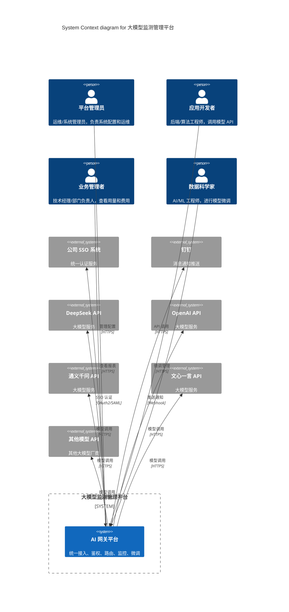
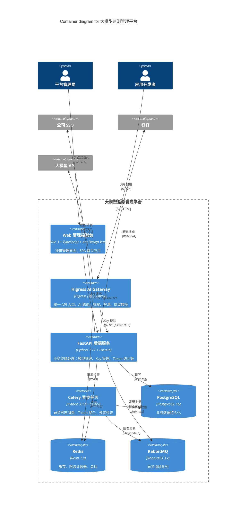
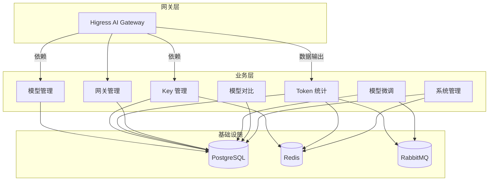

# 系统架构设计文档 — 大模型监测管理平台

| 系统名称 | 大模型监测管理平台 |
|----------|-------------------|
| 文档编号 | ARCH-LLM-MONITOR-001 |
| 版本 | v1.0 |
| 创建日期 | 2025-01-01 |
| 架构风格 | 模块化单体 + Higress AI 网关 |
| 状态 | 草稿 |

---

## 1. 架构概述

### 1.1 系统定位

大模型监测管理平台（AI 网关平台）是**企业 AI 基础设施的管控层**，为企业内部提供大模型的统一接入、API Key 分发与鉴权、Token 用量统计、统一网关路由、模型微调等核心能力。系统不直接提供大模型推理算力，而是对接各类大模型厂商 API。

### 1.2 架构目标

| 目标类型 | 目标描述 | 衡量指标 | 优先级 |
|----------|----------|----------|--------|
| 功能性 | 统一管理企业内所有大模型接入 | 覆盖 ≥ 90% 的模型接入场景 | P0 |
| 性能 | 网关代理延迟 < 5ms（不含模型调用） | P99 延迟 < 15ms | P0 |
| 可扩展性 | 支持水平扩展，适应业务增长 | 网关 QPS ≥ 5,000 | P0 |
| 可用性 | 系统全年可用 | SLA ≥ 99.9% | P0 |
| 可维护性 | 模块化设计，便于团队协作 | 模块间低耦合 | P1 |
| 安全性 | API Key 加密存储，全站 HTTPS | 通过安全审计 | P0 |

### 1.3 架构约束

| 约束项 | 说明 |
|--------|------|
| 技术栈 | Python 3.12+ + FastAPI + Vue 3 + TypeScript |
| 网关 | Higress AI Gateway（基于 Envoy） |
| 数据库 | PostgreSQL 16 |
| 缓存 | Redis 7.x |
| 消息队列 | RabbitMQ |
| 部署方式 | 容器化（Docker + Docker Compose） |
| 认证方式 | 对接公司 SSO，不维护独立用户体系 |

---

## 2. C4 架构设计

### 2.1 Level 1: System Context（系统上下文）



**外部系统说明**：

| 外部系统 | 交互方式 | 数据流向 | 说明 |
|----------|----------|----------|------|
| 公司 SSO 系统 | OAuth2 / SAML / LDAP | 双向 | 用户认证 |
| 钉钉 | Webhook | 单向（平台→钉钉） | 告警通知 |
| DeepSeek API | HTTPS REST | 双向 | 模型调用 |
| OpenAI API | HTTPS REST | 双向 | 模型调用 |
| 通义千问 API | HTTPS REST | 双向 | 模型调用 |
| 文心一言 API | HTTPS REST | 双向 | 模型调用 |

---

### 2.2 Level 2: Container（容器图）



**容器说明**：

| 容器名称 | 技术栈 | 实例数 | 职责 |
|----------|--------|--------|------|
| Web 管理控制台 | Vue 3 + TypeScript + Ant Design Vue | 2 | 管理界面、数据可视化 |
| Higress AI Gateway | Higress（基于 Envoy） | 2-3 | API 路由、鉴权、限流、协议转换、日志 |
| FastAPI 后端服务 | Python 3.12 + FastAPI + SQLAlchemy 2.0 | 2-4 | 业务逻辑处理 |
| Celery 异步任务 | Python 3.12 + Celery + RabbitMQ | 1-2 | 异步消费、聚合计算 |
| PostgreSQL | PostgreSQL 16 | 主 + 从 | 业务数据存储 |
| Redis | Redis 7.x | 主 + 从 | 缓存、限流、会话 |
| RabbitMQ | RabbitMQ 3.x | 1-3 | 异步消息 |

---

### 2.3 Level 3: Component（组件图 — FastAPI 后端）

```mermaid
C4Component
    title Component diagram for FastAPI 后端服务

    Container_Boundary(api, "FastAPI 后端服务") {
        Component(router, "API 路由层", "FastAPI Router", "请求路由、参数校验、响应序列化")
        Component(auth, "认证中间件", "FastAPI Middleware", "JWT 校验、SSO 回调处理")
        
        Component(model_svc, "模型管理服务", "Service Layer", "模型 CRUD、状态监控、版本管理")
        Component(key_svc, "Key 管理服务", "Service Layer", "Key 生成、权限控制、生命周期")
        Component(token_svc, "Token 统计服务", "Service Layer", "用量统计、费用报表、预警")
        Component(gateway_svc, "网关管理服务", "Service Layer", "路由规则管理、限流配置")
        Component(finetune_svc, "微调管理服务", "Service Layer", "任务管理、数据集、评估")
        Component(compare_svc, "模型对比服务", "Service Layer", "多维度对比、评分计算")
        Component(sys_svc, "系统管理服务", "Service Layer", "SSO 配置、通知、审计日志")
        
        Component(dao, "数据访问层", "SQLAlchemy 2.0 Repository", "数据库 CRUD 操作")
        Component(cache, "缓存层", "Redis Service", "数据缓存、分布式锁")
        Component(task, "异步任务层", "Celery Tasks", "日志消费、统计聚合、预警检查")
    }

    Rel(web, router, "HTTP 请求")
    Rel(higress, router, "Key 校验回调")
    Rel(router, auth, "认证校验")
    Rel(router, model_svc, "委托")
    Rel(router, key_svc, "委托")
    Rel(router, token_svc, "委托")
    Rel(router, gateway_svc, "委托")
    Rel(router, finetune_svc, "委托")
    Rel(router, compare_svc, "委托")
    Rel(router, sys_svc, "委托")
    
    Rel(model_svc, dao, "读写")
    Rel(key_svc, dao, "读写")
    Rel(token_svc, dao, "读写")
    Rel(gateway_svc, dao, "读写")
    Rel(finetune_svc, dao, "读写")
    Rel(sys_svc, dao, "读写")
    
    Rel(model_svc, cache, "缓存")
    Rel(key_svc, cache, "缓存")
    Rel(token_svc, cache, "缓存")
    
    Rel(token_svc, task, "触发异步任务")
    Rel(sys_svc, task, "触发异步任务")
    
    Rel(dao, db, "SQL")
    Rel(cache, redis, "Redis 协议")
    Rel(task, mq, "消息")
```

### 2.4 Level 3: Component（组件图 — Higress 网关）

```
┌─────────────────────────────────────────────────────────────────┐
│                     Higress AI Gateway                           │
│                                                                  │
│  ┌─────────────┐  ┌─────────────┐  ┌─────────────────────────┐  │
│  │ AI 路由插件   │  │ 鉴权插件     │  │ 速率限制插件            │  │
│  │ - 模型路由    │  │ - API Key   │  │ - 全局 QPS             │  │
│  │ - 灰度发布    │  │ - JWT 校验  │  │ - 单 Key QPS           │  │
│  │ - 权重分发    │  │             │  │ - 并发限制              │  │
│  └──────┬───────┘  └──────┬──────┘  └──────────┬──────────────┘  │
│         │                │                     │                 │
│  ┌──────▼────────────────▼─────────────────────▼──────────────┐  │
│  │              协议转换引擎                                     │  │
│  │  OpenAI 格式 ↔ DeepSeek/GPT/通义千问/文心一言 格式            │  │
│  └─────────────────────────────────────────────────────────────┘  │
│  ┌─────────────────────────────────────────────────────────────┐  │
│  │              可观测性                                         │  │
│  │  Prometheus 指标 + 访问日志 (JSON) + 链路追踪                 │  │
│  └─────────────────────────────────────────────────────────────┘  │
└─────────────────────────────────────────────────────────────────┘
```

---

## 3. 模块依赖关系



### 3.1 Higress 配置同步机制

路由规则变更后，通过 API 实时推送到 Higress 并热加载生效：

```
┌──────────────┐     ┌──────────────┐     ┌──────────────┐
│  FastAPI 后端  │────▶│  Higress API  │────▶│  配置热加载    │
│  路由规则修改  │     │  /v1/routes   │     │  立即生效      │
└──────────────┘     └──────────────┘     └──────────────┘
       │                                         │
       ▼                                         ▼
┌──────────────┐                          ┌──────────────┐
│  PostgreSQL   │                          │  Redis 缓存   │
│  持久化路由规则 │                          │  路由规则快照   │
└──────────────┘                          └──────────────┘
```

**同步策略**：
| 步骤 | 操作 | 说明 |
|------|------|------|
| 1 | 后端保存路由规则到 PostgreSQL | 持久化存储，作为配置来源 |
| 2 | 后端调用 Higress Admin API | 推送路由配置变更 |
| 3 | Higress 热加载新配置 | 不重启，零中断生效 |
| 4 | 更新 Redis 缓存 | 缓存路由规则快照，加速后续查询 |
| 5 | 返回操作结果 | 记录操作审计日志 |

**备用方案**：如果 Higress Admin API 不可用，从 Redis 缓存读取路由规则，确保网关运行不中断。

---

## 4. 关键技术决策

### 4.1 架构风格：模块化单体

| 决策项 | 选择 | 理由 |
|--------|------|------|
| 架构风格 | 模块化单体（Modular Monolith） | 团队规模小（5-8人），单体降低运维复杂度 |
| 模块隔离 | Python Package 模块化 | 通过包结构和接口定义实现模块间解耦 |
| 未来演进 | 可拆分为微服务 | 模块边界清晰，未来可按需拆分 |

### 4.2 API 设计风格

| 决策项 | 选择 |
|--------|------|
| 管理端 API | RESTful，路径前缀 `/api/v1/` |
| 网关 API | OpenAI 兼容格式 |
| 认证 | 管理端：JWT（SSO 登录后获取）；网关：API Key |
| 序列化 | JSON（Pydantic v2） |
| 分页 | `page` + `size` 参数，返回 `{ total, items }` |

### 4.3 异步任务设计

| 任务 | 触发方式 | 队列 | 说明 |
|------|----------|------|------|
| 请求日志消费 | Higress 写入 MQ | `log_queue` | 批量写入 PostgreSQL |
| Token 统计聚合 | Celery Beat 定时 | `stats_queue` | 每小时/每天聚合 |
| 预警检查 | Celery Beat 定时 | `alert_queue` | 每 5 分钟检查 |
| 模型健康检查 | Celery Beat 定时 | `health_queue` | 每 30 秒检查 |
| 微调任务调度 | 用户触发 | `finetune_queue` | 调度 GPU 资源 |

---

## 5. 安全架构

```
┌──────────────┐     ┌──────────────┐     ┌──────────────┐
│ 外部请求      │────▶│  Nginx       │────▶│  Higress     │
│              │     │  SSL 卸载    │     │  API Key 校验 │
└──────────────┘     └──────────────┘     └──────┬───────┘
                                                 │
┌──────────────┐     ┌──────────────┐     ┌──────▼───────┐
│ 数据加密      │◀────│  FastAPI     │◀────│  JWT 认证     │
│ AES-256      │     │  权限校验    │     │  SSO 鉴权     │
└──────────────┘     └──────────────┘     └──────────────┘
```

| 安全层 | 措施 | 说明 |
|--------|------|------|
| 传输层 | HTTPS（TLS 1.2+） | Nginx 负责 SSL 卸载 |
| 认证层 | SSO + JWT | 管理端使用公司 SSO |
| 鉴权层 | API Key + RBAC | 网关 API 使用 Key 鉴权 |
| 限流层 | 全局 + 单 Key | Higress 内置限流 |
| 存储层 | AES-256 加密 | API Key 加密存储 |
| 审计层 | 全量操作日志 | 所有关键操作可追溯 |