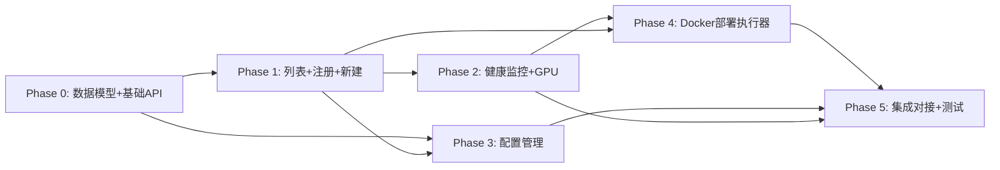

# 开发排期计划 — 模型部署模块

## 项目信息
| 项目 | 内容 |
|------|------|
| 项目名称 | 大模型监测管理平台 — 模型部署模块 |
| 开始日期 | 2026-06-20 |
| 开发人员 | 1 人（全栈） |
| 预计工期 | **11 个工作日** |
| 预计结束 | 2026-07-04 |

## 依赖关系图



## 分阶段排期

### Phase 0 — 数据模型与基础API（第1天）

| 任务 | 工时 | 说明 |
|------|------|------|
| 创建 deployment 表迁移 | 0.5 天 | SQLAlchemy Model + Alembic migration |
| DeploymentRepository | 0.5 天 | CRUD + 筛选 + 分页 |
| 合计 | 1 天 | |

### Phase 1 — 部署列表 + 注册 + 新建（第2-4天）

| 任务 | 工时 | 说明 |
|------|------|------|
| DeploymentService (M01/M02) | 1 天 | 业务逻辑：注册、新建、启停 |
| Deployment REST API | 0.5 天 | 所有 CRUD 端点 |
| 前端部署列表页 | 1 天 | 表格+筛选+统计卡片+GPU拓扑 |
| 前端注册已有端点弹窗 | 0.5 天 | 表单+连通性检测 |
| 前端新建部署弹窗 | 0.5 天 | 模型选择+引擎+GPU分配+模板 |
| 左侧菜单加「模型部署」 | 0.5 天 | BasicLayout.vue |
| 合计 | 4 天 | |

### Phase 2 — 健康监控 + GPU 拓扑（第5-6天）

| 任务 | 工时 | 说明 |
|------|------|------|
| Celery Beat 健康检查任务 | 1 天 | 定时 HTTP 检查，状态更新 |
| 健康检查日志 + 健康率统计 | 0.5 天 | 数据库记录和计算 |
| GPU 资源采集 | 0.5 天 | nvidia-smi / pynvml 采集 |
| 前端详情弹窗（概览+日志+监控） | 1 天 | 三个页签 |
| 合计 | 3 天 | |

### Phase 3 — 配置管理（第5-7天，与 Phase 2 并行）

| 任务 | 工时 | 说明 |
|------|------|------|
| ConfigService (ToolCall/Prompt/Search) | 1 天 | 配置存取和校验 |
| 配置 API (CRUD) | 0.5 天 | |
| 前端配置编辑器 | 1.5 天 | ToolCall JSON编辑器 + Prompt文本框 + Search配置 |
| 合计 | 3 天 | |

### Phase 4 — Docker 部署执行器（第7-8天）

| 任务 | 工时 | 说明 |
|------|------|------|
| DockerService (docker-py 封装) | 0.5 天 | 创建/启动/停止/删除容器 |
| Celery 部署任务 (deploy_task) | 0.5 天 | 异步执行部署流程 |
| vLLM 容器参数生成 + 端口分配 | 0.5 天 | |
| 部署进度日志收集 | 0.5 天 | |
| 合计 | 2 天 | |

### Phase 5 — 集成对接 + 测试（第9-11天）

| 任务 | 工时 | 说明 |
|------|------|------|
| 自动注册到模型管理 | 0.5 天 | 注册/注销 API 调用 |
| 配置注入网关 | 0.5 天 | 网关读取配置逻辑 |
| 删除部署级联操作 | 0.5 天 | 停止容器+注销模型 |
| 后端测试 | 1 天 | 单元测试+集成测试 |
| 前端回归 | 0.5 天 | 所有页面交互测试 |
| 合计 | 3 天 | |

## 甘特图

```mermaid
gantt
    title 模型部署模块开发排期
    dateFormat  YYYY-MM-DD
    axisFormat  %m-%d

    section Phase 0
    数据模型+基础API     :p0, 2026-06-20, 1d

    section Phase 1
    后端 Service+API     :p1a, after p0, 1d
    前端列表页            :p1b, after p0, 1d
    前端注册+新建弹窗      :p1c, after p1b, 2d
    菜单集成              :p1d, after p1b, 6h

    section Phase 2
    健康检查 Celery 任务   :p2a, after p0, 2d
    GPU 拓扑采集          :p2b, after p2a, 1d
    前端详情弹窗           :p2c, after p1b, 2d

    section Phase 3
    ConfigService         :p3a, after p0, 2d
    前端配置编辑器         :p3b, after p3a, 2d

    section Phase 4
    DockerService         :p4a, after p1a, 2d
    Celery 部署任务        :p4b, after p4a, 1d

    section Phase 5
    自动注册+集成          :p5a, after p4b, 1d
    测试                  :p5b, after p3b, after p4b, after p2c, 2d
```

## 里程碑

| 里程碑 | 目标日期 | 交付物 | 检查点 |
|--------|---------|--------|--------|
| M1 — 基础功能可用 | 第 4 天 | 部署列表展示、注册已有端点、新建部署表单、菜单 | 打开页面能看到部署列表，能提交注册 |
| M2 — 配置管理可用 | 第 7 天 | ToolCall/Prompt/Search 配置编辑 | 能在详情页编辑和保存配置 |
| M3 — 完整生命周期 | 第 8 天 | Docker 容器自动部署、启停 | 从量化结果创建部署，容器跑起来 |
| M4 — 全功能交付 | 第 11 天 | 自动注册+测试+回归 | 所有功能点通过测试 |

## 资源分配（单人全栈）

```
第1天  │ 数据模型
第2-4天  │ 后端API + 前端列表/注册/新建   ← M1 checkpoint
第5-6天  │ 健康监控 (Phase 2) + 配置管理 (Phase 3) 并行
第7-8天  │ Docker部署执行器               ← M3 checkpoint
第9-11天 │ 集成对接 + 测试                 ← M4 delivery
```