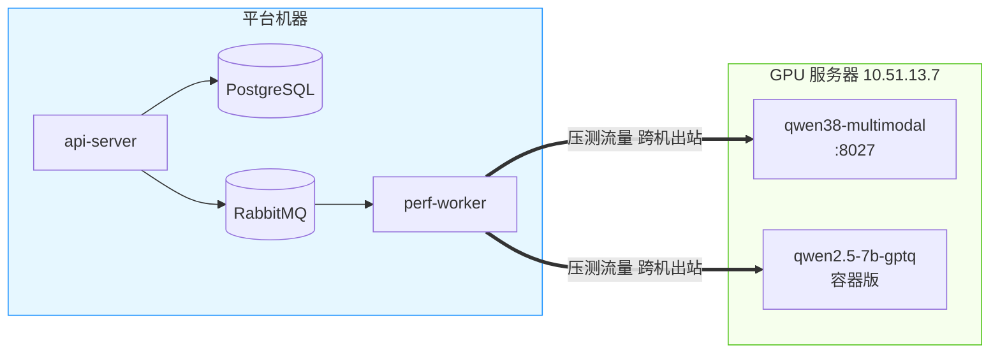

# 待确认问题 — 模型压测模块（已全部确认）

> 状态：**全部已确认**，本文件作为决策记录保留。

| 编号 | 问题 | 结论 | 影响 |
|------|------|------|------|
| Q-001 | 压测 worker 部署位置？ | **与平台同机部署（与 api-server / perf-worker 一起），与被压测的大模型分属不同机器** | 压测流量为跨机单向出站，不会"自己压自己"导致 API 抖动；但同机网卡带宽仍有占用，需关注 |
| Q-002 | 是否需要跨机器分布式压测？ | **不需要**。一期单机 perf-worker，并发上限 500 | 无需实现分布式协调，架构简化 |
| Q-003 | EvalScope 原生 HTML 报告是否暴露下载？ | **暴露给用户下载** | `outputs/` 目录需挂持久卷，任务结束后保留报告文件 |
| Q-004 | 压测指标是否回写到「模型管理」？ | **不回写** | 无需扩展 `model` 表；性能基线只在压测模块内查看 |
| Q-005 | 是否禁止压测第三方付费模型？ | **需要硬限制：仅对自建部署模型开放压测** | API 层强制校验，非自建模型直接拒绝（不可通过二次确认绕过） |
| Q-006 | Token 统计排除方式？ | **完全不记录请求日志** | 网关识别 `X-Perf-Test: 1` 后跳过 `api_request_log` 写入；不改表结构 |

---

## Q-005 的落地规则（硬限制）

**判定依据**：模型的 `provider` 字段

```python
def is_perf_testable(model) -> bool:
    """只有平台自建部署的模型允许压测。

    平台部署出来的模型 provider 形如 local-vllm / local-tgi；
    第三方接入（openai / deepseek / dashscope 等）一律拒绝。
    """
    return bool(model.provider) and model.provider.startswith("local-")
```

**拒绝行为**：
- 新建压测接口返回 `400`，错误信息：`仅支持对平台自建部署的模型压测；第三方模型（provider=xxx）不允许压测`
- 前端模型下拉列表中**直接过滤掉**非 `local-` 开头的模型（不给用户选，而不是选了再报错）
- 这条限制**不提供任何开关或二次确认绕过**

**影响范围**：
- 模型管理里的自建模型 provider 必须是 `local-*`（模型部署模块自动注册时已按 `local-{engine}` 生成，符合要求）
- 手工注册的 conda/Docker 端点若想被压测，provider 需设为 `local-*`（属于自建，合理）

---

## Q-003 的落地规则（HTML 报告）

| 项 | 方案 |
|----|------|
| 生成 | EvalScope `gen_perf_html_report()` 自动生成到 `outputs/<ts>/perf_report.html` |
| 保留 | `outputs/` 挂 Docker 卷（如 `perf_outputs`），不随容器销毁 |
| 下载 | 新增 `GET /api/v1/perf/tasks/{id}/report` 下载端点，返回 HTML 文件 |
| 清理 | 随任务删除一起清理该任务目录 |

---

## Q-001 的架构影响



**与"独立机器"方案的差异**：
- ✅ 消除了「压测目标与本机 API 争抢同一网卡同一方向」的极端情况
- ⚠️ 平台机器网卡仍需承载压测出站流量（500 并发约 0.5-2 MB/s），若平台机器网卡较小需关注
- ✅ 部署与运维更简单（不用多维护一台机器）
