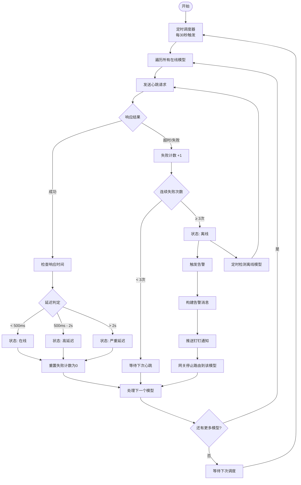

# M01-02 模型状态监控 — 业务流程图

## 流程概述

系统自动定时对已接入模型进行健康检查，根据响应时间判定模型状态（在线/高延迟/离线），并在状态异常时触发告警通知。

## 业务流程图

## 状态定义

| 状态 | 判定条件 | 图标 | 说明 |
|------|----------|------|------|
| 在线 | 响应时间 < 500ms | 🟢 | 正常运行 |
| 高延迟 | 500ms ≤ 响应时间 < 2s | 🟡 | 响应较慢，需关注 |
| 严重延迟 | 响应时间 ≥ 2s（持续5分钟） | 🟠 | 需排查原因 |
| 离线 | 连续3次心跳失败 | 🔴 | 模型不可用 |
| 待配置 | 未完成初始化配置 | ⚪ | 等待管理员配置 |

## 告警规则

| 事件 | 告警级别 | 通知方式 | 附加操作 |
|------|----------|----------|----------|
| 模型离线 | 严重 | 钉钉推送 | 停止路由，自动恢复后通知 |
| 严重延迟 | 警告 | 钉钉推送 | 仅通知，不停止路由 |
| 模型恢复 | 通知 | 钉钉推送 | 恢复路由 |