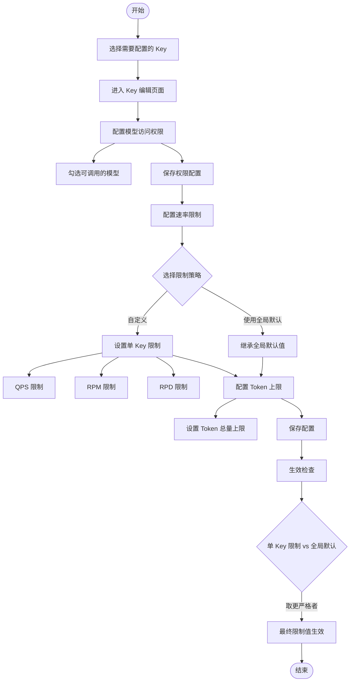

# M02-02 Key 权限控制 — 业务流程图

## 流程概述

配置每个 Key 的模型访问权限和调用速率限制，支持全局默认和单 Key 自定义两级策略。

## 业务流程图

## 速率限制策略

| 策略 | 说明 | 生效规则 |
|------|------|----------|
| 全局默认 | 系统全局配置的默认值 | 全局限流配置 |
| 单 Key 自定义 | 针对特定 Key 的设置 | 与全局取更严格者 |

## 限制维度

| 维度 | 单位 | 说明 |
|------|------|------|
| QPS | 次/秒 | 每秒最大请求数 |
| RPM | 次/分钟 | 每分钟最大请求数 |
| RPD | 次/天 | 每天最大请求数 |
| Token 上限 | Token | 总量上限，达到后自动禁用 |