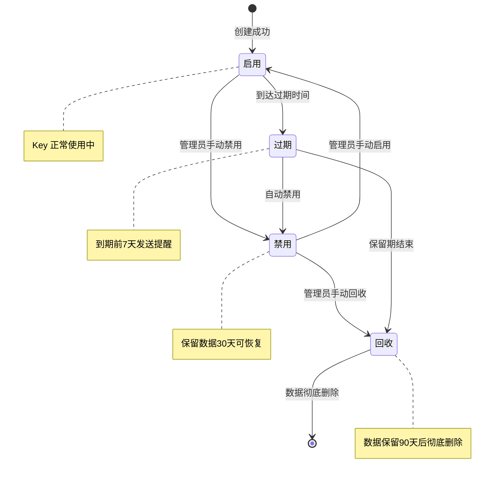

# M02-03 Key 生命周期 — 业务流程图

## 流程概述

管理 Key 从创建到回收的完整生命周期，包含启用、禁用、过期自动处理、回收等环节。

## 状态机



## 业务流程图

```mermaid
flowchart TD
    START([开始]) --> A[Key 创建成功]
    A --> B[状态: 启用]
    B --> C{触发事件}
    
    C -->|手动禁用| D[管理员点击禁用]
    D --> E[确认禁用]
    E --> F[状态: 禁用]
    F --> F1[使用该 Key 的请求被拒绝]
    
    C -->|到达过期时间| G[系统自动检测过期]
    G --> G1[到期前7天: 发送提醒通知]
    G1 --> G2[到期当天: 自动禁用]
    G2 --> H[状态: 过期]
    H --> H1[发送过期通知给管理员]
    
    C -->|手动回收| I[管理员点击回收]
    I --> I1[确认回收(不可恢复)]
    I1 --> J[状态: 回收]
    J --> J1[数据保留90天]
    J1 --> J2[彻底删除]
    
    F -->|手动启用| K[管理员点击启用]
    K --> K1[确认启用]
    K1 --> B
    
    F -->|手动回收| I
    
    H -->|保留30天| L{是否恢复?}
    L -->|管理员手动恢复| M[恢复为启用状态]
    L -->|不恢复| N[自动回收]
    N --> J
    
    M --> B
    J2 --> END([结束])
```

## 生命周期事件

| 事件 | 触发条件 | 系统行为 | 通知 |
|------|----------|----------|------|
| 到期提醒 | 到期前7天 | 无 | 发送通知给管理员 |
| 自动过期 | 到达过期时间 | 自动禁用 Key | 发送过期通知 |
| 手动禁用 | 管理员操作 | 立即禁用 | 记录审计日志 |
| 手动回收 | 管理员操作 | 标记删除，数据保留90天 | 记录审计日志 |
| 数据清理 | 回收后90天 | 彻底删除数据 | 无 |