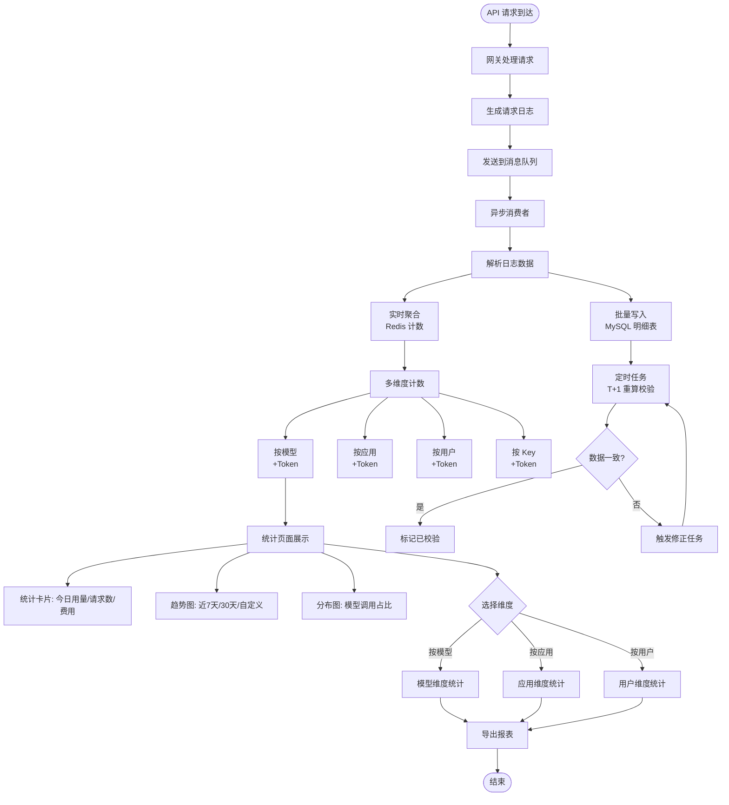

# M03-01 用量统计 — 业务流程图

## 流程概述

API 请求经过网关时记录日志，通过异步消息队列消费后实时聚合统计，支持按模型、应用、用户等多维度查看。

## 业务流程图



## 数据流

```
网关日志 → MQ (RabbitMQ) → 消费者
  ├─ Redis 实时计数（延迟 < 30s）
  └─ MySQL 批量写入（每分钟/每1000条）
       └─ 定时任务 T+1 校验
```

## 统计维度

| 维度 | 粒度 | 展示方式 | 数据来源 |
|------|------|----------|----------|
| 按模型 | 小时/天/月 | 趋势图 + 表格 | 请求日志聚合 |
| 按应用 | 小时/天/月 | 趋势图 + 表格 | 请求日志聚合 |
| 按用户 | 天/月 | 表格 | 请求日志聚合 |
| 按 Key | 天/月 | 表格 | 请求日志聚合 |