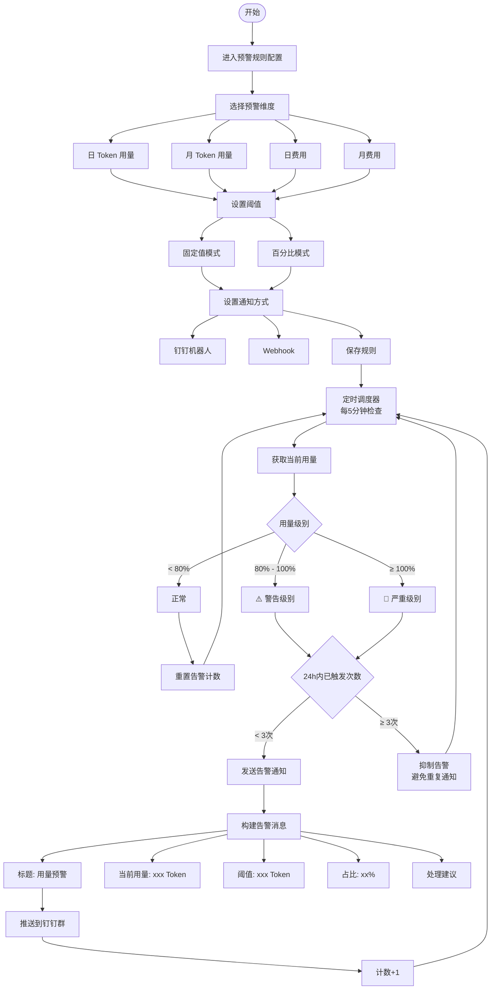

# M03-03 用量预警 — 业务流程图

## 流程概述

管理员配置预警规则，系统定时检查用量是否达到阈值，达到时触发通知，避免重复告警。

## 业务流程图

## 预警规则配置

| 配置项 | 说明 | 示例 |
|--------|------|------|
| 维度 | 监控指标类型 | 日 Token 用量 |
| 阈值 | 触发告警的数值 | 1,000,000 Token |
| 警告阈值 | 80% 阈值时触发警告 | 800,000 Token |
| 通知方式 | 告警推送渠道 | 钉钉机器人 |
| 防重复 | 24h 内最多触发次数 | 3 次 |