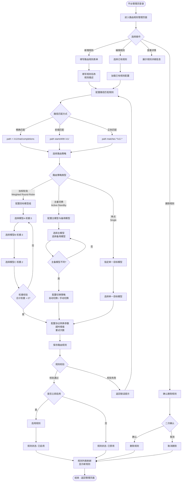
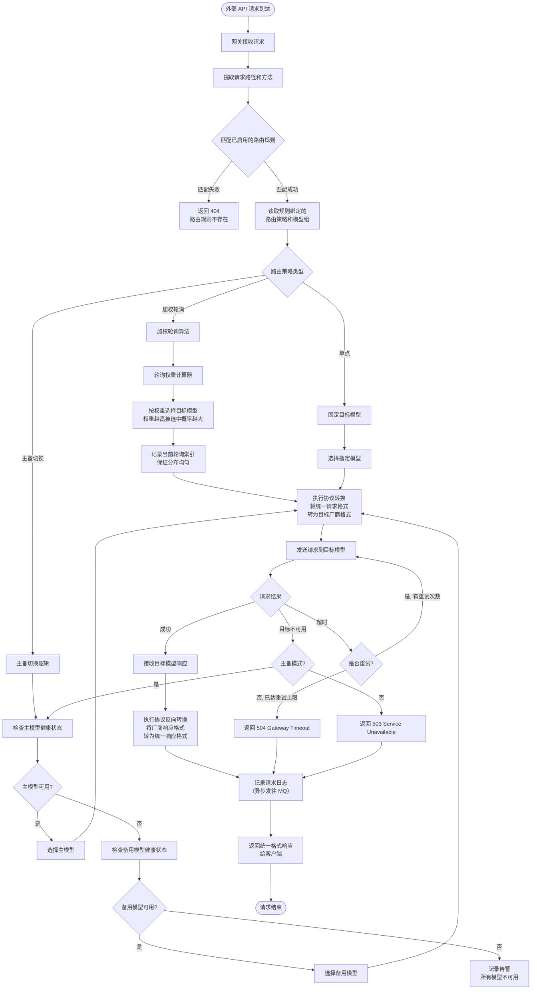

# M04-01 路由规则 — 业务流程图

## 文档信息

| 项目 | 内容 |
|------|------|
| 子模块编号 | M04-01 |
| 子模块名称 | 路由规则 |
| 功能点 | F-011 统一 API 路由 |
| 角色 | 平台管理员（配置端）、系统自动（运行端） |
| 涉及页面 | 路由规则列表页、路由规则编辑页、路由策略配置面板 |

---

## 1. 路由规则管理流程（配置端）

**说明**：平台管理员通过管理控制台对路由规则进行 CRUD 操作和策略配置。



---

## 2. 请求路由分发流程（运行端）

**说明**：应用开发者发送 API 请求到网关，网关自动完成路由匹配和分发。



---

## 3. 路由策略对比

```mermaid
flowchart LR
    subgraph 加权轮询
        WR[请求按权重比例分发\n权重高的模型接收更多流量\n适合: 多模型负载均衡]
    end
    
    subgraph 主备切换
        AS[主模型处理所有流量\n主模型不可用时切到备用\n适合: 高可用保障]
    end
    
    subgraph 单点
        SP[固定转发到单一模型\n不涉及负载分发\n适合: 指定模型调试]
    end
    
    WR -->|算法| WR_DTL[每模型分配权重Wᵢ\n总权重 Sum(W)\n当前选中概率 = Wᵢ / Sum(W)\n平滑轮询保证分布]
    
    AS -->|算法| AS_DTL[主模型存活检查\n心跳间隔 N 秒\n失败阈值 M 次触发切换\n主恢复后自动/手动切回]
    
    SP -->|算法| SP_DTL[配置固定 target\n直接转发\n无分发逻辑]
```

---

## 4. 异常处理流程

| 异常场景 | 触发条件 | 处理方式 | 响应 |
|----------|----------|----------|------|
| 无匹配规则 | 请求路径不匹配任何已启用规则 | 记录警告日志 | 404 Not Found |
| 目标模型不可用 | 单点/轮询选中的模型返回连接错误 | 有备用则切换，无备用则报错 | 503 / 自动切换 |
| 所有模型不可用 | 主备均不可用 / 轮询组全部故障 | 记录告警事件 | 503 Service Unavailable |
| 请求超时 | 模型响应超过配置的超时阈值 | 按配置决定是否重试 | 504 Gateway Timeout（重试耗尽） |
| 协议转换失败 | 请求/响应格式解析异常 | 记录错误日志 | 400 Bad Request |

---

## 5. 业务规则要点

| 规则编号 | 规则描述 |
|----------|----------|
| R-RULE-01 | 路由规则按优先级匹配，匹配到第一条即停止 |
| R-RULE-02 | 加权轮询的权重必须为正整数，合计权重 > 0 |
| R-RULE-03 | 主备切换模式下，主模型恢复健康后默认自动切回（可配置手动） |
| R-RULE-04 | 停用/删除路由规则不影响正在处理的请求 |
| R-RULE-05 | 规则启用后立即生效，无需重启网关 |
| R-RULE-06 | 一条路由规则可绑定多个模型（加权轮询/主备），单点模式只能绑定一个 |
| R-RULE-07 | 协议转换支持 OpenAI 兼容格式作为统一标准 |