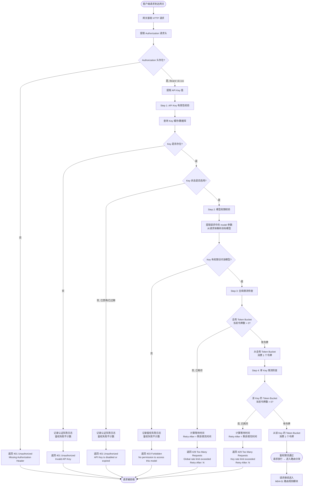
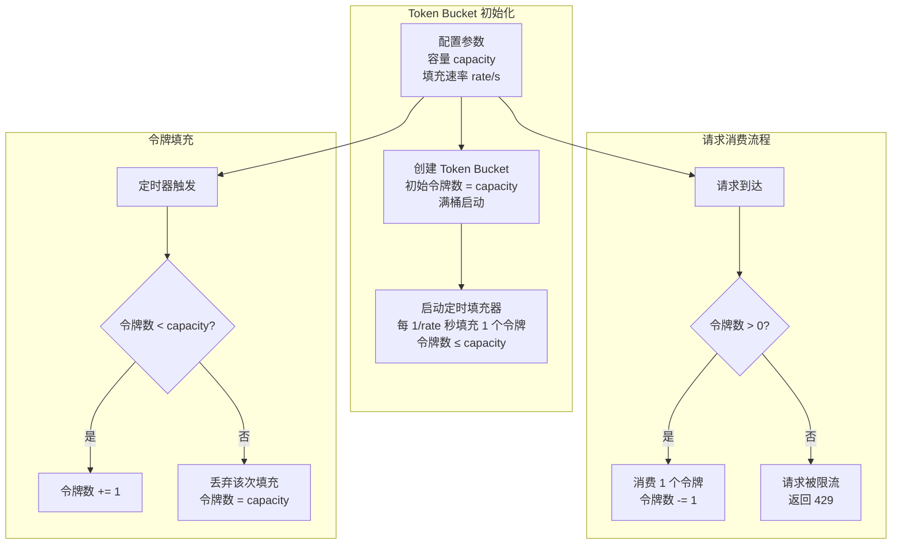
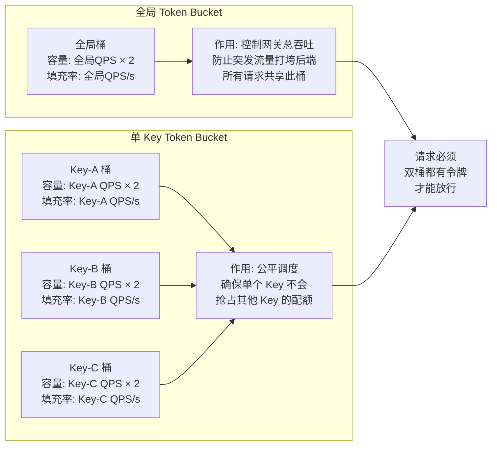
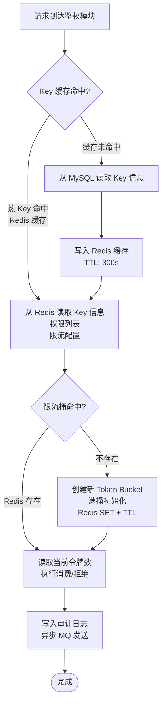

# M04-02 鉴权限流 — 业务流程图

## 文档信息

| 项目 | 内容 |
|------|------|
| 子模块编号 | M04-02 |
| 子模块名称 | 鉴权限流 |
| 功能点 | F-012 请求鉴权与限流 |
| 执行角色 | 系统自动（网关层，无人工干预） |
| 核心算法 | Token Bucket（令牌桶） |
| 异常响应 | 401 Unauthorized、403 Forbidden、429 Too Many Requests |

---

## 1. 请求鉴权与限流完整流程

**说明**：每个到达网关的 API 请求在路由分发之前，必须先通过鉴权与限流检查。该流程完全由网关自动执行，无需人工参与。



---

## 2. Token Bucket 限流算法详解

### 2.1 算法原理



### 2.2 全局与单 Key 的 Token Bucket 对比



### 2.3 关键参数

| 参数 | 全局桶 | 单 Key 桶 |
|------|--------|-----------|
| 容量（burst 上限） | `global_qps × 2` | `key_qps × 2` |
| 填充速率 | `global_qps / s` | `key_qps / s` |
| 初始令牌数 | `global_qps × 2`（满桶） | `key_qps × 2`（满桶） |
| 存储方式 | Redis Hash | Redis Hash（key: `ratelimit:{key_id}`） |
| 过期策略 | 无（常驻） | 无访问 30 分钟后自动删除 |

---

## 3. 异常处理流程

```mermaid
flowchart TD
    subgraph 401 Unauthorized
        A1[无效 API Key] --> A2[场景: Key 不存在]
        A3[已禁用/已过期 Key] --> A2
        A2 --> A4[响应体:\n{\"error\":\"Invalid API Key\"}]
        A4 --> A5[日志记录: 认证失败\n审计字段: status=401\n不纳入限流统计]
    end

    subgraph 403 Forbidden
        B1[无模型权限] --> B2[场景: Key 有效但\n无权访问请求的模型]
        B2 --> B3[响应体:\n{\"error\":\"No permission to access this model\"}]
        B3 --> B4[日志记录: 鉴权失败\n审计字段: status=403\n不纳入限流统计]
    end

    subgraph 429 Too Many Requests
        C1[全局/单Key限流] --> C2[场景: 令牌耗尽]
        C2 --> C3[响应体:\n{\"error\":\"Rate limit exceeded\"}]
        C3 --> C4[响应头:\nRetry-After: N\nX-RateLimit-Limit: N\nX-RateLimit-Remaining: 0\nX-RateLimit-Reset: timestamp]
        C4 --> C5[日志记录: 限流拒绝\n审计字段: status=429\n限流类型: global/key]
    end

    subgraph 正常通过
        D1[鉴权限流通过] --> D2[响应头:\nX-RateLimit-Limit: N\nX-RateLimit-Remaining: M\nX-RateLimit-Reset: timestamp]
        D2 --> D3[请求继续进入路由模块]
    end
```

---

## 4. 缓存性能优化



---

## 5. 业务规则要点

| 规则编号 | 规则描述 |
|----------|----------|
| R-AUTH-01 | 鉴权失败的请求不计入限流统计（不消耗令牌） |
| R-AUTH-02 | API Key 从 Authorization 请求头提取，格式为 `Bearer {key}` |
| R-AUTH-03 | Key 校验顺序：存在性 → 启用状态 → 有效期 → 模型权限 |
| R-AUTH-04 | 每次鉴权通过必须同时校验全局桶和单 Key 桶，两个桶都有令牌才能放行 |
| R-AUTH-05 | 限流响应头必须包含 `Retry-After`（秒），客户端应据此进行重试退避 |
| R-AUTH-06 | 限流参数（全局 QPS / 单 Key QPS）修改后，已有的 Token Bucket 在下次请求时重建 |
| R-AUTH-07 | 缓存 Key 信息 TTL 为 300 秒，Key 状态变更后主动失效缓存 |
| R-AUTH-08 | 限流桶连续 30 分钟无访问自动清除，释放 Redis 内存 |
| R-AUTH-09 | 限流拒绝不记录到请求日志主体表（仅记录到限流统计表，避免日志表膨胀） |

---

## 6. 响应头规范

### 6.1 正常响应

```
X-RateLimit-Limit: 100          # 每秒配额
X-RateLimit-Remaining: 85       # 当前剩余配额
X-RateLimit-Reset: 1705280000   # 配额重置时间戳
```

### 6.2 限流响应

```
HTTP/1.1 429 Too Many Requests
Content-Type: application/json
Retry-After: 5
X-RateLimit-Limit: 100
X-RateLimit-Remaining: 0
X-RateLimit-Reset: 1705280005

{"error": "Rate limit exceeded", "message": "Too many requests, please retry after 5 seconds"}
```