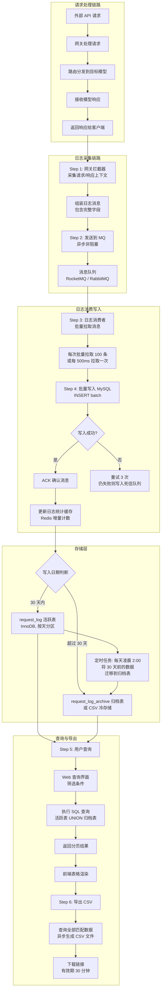
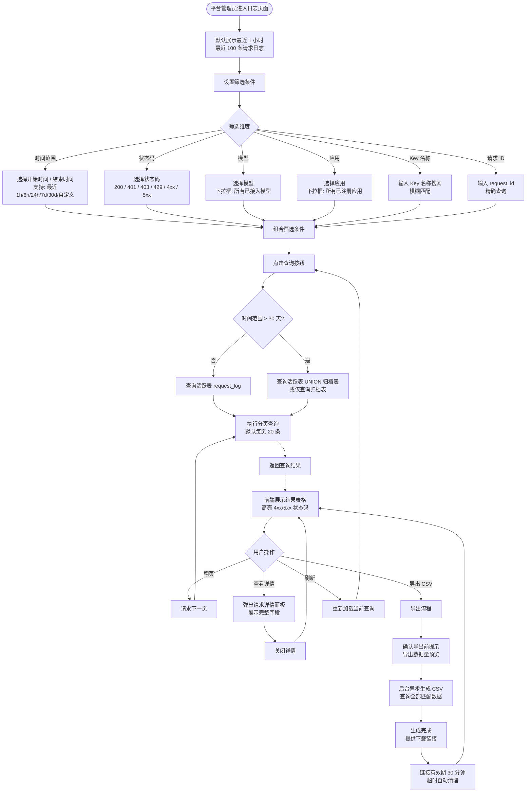
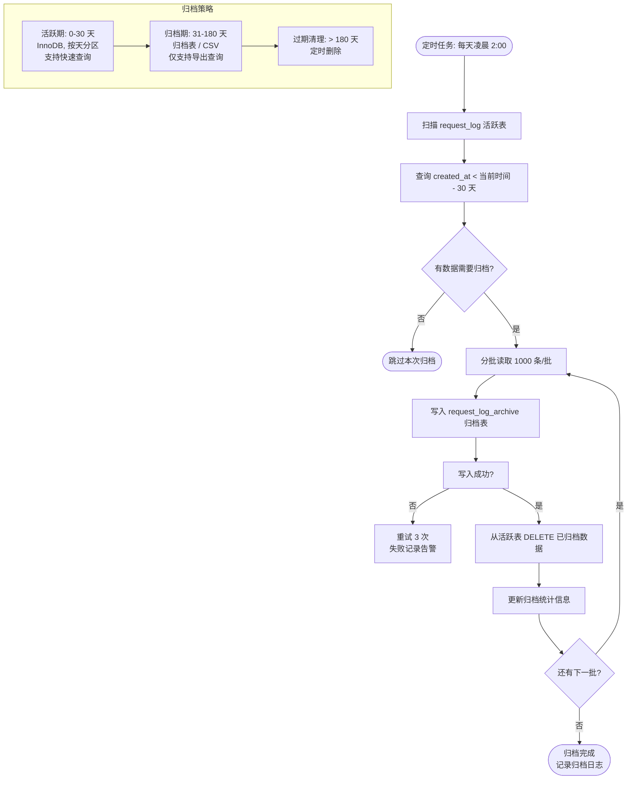
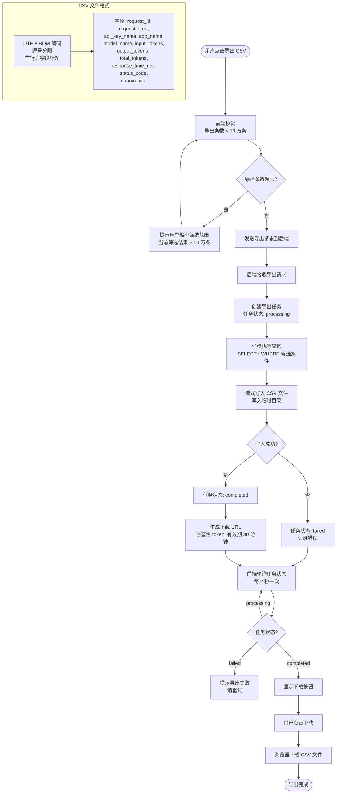

# M04-03 请求日志 — 业务流程图

## 文档信息

| 项目 | 内容 |
|------|------|
| 子模块编号 | M04-03 |
| 子模块名称 | 请求日志 |
| 功能点 | F-013 请求日志与审计 |
| 角色 | 平台管理员（查询/导出）、系统自动（采集/写入） |
| 存储策略 | 活跃数据 30 天（MySQL）、归档数据 180 天（MySQL 归档表/冷存储） |

---

## 1. 请求日志整体数据流

**说明**：日志采集与业务请求处理解耦，采用异步 MQ 方式，确保不影响主链路的请求处理性能。

---

## 2. 日志字段定义

### 2.1 字段清单

| 字段名 | 类型 | 说明 | 示例 |
|--------|------|------|------|
| `id` | BIGINT | 自增主键 | 1000001 |
| `request_id` | VARCHAR(64) | 全局唯一请求 ID（UUID） | `req_abc123...` |
| `request_time` | DATETIME(3) | 请求到达时间（毫秒精度） | 2025-01-15 14:30:00.123 |
| `api_key_name` | VARCHAR(128) | API Key 名称（脱敏后） | `app-dev-***` |
| `api_key_id` | BIGINT | Key 内部 ID（关联 Key 表） | 42 |
| `app_name` | VARCHAR(128) | 应用名称 | `智能客服` |
| `model_name` | VARCHAR(128) | 请求的目标模型 | `deepseek-chat` |
| `request_path` | VARCHAR(256) | 请求路径 | `/v1/chat/completions` |
| `method` | VARCHAR(16) | 请求方法 | `POST` |
| `input_tokens` | INT | 输入 Token 数 | 1024 |
| `output_tokens` | INT | 输出 Token 数 | 512 |
| `total_tokens` | INT | 总 Token 数 | 1536 |
| `response_time_ms` | INT | 响应时间（毫秒） | 1250 |
| `status_code` | INT | HTTP 状态码 | 200 |
| `source_ip` | VARCHAR(64) | 客户端 IP | `10.0.0.1` |
| `user_agent` | VARCHAR(512) | 客户端 UA | `okhttp/4.12.0` |
| `route_rule_id` | BIGINT | 命中的路由规则 ID | 5 |
| `target_model` | VARCHAR(128) | 实际路由到的目标模型 | `deepseek-chat` |
| `error_message` | TEXT | 错误信息（仅在非 2xx 时填充） | `null` |
| `created_at` | DATETIME | 记录创建时间 | 2025-01-15 14:30:01.000 |

### 2.2 索引设计

| 索引名称 | 字段 | 说明 |
|----------|------|------|
| `idx_rtime` | `request_time` | 时间范围查询（主要查询条件） |
| `idx_status` | `status_code` | 按状态码筛选 |
| `idx_model` | `model_name` | 按模型筛选 |
| `idx_app` | `app_name` | 按应用筛选 |
| `idx_rkey` | `api_key_id` | 按 Key 查询 |
| `idx_rid` | `request_id` | 唯一请求 ID 查询 |

---

## 3. 日志查询筛选流程

**说明**：平台管理员在 Web 界面上查看和筛选请求日志。

---

## 4. 日志归档策略

---

## 5. 日志导出 CSV 流程

---

## 6. 日志字段详细说明

### 6.1 字段分类

| 分类 | 字段 | 用途 |
|------|------|------|
| **标识** | `request_id`, `id` | 请求唯一标识，用于追踪和关联 |
| **时间** | `request_time`, `created_at` | 时序分析，费用计算的时间基准 |
| **认证** | `api_key_name`, `api_key_id`, `app_name` | 调用方身份识别，用于费用分摊 |
| **路由** | `model_name`, `request_path`, `route_rule_id`, `target_model` | 路由追踪，验证规则是否按预期工作 |
| **用量** | `input_tokens`, `output_tokens`, `total_tokens` | Token 用量统计，核心计费数据 |
| **性能** | `response_time_ms` | 响应时间监控，识别慢模型 |
| **结果** | `status_code`, `error_message` | 请求成功/失败状态，异常监控 |
| **网络** | `source_ip`, `user_agent` | 安全审计，异常 IP 识别 |

### 6.2 字段取值约束

| 字段 | 约束 |
|------|------|
| `request_id` | 全局唯一，UUID v4 格式，前缀 `req_` |
| `request_time` | 毫秒精度，网关接收请求的时间戳 |
| `api_key_name` | 日志中脱敏显示，仅保留前 4 位 + `***` |
| `input_tokens` | 请求完成后从模型响应中获取，非流式模式 |
| `output_tokens` | 请求完成后从模型响应中获取 |
| `response_time_ms` | 网关发出请求到收到完整响应的时间差 |
| `error_message` | 仅 4xx/5xx 时填充，2xx 时为 NULL |

---

## 7. 业务规则要点

| 规则编号 | 规则描述 |
|----------|----------|
| R-LOG-01 | 日志采集必须异步执行，禁止阻塞主请求链路 |
| R-LOG-02 | 日志写入采用批量模式，每批 100 条或 500ms 间隔，以先到者为准 |
| R-LOG-03 | 活跃数据保留 30 天，按天分区，支持快速查询 |
| R-LOG-04 | 归档数据保留 180 天，超过 180 天自动清理 |
| R-LOG-05 | 归档任务每天凌晨 2:00 执行，避开业务高峰期 |
| R-LOG-06 | CSV 导出上限 10 万条，超限提示用户缩小范围 |
| R-LOG-07 | 导出文件下载链接有效期 30 分钟，超时自动清理 |
| R-LOG-08 | API Key 名称在日志中脱敏显示，保护敏感信息 |
| R-LOG-09 | 日志表按 `request_time` 范围分区，提升查询性能 |
| R-LOG-10 | MQ 消费失败重试 3 次，仍失败则写入死信队列人工处理 |

---

## 8. 查询性能说明

| 场景 | 查询方式 | 预期性能 | 说明 |
|------|----------|----------|------|
| 最近 1 小时查询 | 活跃表，走 `idx_rtime` 索引 | < 100ms | 常见场景，数据量小 |
| 近 7 天查询 | 活跃表，走 `idx_rtime` 索引 | < 500ms | 中等数据量 |
| 近 30 天查询 | 活跃表，范围扫描 | < 2s | 数据量大，建议加其他筛选条件 |
| 跨 30 天查询 | 活跃表 UNION 归档表 | < 5s | 仅用于导出场景 |
| 单 request_id 查询 | 活跃表/归档表，走 `idx_rid` 索引 | < 50ms | 精确查询 |
| 复杂组合筛选 | 活跃表，多索引组合 | < 1s | 需合理使用索引 |