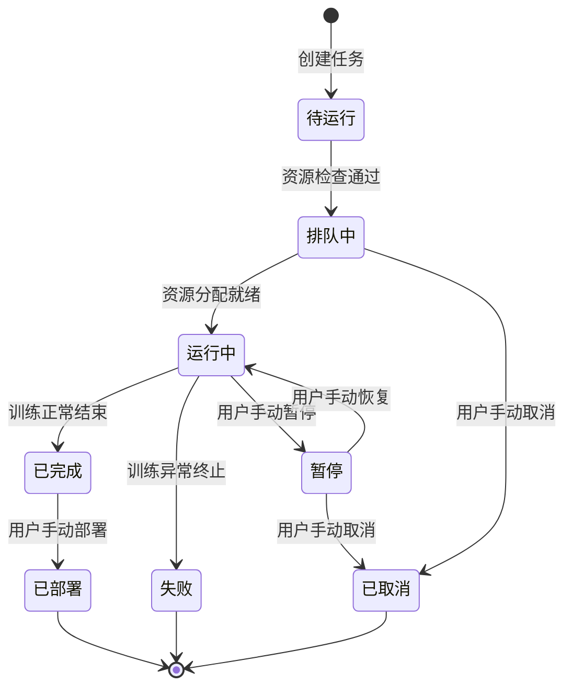

# M05-01 微调任务 — 业务流程图

## 流程概述

数据科学家创建微调任务，选择基座模型和训练数据集，配置超参数后开始训练，系统自动调度资源并监控进度，训练完成后可部署为模型新版本。

## 任务状态机



## 业务流程图

```mermaid
flowchart TD
    START([开始]) --> A[进入微调任务页面]
    A --> B[点击"创建微调任务"]
    B --> C[填写任务信息]
    C --> C1[任务名称]
    C --> C2[选择基座模型]
    C --> C3[选择训练数据集]
    C --> C4[选择验证数据集<br/>可选]
    C --> D[配置超参数]
    
    D --> D1[Epochs: 训练轮数]
    D --> D2[Learning Rate: 学习率]
    D --> D3[Batch Size: 批次大小]
    D --> D4[Max Length: 最大序列长度]
    D --> E[点击"开始训练"]
    
    E --> F[资源检查]
    F --> F1{计算资源充足?}
    F1 -->|是| G[状态: 排队中]
    F1 -->|否| F2[提示资源不足<br/>加入等待队列]
    F2 --> G
    
    G --> H[资源分配就绪]
    H --> I[状态: 运行中]
    I --> I1[实时显示进度条]
    I --> I2[显示当前损失值]
    I --> I3[显示训练日志]
    
    I --> MONITOR{用户操作}
    MONITOR -->|暂停| PAUSE[状态: 暂停]
    PAUSE -->|恢复| I
    PAUSE -->|取消| CANCEL[状态: 已取消]
    MONITOR -->|等待完成| COMPLETE
    
    I --> COMPLETE{训练结果}
    COMPLETE -->|正常结束| SUCCESS[状态: 已完成]
    COMPLETE -->|异常终止| FAIL[状态: 失败]
    FAIL --> FAIL_LOG[查看失败日志]
    FAIL_LOG --> RETRY[重新创建任务]
    
    SUCCESS --> DEPLOY{是否部署?}
    DEPLOY -->|是| DEPLOY_MODEL[部署为模型新版本]
    DEPLOY_MODEL --> STATUS[状态: 已部署]
    DEPLOY -->|否| END([结束])
    STATUS --> END
    CANCEL --> END
    RETRY --> B
```

## 超参数说明

| 参数 | 说明 | 推荐范围 | 默认值 |
|------|------|----------|--------|
| Epochs | 训练轮数 | 1-10 | 3 |
| Learning Rate | 学习率 | 1e-6 ~ 5e-5 | 2e-5 |
| Batch Size | 批次大小 | 4-32 | 8 |
| Max Length | 最大序列长度 | 512-8192 | 4096 |