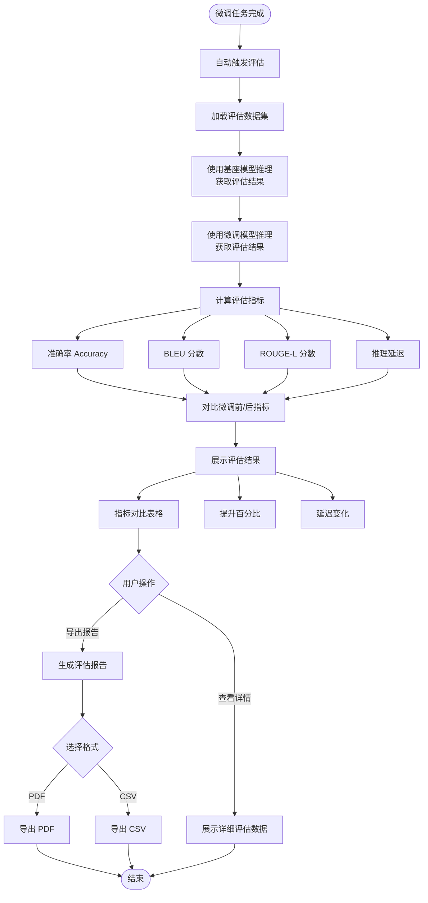

# M05-03 结果评估 — 业务流程图

## 流程概述

微调任务完成后，自动对微调后的模型进行效果评估，与基座模型进行多维度指标对比，展示评估结果并支持导出报告。

## 业务流程图

## 评估指标

| 指标 | 说明 | 对比方式 | 提升判定 |
|------|------|----------|----------|
| Accuracy | 准确率 | 微调前 vs 微调后 | 正向提升 |
| BLEU | 文本生成质量 | 微调前 vs 微调后 | 分数越高越好 |
| ROUGE-L | 摘要/翻译质量 | 微调前 vs 微调后 | 分数越高越好 |
| 推理延迟 | 模型响应时间 | 微调前 vs 微调后 | 允许小幅增加 |