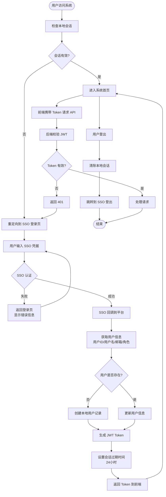

# M07-01 SSO 认证 — 业务流程图

## 流程概述

用户访问系统时跳转到公司 SSO 登录页，认证通过后回调获取用户信息，创建本地会话并返回 JWT Token。

## 业务流程图

## SSO 对接协议

| 协议 | 支持情况 | 说明 |
|------|----------|------|
| OAuth2 | ✅ 推荐 | 最通用，支持授权码流程 |
| SAML | ✅ 支持 | 企业级应用常用 |
| LDAP | ✅ 支持 | 内部目录服务 |
| CAS | ✅ 支持 | 高校/机构常用 |