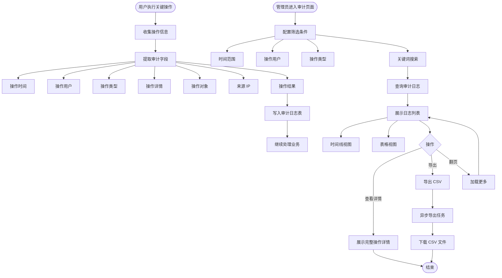

# M07-03 操作审计 — 业务流程图

## 流程概述

记录所有用户的关键操作到审计日志，支持按时间、用户、操作类型筛选查询，并支持导出为 CSV 格式。

## 业务流程图

## 记录范围

| 操作类型 | 记录内容 | 示例 |
|----------|----------|------|
| Key 管理 | 创建/禁用/回收 Key | "管理员 admin 创建了 Key「智能客服 Key」" |
| 模型配置 | 接入/编辑/启停模型 | "管理员 admin 更新了 DeepSeek-V3 配置" |
| 路由规则 | 创建/编辑/删除路由 | "管理员 admin 启用了路由规则「默认 Chat 路由」" |
| 系统配置 | 修改系统配置 | "管理员 admin 更新了钉钉 Webhook 配置" |
| 用户登录 | 登录/登出 | "用户 zhangsan 通过 SSO 登录系统" |

## 数据保留

| 时间范围 | 存储方式 | 可查询性 |
|----------|----------|----------|
| 0-90 天 | MySQL 热表 | 快速查询 |
| 91-180 天 | 冷存储 | 可导出查询 |
| 180 天以上 | 自动删除 | 不可查询 |