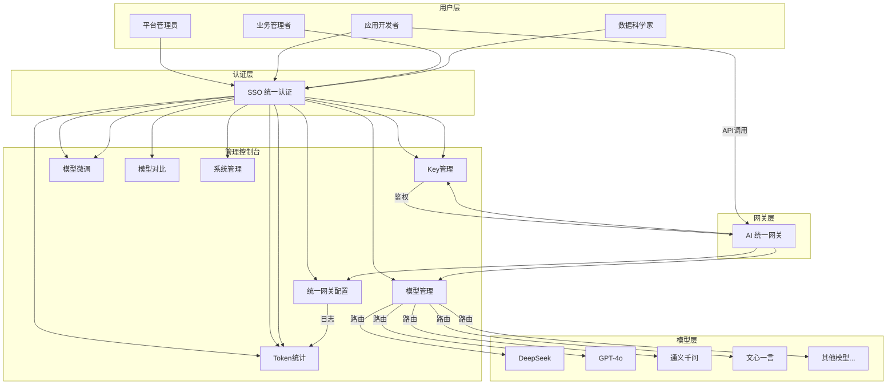

# 大模型监测管理平台 — 需求理解文档

## 项目信息

| 项目 | 内容 |
|------|------|
| 项目名称 | 大模型监测管理平台 |
| 阶段 | 需求理解（stage-02） |
| 前置文档 | docs/需求分析/PRD-大模型监测管理平台.md |
| 原型参考 | docs/需求分析/prototype-v2/ |

## 模块结构总览

| 模块编号 | 模块名称 | 子模块 | 优先级 | 功能点数 |
|----------|----------|--------|--------|----------|
| M01 | 模型管理 | M01-01 模型接入配置 | Must | 5 |
| | | M01-02 模型状态监控 | Must | 1 |
| | | M01-03 模型版本管理 | Should | 1 |
| M02 | Key 管理 | M02-01 Key 生成分发 | Must | 4 |
| | | M02-02 Key 权限控制 | Must | 1 |
| | | M02-03 Key 生命周期 | Should | 1 |
| M03 | Token 统计 | M03-01 用量统计 | Must | 4 |
| | | M03-02 费用报表 | Must | 1 |
| | | M03-03 用量预警 | Should | 1 |
| M04 | 统一网关 | M04-01 路由规则 | Must | 3 |
| | | M04-02 鉴权限流 | Must | 3 |
| | | M04-03 请求日志 | Must | 1 |
| M05 | 模型微调 | M05-01 微调任务 | Should | 4 |
| | | M05-02 数据集管理 | Should | 4 |
| | | M05-03 结果评估 | Should | 1 |
| M06 | 模型对比评估 | — | Should | 3 |
| M07 | 系统管理 | M07-01 SSO 认证 | Must | 1 |
| | | M07-02 通知推送 | Could | 1 |
| | | M07-03 操作审计 | Should | 1 |

## 业务流程总览图

---

## 各模块文档索引

| 模块 | 文档路径 |
|------|----------|
| M01 模型管理 | [M01-模型管理/README.md](M01-模型管理/README.md) |
| M02 Key 管理 | [M02-Key管理/README.md](M02-Key管理/README.md) |
| M03 Token 统计 | [M03-Token统计/README.md](M03-Token统计/README.md) |
| M04 统一网关 | [M04-统一网关/README.md](M04-统一网关/README.md) |
| M05 模型微调 | [M05-模型微调/README.md](M05-模型微调/README.md) |
| M06 模型对比评估 | [M06-模型对比评估/README.md](M06-模型对比评估/README.md) |
| M07 系统管理 | [M07-系统管理/README.md](M07-系统管理/README.md) |