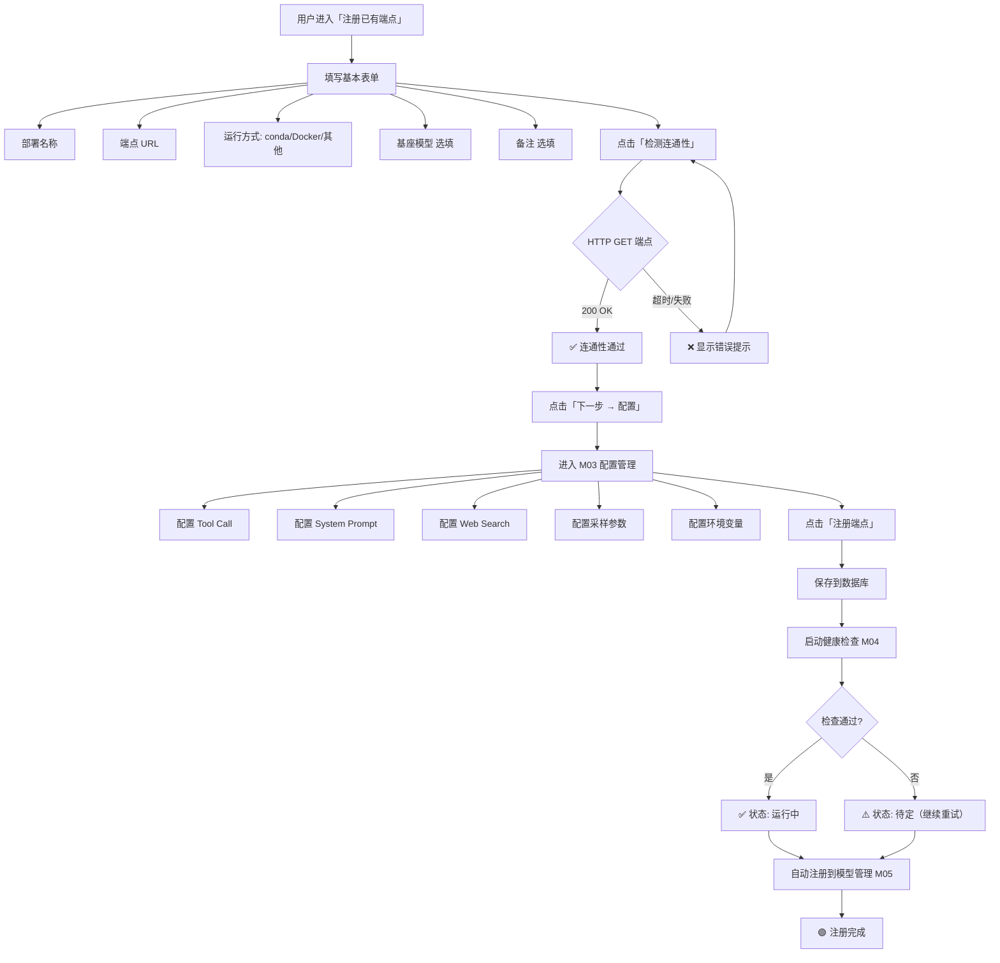
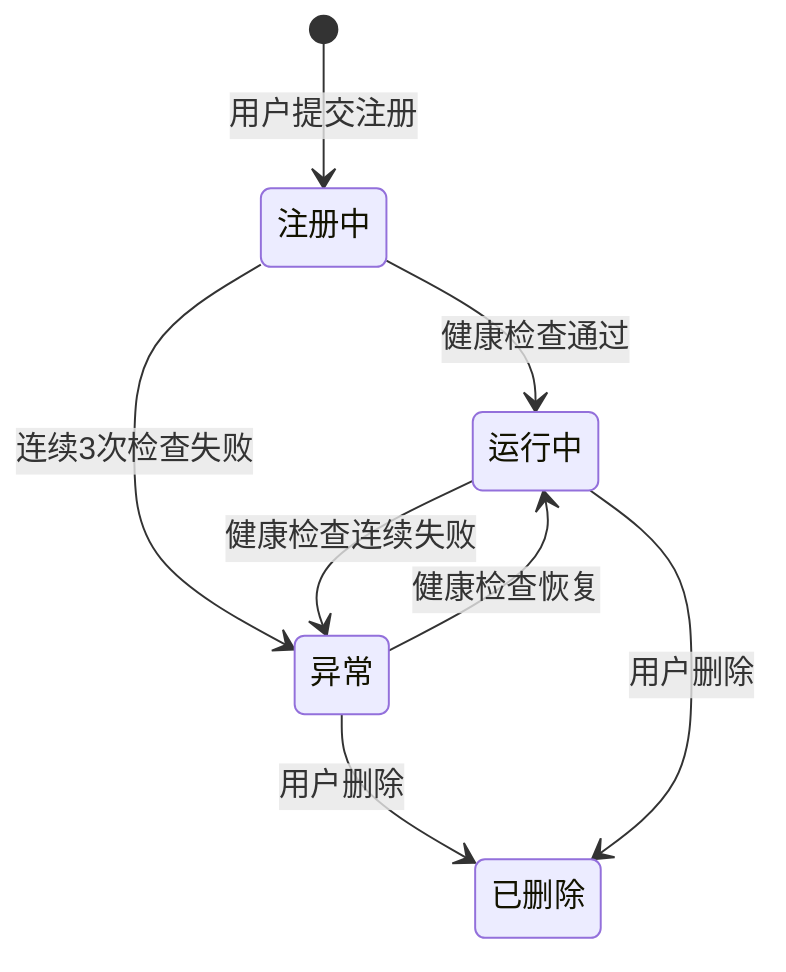

# M01 — 端点注册管理 业务流程图

## 流程概述
将已在 conda/Docker 中运行的模型端点注册到平台。平台不管理进程生命周期，只负责健康检查和配置管理。

## 业务流程图

## 核心规则

| 规则 | 说明 |
|------|------|
| 运行方式不可更改 | 注册后不可编辑，只能删除重建 |
| 端点 URL 不可更改 | 注册后不可编辑 |
| 其他配置可编辑 | System Prompt、Tool Call、Web Search、采样参数、环境变量均支持修改 |
| 启停按钮灰化 | conda/Docker 类型的部署，停止/启动按钮 disabled，提示「请在 conda/Docker 中手动管理」 |

## 状态流转（注册类型）

