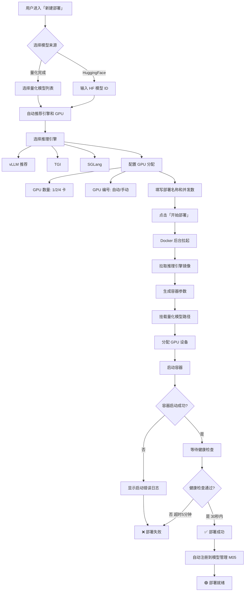
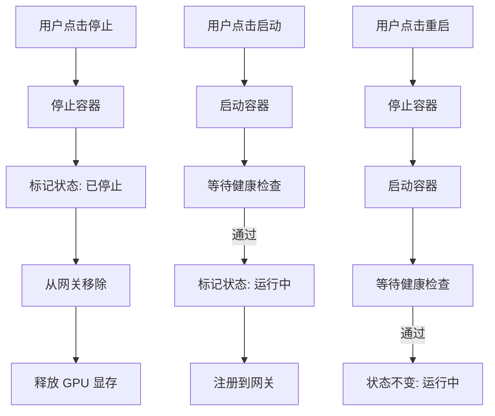
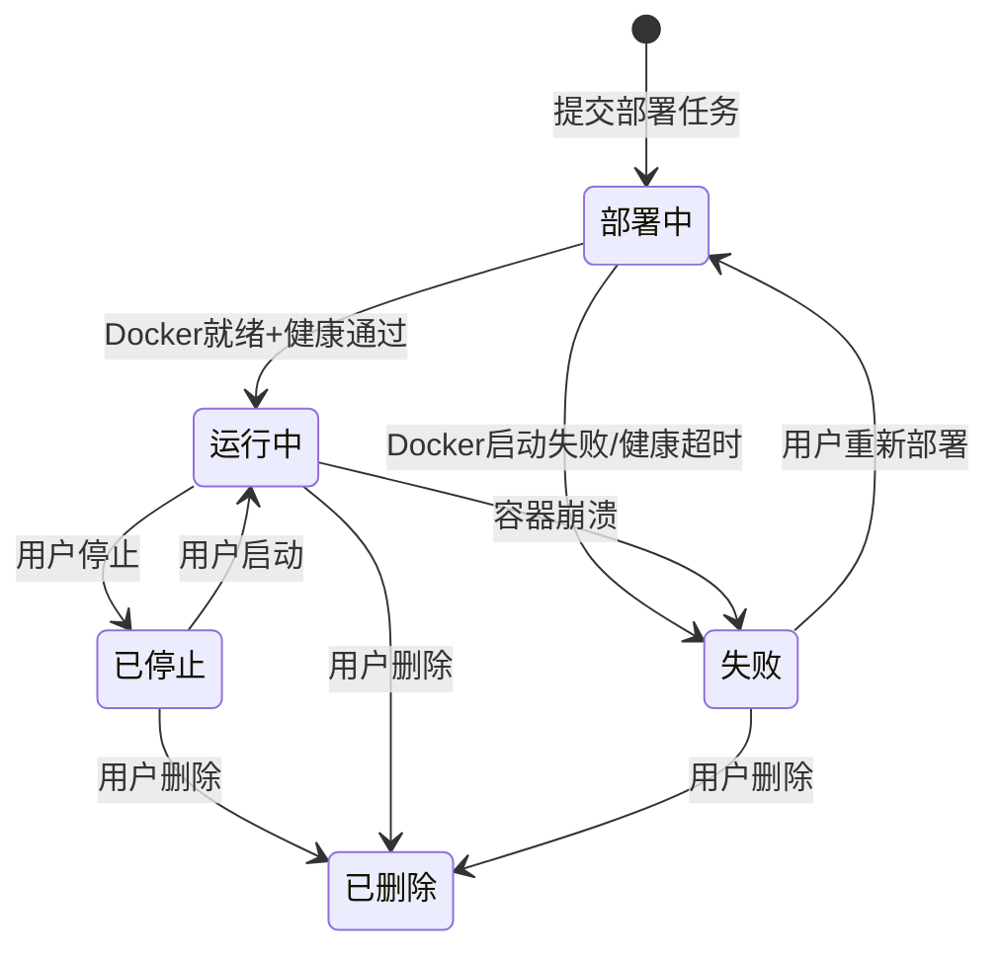

# M02 — 自动部署管理 业务流程图

## 流程概述
从量化完成后的模型路径或 HuggingFace 模型 ID，一键部署为 vLLM/TGI/SGLang 推理容器，支持生命周期管理。

## 业务流程图

## 部署启停流程

## 状态流转（平台管理类型）

## 部署模板

| 模板名称 | 引擎 | GPU | 推荐场景 |
|----------|------|-----|----------|
| 7B GPTQ 单卡 | vLLM | 1 卡 | 7B 量化模型的默认配置 |
| 7B AWQ 单卡 | vLLM | 1 卡 | 7B AWQ 量化模型 |
| 14B AWQ 双卡 TP | vLLM | 2 卡 TP | 14B 模型需要双卡张量并行 |
| 32B GPTQ 4卡 TP | vLLM | 4 卡 TP | 32B 模型需要 4 卡 |