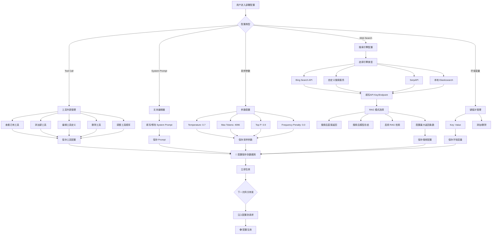
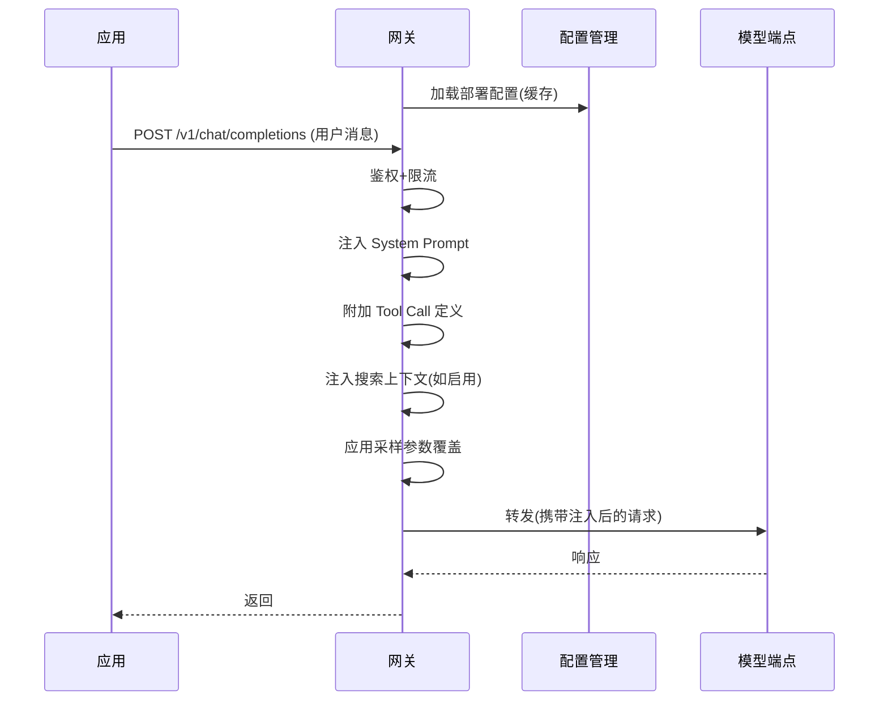

# M03 — 配置管理 业务流程图

## 流程概述
为每个部署（无论注册还是新建）提供统一的配置管理界面，包括 Tool Call、System Prompt、Web Search、采样参数和环境变量。

## 业务流程图

## 网关注入时序

## 配置生效策略

| 配置项 | 生效时机 | 备注 |
|--------|----------|------|
| Tool Call | 下一次请求 | 新增/修改/删除即时生效 |
| System Prompt | 下一次请求 | 不修改存量请求 |
| 采样参数 | 下一次请求 | 请求参数优先级高于部署配置 |
| Web Search | 下一次请求 | 修改后新请求使用新搜索API地址 |
| 环境变量 | 下一次请求 | 透传给网关转发逻辑 |