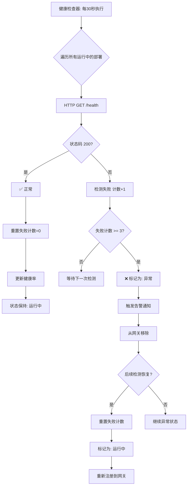
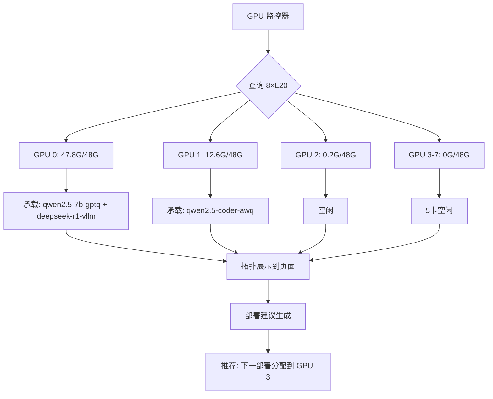
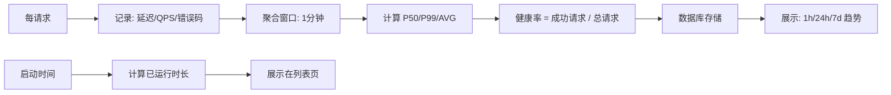

# M04 — 健康监控 业务流程图

## 流程概述
对所有已注册/已部署的端点进行持续健康检测，采集性能指标，展示 GPU 资源拓扑。

## 健康检查流程

## GPU 资源拓扑

## 指标采集

## 部署详情信息结构

| 信息类别 | 字段 |
|----------|------|
| 基本信息 | 部署名称、基座模型、引擎版本、GPU分配 |
| 端点信息 | URL、API Key（已脱敏） |
| 性能指标 | QPS、P50延迟、P99延迟、健康率、当前请求数、排队数 |
| 运行状态 | 运行时长、状态、最新健康检查时间 |
| 日志 | 终端风格输出，支持自动刷新 |
| 注册状态 | 是否已注册到模型管理 |