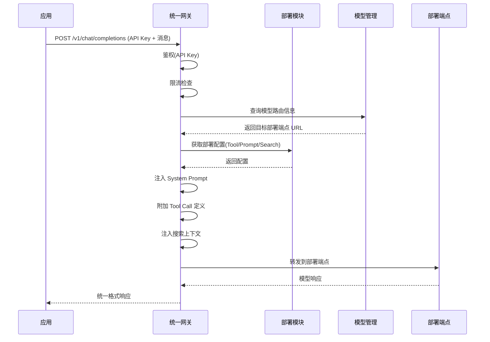
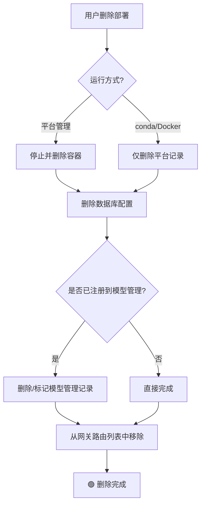
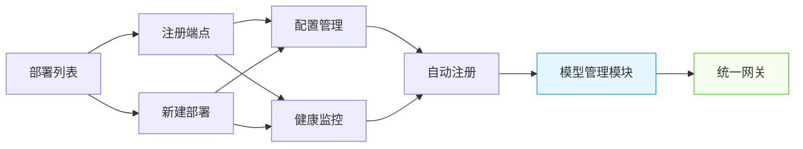

# M05 — 集成对接 业务流程图

## 流程概述
部署模块与现有模型管理、统一网关的集成逻辑。

## 自动注册到模型管理

```mermaid
flowchart TD
    A[部署完成: 健康检查通过] --> B{自动注册开关是否开启?}
    B -->|关闭| C[仅展示部署列表中]
    B -->|开启| D[调用模型管理 API]

    D --> E[创建模型记录]
    E --> E1[名称 = 部署名称]
    E --> E2[URL = 部署端点地址]
    E --> E3[状态 = 在线]
    E --> E4[生成 API Key (可选)]

    E --> F{模型管理已有同名?}
    F -->|否| G[新增记录]
    F -->|是| H[更新已有记录]

    G --> I[✅ 注册成功]
    H --> I

    I --> J[出现在模型管理列表]
    J --> K[可被网关路由调用]
```

## 网关调用链路



## 删除部署的级联操作



## 模块间依赖关系

