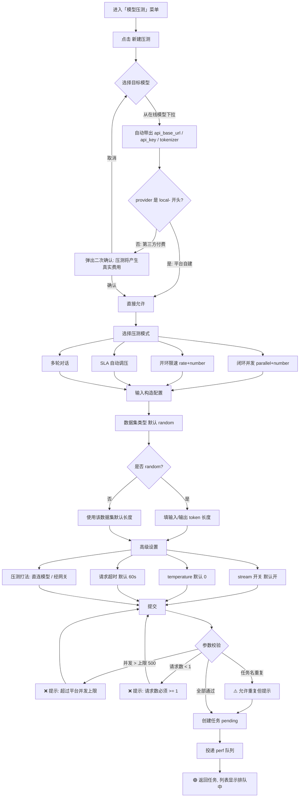
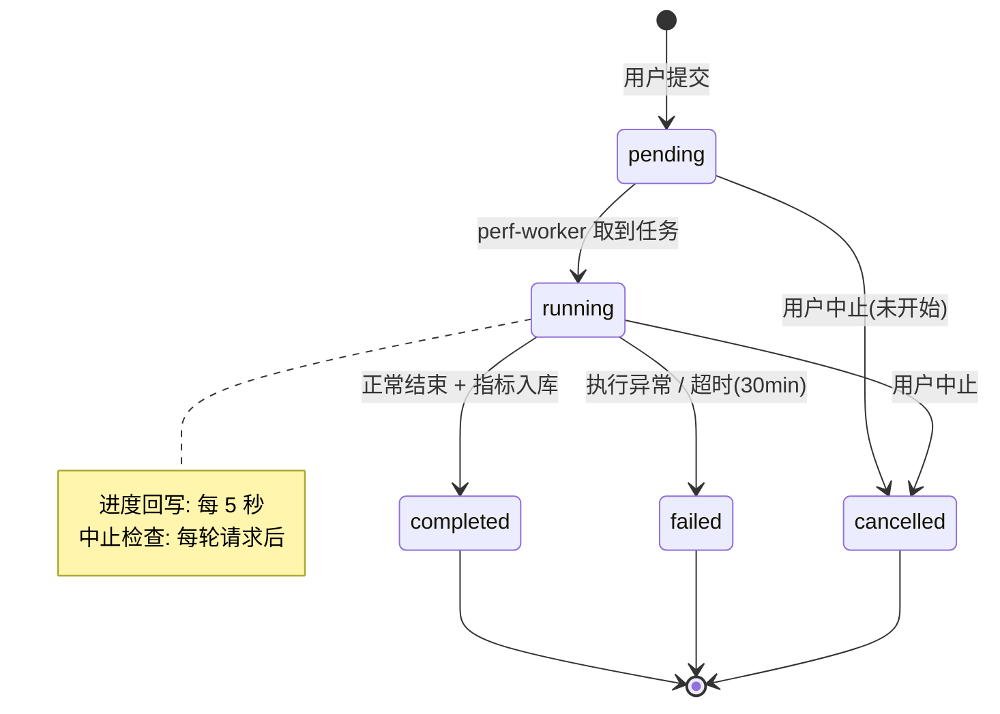
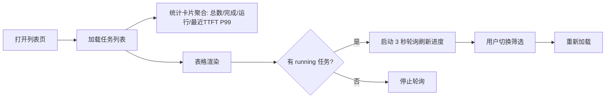

# M01 — 压测任务管理 业务流程图

## 模块职责
压测任务的创建、参数校验、状态展示、模板与模型联动入口。

## 1. 创建压测任务主流程

## 2. 任务状态机

## 3. 列表查询与筛选

## 4. 快速模板

| 模板 | 模式 | 关键参数 | 用途 |
|------|------|----------|------|
| 冒烟试跑 | 闭环并发 | parallel=50, number=500 | 改完配置先验证跑得通 |
| 标准基准 | 闭环并发 | parallel=200, number=2000 | 常规基线 |
| SLA 找拐点 | SLA 调压 | TTFT≤500ms, lower=10, upper=400 | 容量规划（上下界搜索） |
| 极限压测 | 闭环并发 | parallel=500, number=5000 | 摸底极限（需确认） |

## 业务规则
| 规则 | 说明 |
|------|------|
| 并发上限 | 默认 500，由 `settings.perf_max_parallel` 控制，超限直接拒绝 |
| 时长上限 | 默认 600 秒，任务级；另有全局 30 分钟硬超时 |
| 任务名 | 允许重复（同模型多次压测），但列表按创建时间倒序 |
| 第三方模型 | `provider` 非 `local-*` 时二次确认，防止意外产生费用 |
| 参数快照 | 创建时把完整参数存为 JSON，保证重跑与对比时参数可追溯 |
