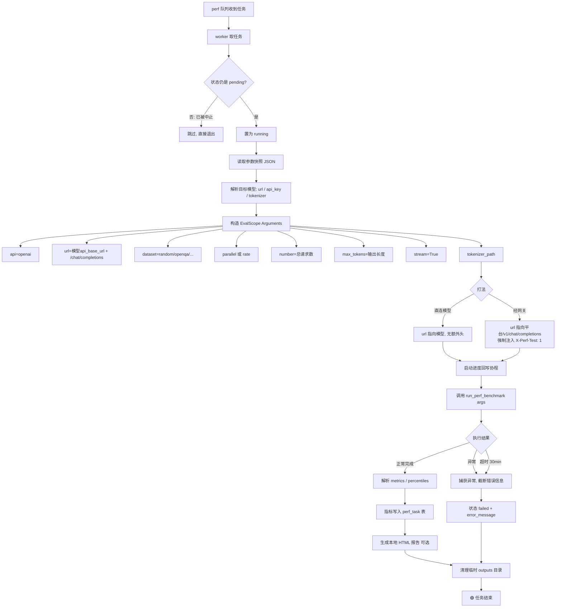
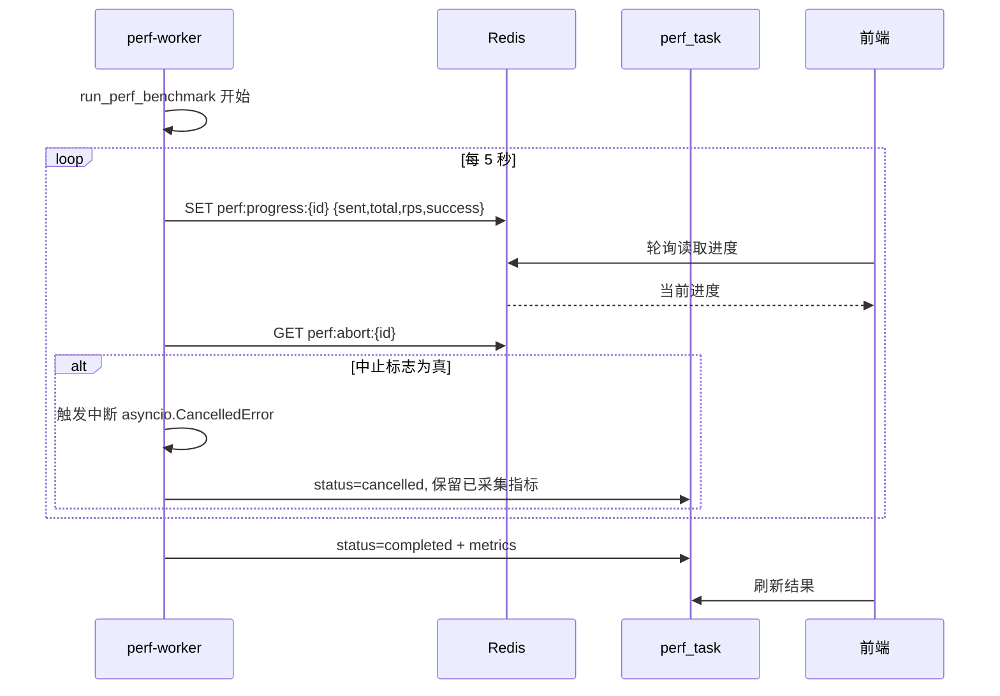
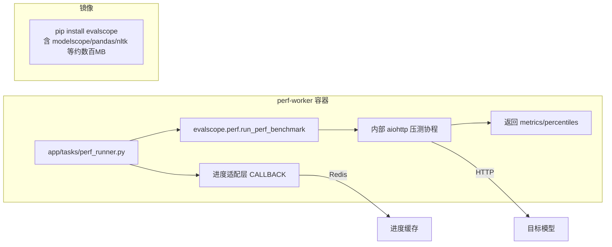

# M02 — 压测执行引擎 业务流程图

## 模块职责
独立的 `perf-worker` 容器消费 `perf` 队列，把平台任务参数翻译成 EvalScope `Arguments`，调用 `run_perf_benchmark()`，过程中回写进度、响应中止。

## 1. 执行主流程

## 2. 进度回写与中止机制

## 3. EvalScope 集成边界

**关键约束**
| 约束 | 说明 |
|------|------|
| 必须独立镜像 | evalscope 会连带 `modelscope[datasets]`、`pandas`、`nltk`、`sacrebleu` 等，几百 MB，不进 api-server |
| 不需要 GPU | 纯 HTTP 负载生成 |
| 进程隔离 | `run_perf_benchmark` 是阻塞调用（内部自建事件循环），worker 用 `--concurrency=2` 控制同时任务数；单任务若需更高并发由 evalscope 内部协程承担 |
| 输出目录 | EvalScope 会写 `outputs/<ts>/`，挂临时卷，任务结束后按需保留或清理 |
| 版本锁定 | 必须锁定 `evalscope` 版本，避免上游 breaking change 影响平台 |

## 4. 失败与降级

| 失败场景 | 处理 |
|----------|------|
| Docker/网络不可达 | `failed`，错误信息截断 4000 字 |
| 目标模型 401/403 | 提示 Key 失效，建议在模型管理更新 |
| 全量请求失败（成功率 0） | 仍标 `completed`，但前端高亮"成功率 0%，请检查模型可用性" |
| 部分请求失败 | `completed`，错误按状态码分类展示 |
| worker 崩溃 | 任务停留在 `running`；由定时巡检把超 30 分钟的 `running` 改判 `failed` |
| 并发超目标承载 | 大量 429/超时，成功率低，属预期结果（不是平台 bug） |

## 5. 配置项（settings）

| 配置 | 默认 | 说明 |
|------|------|------|
| `perf_max_parallel` | 500 | 单任务并发上限 |
| `perf_max_number` | 50000 | 单任务请求数上限 |
| `perf_task_timeout` | 1800 | 硬超时（秒） |
| `perf_worker_concurrency` | 2 | worker 同时执行任务数 |
| `perf_progress_interval` | 5 | 进度回写间隔（秒） |
