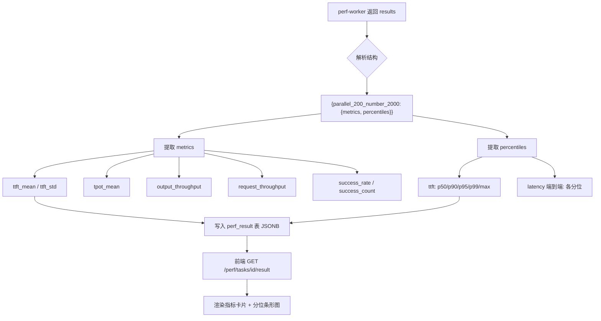
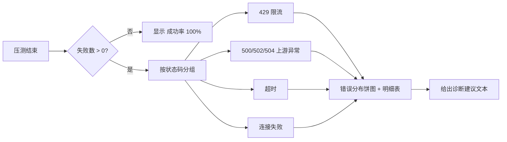

# M03 — 结果分析与对比 业务流程图

## 模块职责
压测指标入库、结果详情展示、错误分析、日志、**历史任务对比**、报告导出。

## 1. 指标入库与展示



## 2. 历史对比流程（Must）

```mermaid
flowchart TD
    A[用户点击 历史对比] --> B[弹出对比选择器]
    B --> C[列出可选任务: 状态=completed]
    C --> D[勾选 2-4 个任务]
    D --> E{数量校验}
    E -->|< 2| E1[提示: 至少选 2 个]
    E -->|> 4| E2[提示: 最多选 4 个]
    E1 --> D
    E2 --> D

    E -->|通过| F[标记"同参数对比"过滤]
    F -->|勾选| F1[仅显示参数指纹一致的任务]
    F -->|不勾| F2[全部可选]

    F1 --> G[请求对比接口]
    F2 --> G

    G --> H[后端并行取各任务指标]
    H --> I[构造对比矩阵]
    I --> I1[行=指标, 列=任务]
    I --> I2[计算参数差异标记]
    I --> I3[计算指标差异百分比]

    I --> J[渲染]
    J --> J1[对比表格: 指标 x 任务]
    J --> J2[参数差异行的表头标 ⚠️ 红底]
    J --> J3[柱状图: 选 1-3 个关键指标]
    J --> J4[差异百分比着色: 更好=绿, 更差=红]

    J1 --> K[🟢 对比完成]
    J2 --> K
    J3 --> K
    J4 --> K
```

### 参数指纹（判定"可对比"）
```
fingerprint = hash(
    model_id,
    mode,                 # closed_loop / open_loop / sla / multi_turn
    parallel 或 rate,
    number,
    dataset,
    input_length,
    output_length,
    stream
)
```
指纹一致 → 视为「严格可比」；不一致 → 仍允许对比但表头标红提示差异项。

## 3. 错误分析



### 诊断建议映射
| 主导错误 | 建议文案 |
|----------|---------|
| 429 为主 | 目标模型达到限流上限，降低并发或检查模型侧 max_num_seqs |
| 504/超时为主 | 目标模型处理不过来，降低并发或加 GPU 卡 |
| 连接失败为主 | 目标端点不可达，检查部署状态与网络 |
| 500 为主 | 上游服务内部错误，查看模型侧日志 |

## 4. 运行日志

| 项 | 说明 |
|----|------|
| 来源 | worker 侧执行日志（EvalScope 的 `benchmark.log` + 平台自身埋点） |
| 存储 | 写入 `perf_task_log` 表（level + message + created_at） |
| 展示 | 终端风格，滚动到底部，支持刷新 |
| 脱敏 | URL 中的 api_key 参数需脱敏；Authorization 头不落日志 |

## 5. 报告导出

| 格式 | 内容 | 优先级 |
|------|------|--------|
| JSON | 原始指标 + 参数快照 | Should |
| HTML | EvalScope 原生报告（可选保留）/ 平台自绘报告 | Could |

## 业务规则
| 规则 | 说明 |
|------|------|
| 对比数量 | 2-4 个任务 |
| 对比前提 | 必须状态为 `completed`；`failed`/`cancelled` 不可选 |
| 差异计算 | 以第一个选中任务为基准，其余显示相对变化 % |
| 指标缺失 | 若某任务缺某指标（如未开 stream 无 TTFT），显示 `--` 而非 0 |
| 结果保留 | 永久保留，支持手动删除 |
