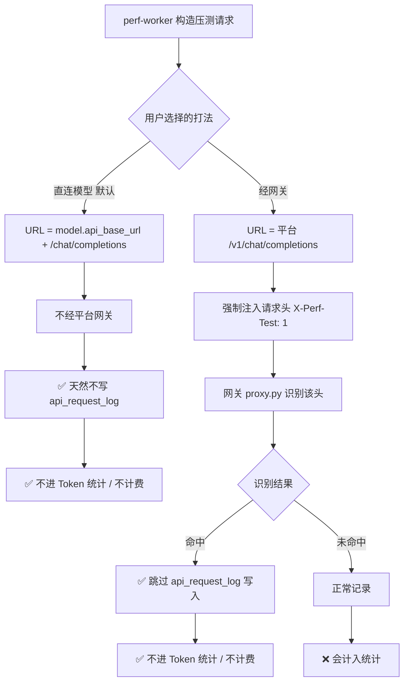
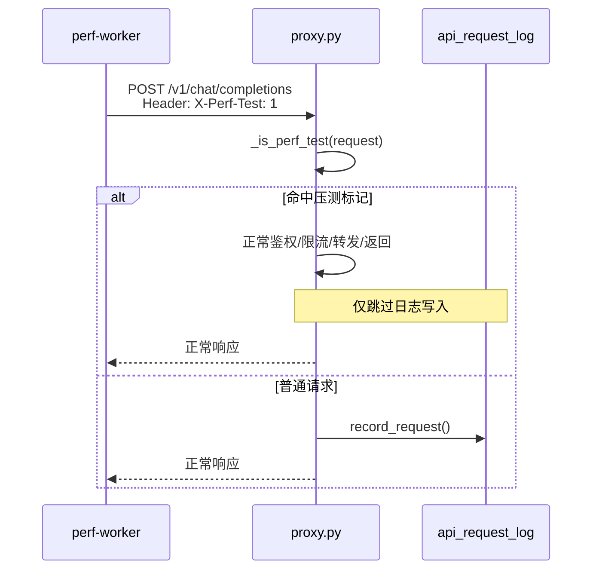
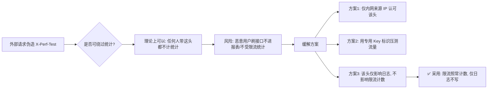

# M04 — 流量标记与隔离 业务流程图

## 模块职责
保证压测流量不污染 Token 用量统计与费用报表。

## 1. 两种打法的隔离路径



## 2. 网关侧改造点



## 3. 判定逻辑（纯函数，可单测）

```python
def is_perf_test_request(headers) -> bool:
    """是否压测流量。仅精确匹配 '1'/'true'，避免被任意值绕过。"""
    raw = headers.get("x-perf-test", "")
    return raw.strip().lower() in ("1", "true")
```

## 4. 关键设计决策

| 决策 | 结论 | 理由 |
|------|------|------|
| 默认打法 | **直连模型** | 压测目的是测模型性能，直连最纯粹；且天然不污染，不依赖网关改造 |
| 排除方式 | **完全不记录** `api_request_log` | 最简单彻底；审计需求由 `perf_task` 表本身满足（谁在何时压测了哪个模型、参数是什么） |
| 头部命名 | `X-Perf-Test` | 语义清晰；小写比对，兼容各家 header 大小写 |
| 用户能否关闭 | **不能** | 经网关压测时 worker 强制注入，防止用户误关导致统计被污染 |
| 是否需要改表 | **不需要** | 不记录即不改表，避免 DB 迁移 |

## 5. 安全考虑



**采用方案 3**：`X-Perf-Test` **只影响日志写入**，鉴权、限流、路由完全照常执行。这样：
- 压测仍受速率限制（不会打穿网关自身）
- 伪造该头也不会获得额外配额，只是自己的请求不进报表（损失有限）
- 若后续要更严格，可叠加方案 1（仅内网 IP 认可）

## 6. 待确认项
| 问题 | 状态 |
|------|------|
| 是否要限制该头仅内网来源生效？（Q-006 延伸） | 待定，一期先不做，二期按需加白名单 |
