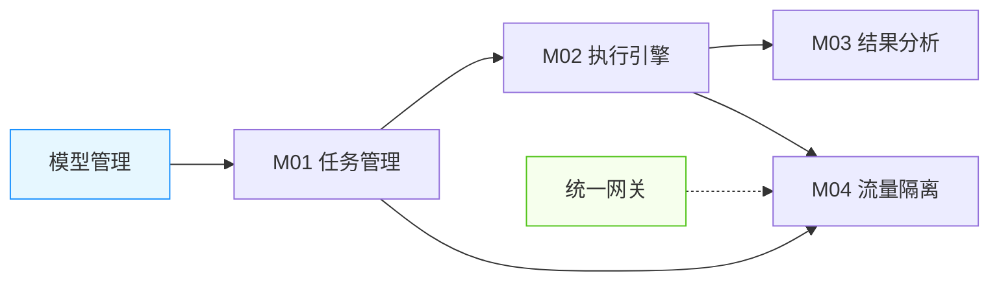

# 模型压测模块 — 需求理解文档

## 概述
| 项目 | 内容 |
|------|------|
| 所属项目 | 大模型监测管理平台 |
| 模块说明 | 基于 EvalScope `perf`（Apache-2.0）提供 Web 化大模型推理性能压测：选模型 → 配参数 → 异步执行 → 看指标 → 历史对比 |
| 功能点总数 | 41（Must 27 / Should 10 / Could 4） |
| 原型 | `docs/需求分析/v4-模型压测/prototype-v1/index.html` |
| 已锁定决策 | 独立 perf-worker 容器 / 默认 random 数据集 / 历史对比 Must / 压测流量排除统计 |

## 模块划分

| 编号 | 模块 | 职责 | 对应功能点 | 复杂度 |
|------|------|------|-----------|--------|
| M01 | 压测任务管理 | 任务的增删改查、参数校验、模板、模型联动入口 | PERF-001~005, 012, 015, 016 | H |
| M02 | 压测执行引擎 | perf-worker 容器、Celery 队列、EvalScope 调用、进度回写、中止/超时 | PERF-006, 006.1~006.4 | H |
| M03 | 结果分析与对比 | 指标入库与展示、分位分布、错误分析、日志、**历史对比**、导出 | PERF-007~011, 013 | H |
| M04 | 流量标记与隔离 | `X-Perf-Test` 头注入与网关侧识别、跳过统计写入 | PERF-014, 014.1~014.2 | M |

## 角色与权限
| 角色 | 可操作 |
|------|--------|
| 平台管理员 | 全部（含 SLA 调压、极限并发） |
| AI 工程师 | 创建/查看/对比自己的压测；并发上限受限 |
| 运维人员 | 查看、中止运行中任务 |

## 关键设计约束
1. **打标默认值**：`直连模型` 为默认打法，不经过平台网关 → 天然不进 Token 统计
2. **经网关打法**：perf-worker 强制注入 `X-Perf-Test: 1`，用户不可关闭
3. **安全护栏**：默认只允许压测 `provider` 以 `local-` 开头的模型（平台自建部署），第三方付费模型需二次确认（见待确认问题 Q-005）

## 目录结构
```
docs/需求理解/v4-模型压测/
├── README.md                          ← 本文件
├── M01-压测任务管理/业务流程图.md        ← 创建流程、状态机、参数校验
├── M02-压测执行引擎/业务流程图.md        ← worker 执行、进度回写、中止
├── M03-结果分析与对比/业务流程图.md      ← 指标计算、历史对比流程
└── M04-流量标记与隔离/业务流程图.md      ← X-Perf-Test 打标与网关跳过
```

## 模块依赖

